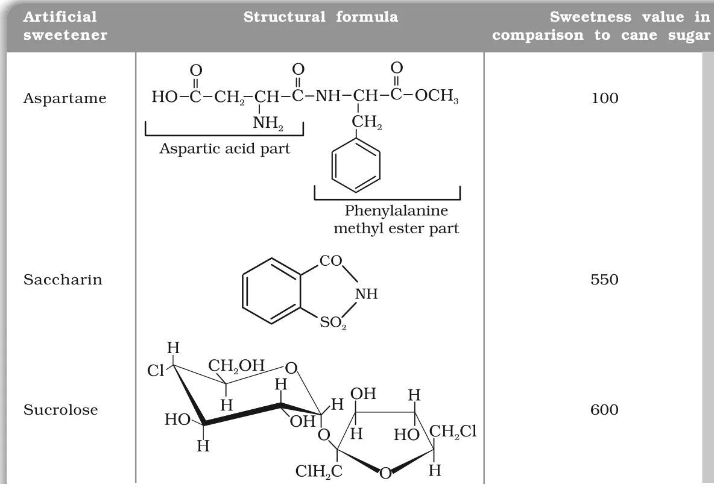
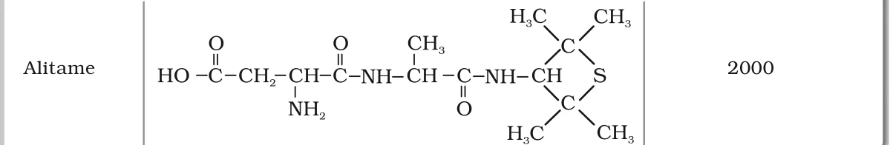

# [{ align=left, width=3.8% }](../../index.md)  Chemistry in Everyday Life | Chemicals in Food

Chemicals are added to food for three reasons: (i) its **preservation**, (ii) enhancing its **appeal**, and (iii) adding **nutritive value** to it.

## Food Additives

The main categories of food additives are:

1. Food colours
2. Flavours and sweeteners
3. Fat emulsifiers and stabilising agents
4. Flour improvers - antistaling agents and bleaches
5. Antioxidants
6. Preservatives
7. Nutritional supplements such as minerals, vitamins and amino acids

* Except for nutritional supplements (category 7), **none** of these additives has any nutritive value.
* They are added either to increase the **shelf life** of stored food or for **cosmetic** purposes (colour, taste, appearance).

## Artificial Sweetening Agents

* Natural sweeteners such as **sucrose** add to calorie intake. So many people, especially **diabetic** persons and those who need to control calorie intake, prefer **artificial sweeteners**.
* Artificial sweeteners give a sweet taste without adding (significant) calories.

### 1. Saccharin

* **Ortho-sulphobenzimide**, called **saccharin**, was the first popular artificial sweetener. It has been used since its discovery in **1879**.
* It is about **550 times** as sweet as cane sugar.
* It is excreted from the body in urine **unchanged**, and appears to be entirely inert and harmless.
* It is of great value to diabetic persons and people who need to control their calorie intake.

### 2. Aspartame

* **Aspartame** is the most successful and widely used artificial sweetener. It is roughly **100 times** as sweet as cane sugar.
* It is the **methyl ester of a dipeptide** formed from **aspartic acid** and **phenylalanine**.
* It is **unstable at cooking temperature**, so its use is limited to **cold foods and soft drinks**.

### 3. Alitame

* **Alitame** is a high-potency sweetener, about **2000 times** as sweet as cane sugar.
* It is more stable than aspartame, but it is difficult to **control the sweetness** of food when using it.

### 4. Sucrolose

* **Sucrolose** (sucralose) is a **trichloro derivative of sucrose**. It is about **600 times** as sweet as cane sugar.
* Its appearance and taste are like sugar.
* It is **stable at cooking temperature** and does **not provide calories**.

### Summary of Artificial Sweeteners

Artificial sweetener | Sweetness relative to cane sugar | Key point
---------------------|----------------------------------|------------------------------------------------------
Aspartame            | 100                              | Methyl ester of aspartyl-phenylalanine; unstable on cooking
Saccharin            | 550                              | First popular sweetener; excreted unchanged in urine
Sucrolose            | 600                              | Trichloro derivative of sucrose; stable on cooking; no calories
Alitame              | 2000                             | High potency; sweetness hard to control

!!! tip "Structures of artificial sweeteners"

    {loading=lazy}

    {loading=lazy}

## Food Preservatives

* **Food preservatives** prevent spoilage of food due to **microbial growth**.
* The most commonly used preservatives are **table salt, sugar, vegetable oils** and **sodium benzoate** (C6H5COONa).
* Sodium benzoate is used in limited quantities and is **metabolised** in the body.
* Salts of **sorbic acid** and **propanoic acid** are also used as preservatives.

## Antioxidants

* **Antioxidants** are additives that slow down the oxidation of food, especially of fats and oils. Oxidation of fats causes **rancidity** (bad smell and taste).
* They act by reacting with oxygen (or with the free radicals formed during oxidation) more readily than the food does, so the food itself is protected.
* Common examples are **BHT** (butylated hydroxytoluene) and **BHA** (butylated hydroxyanisole). Sulphur dioxide and sulphites are used as antioxidants in wines, beers, sugar syrups and dried fruits.

!!! note "Note"

    Preservatives fight **microbes**, while antioxidants fight **oxidation**. Both increase the shelf life of food but by different mechanisms.
