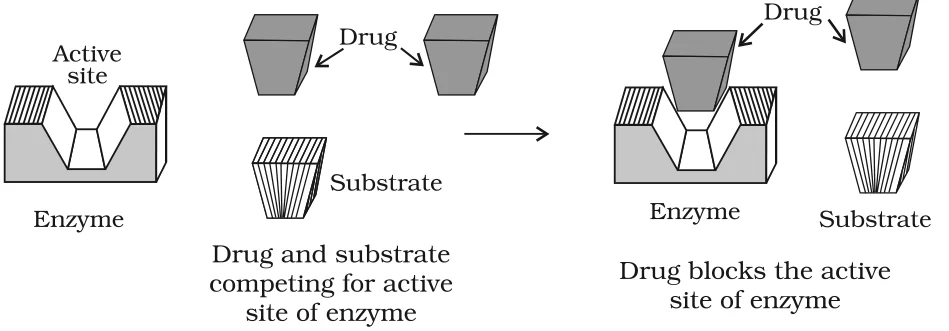
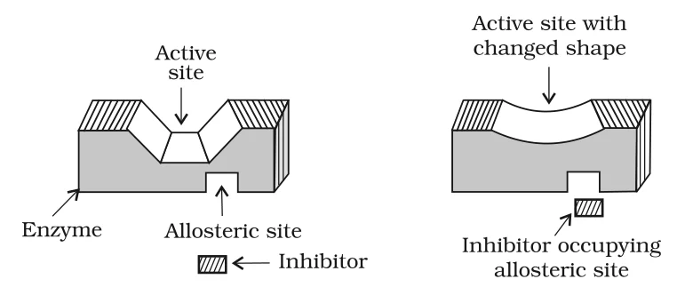
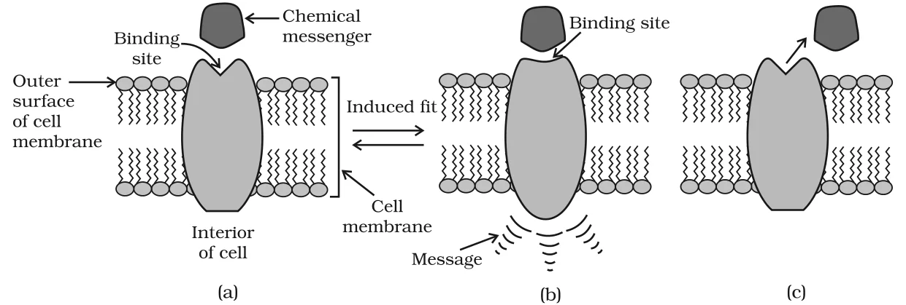

# [{ align=left, width=3.8% }](../../index.md)  Chemistry in Everyday Life | Drugs and Drug-Target Interaction

Chemistry touches almost every part of daily life: soaps and detergents for cleanliness, dyes and synthetic fibres in clothes, additives in food and, of course, medicines. In this chapter we look at three such areas: **medicines**, **food chemicals** and **cleansing agents**.

## Drugs

* **Drugs** are chemicals of low molecular mass (about 100 - 500 u) which interact with macromolecular targets in the body and produce a biological response.
* When this biological response is therapeutic and useful, the chemicals are called **medicines**. Medicines are used in the diagnosis, prevention and treatment of diseases.
* Most drugs used as medicines become potential **poisons** if taken in doses higher than those recommended. This is why medicines should never be taken without consulting a doctor.
* The use of chemicals for therapeutic effect is called **chemotherapy**.

## Classification of Drugs

Drugs can be classified in four main ways. Each classification is useful to a different group of people.

### 1. On the basis of pharmacological effect

* Drugs are grouped by the effect they produce in the body.
* This is useful for **doctors**, because it gives them the whole range of drugs available for treating a particular problem.
* Example: **analgesics** have a pain-killing effect; **antiseptics** kill or arrest the growth of microorganisms.

### 2. On the basis of drug action

* Drugs are grouped by their action on a particular biochemical process.
* Example: all **antihistamines** inhibit the action of histamine, the compound which causes inflammation in the body. (Histamine action can be blocked in different ways, as discussed under antihistamines.)

### 3. On the basis of chemical structure

* Drugs which share common structural features are grouped together. Such drugs often have similar pharmacological activity.
* Example: all **sulphonamides** contain the common structural unit H2N-C6H4-SO2-NHR, i.e., a benzene ring carrying an -NH2 group and, para to it, a sulphonamide group -SO2NHR.

### 4. On the basis of molecular targets

* Drugs usually interact with biomolecules such as **carbohydrates, lipids, proteins and nucleic acids**. These are called **target molecules** or **drug targets**.
* Drugs with common structural features may have the same mechanism of action on their targets.
* This classification is the **most useful for medicinal chemists**.

!!! note "Note"

    The same drug can be described in more than one way. For example, "ranitidine is an antacid" is a classification based on **pharmacological effect**, since any drug that counteracts excess stomach acid is called an antacid.

## Drug-Target Interaction

Macromolecules of biological origin perform different functions in the body:

* **Enzymes**: proteins that act as biological catalysts.
* **Receptors**: proteins that are crucial to the body's communication system.
* **Carrier proteins**: carry polar molecules across the cell membrane.
* **Nucleic acids**: carry the coded genetic information of the cell.
* **Lipids and carbohydrates**: structural parts of the cell membrane.

We will understand drug-target interaction using two examples: enzymes and receptors.

## Enzymes as Drug Targets

### 1. Catalytic action of enzymes

An enzyme performs two major functions during catalysis:

* **It holds the substrate**: The active site of the enzyme holds the substrate molecule in a suitable position so that the reagent can attack it effectively. Substrates bind to the active site through ionic bonding, hydrogen bonding, van der Waals interaction or dipole-dipole interaction.
* **It provides functional groups** that attack the substrate and carry out the chemical reaction.

### 2. Drug-enzyme interaction

* Drugs can block either of the above functions. They can block the binding site and prevent the substrate from binding, or they can inhibit the catalytic activity of the enzyme. Such drugs are called **enzyme inhibitors**.
* Drugs prevent the attachment of the substrate to the active site in two ways:

#### (a) Competitive inhibitors

* The drug competes with the natural substrate for the active site of the enzyme.
* When the drug occupies the active site, the substrate cannot bind and the reaction is blocked.

{loading=lazy}

#### (b) Inhibitors binding at the allosteric site (non-competitive inhibitors)

* Some drugs do not bind to the active site at all. They bind to a different site on the enzyme, called the **allosteric site**.
* This binding changes the shape of the active site so that the substrate can no longer recognise it.

{loading=lazy}

!!! note "Note"

    If the bond formed between the enzyme and the inhibitor is a strong covalent bond that cannot be broken easily, the enzyme is blocked **permanently**. The body then degrades the enzyme-inhibitor complex and synthesises fresh enzyme.

## Receptors as Drug Targets

* **Receptors** are proteins crucial to the body's communication process. Most of them are embedded in cell membranes, with the small part carrying the active site projecting out of the membrane towards the outside of the cell.
* Messages between two neurons, and between neurons and muscles, are carried by chemicals called **chemical messengers** (neurotransmitters and hormones).
* A chemical messenger binds at the binding site of the receptor. To accommodate it, the shape of the receptor site changes (induced fit). This change transfers the message into the cell.
* Thus, the chemical messenger passes its message to the cell **without entering the cell**. When the messenger leaves, the receptor regains its original shape.

{loading=lazy}

* There are many different receptors in the body. Each receptor is **selective** for a particular messenger because binding sites differ in shape, structure and amino acid composition.

### Antagonists and Agonists

Drugs can act on receptors in two opposite ways:

Type of drug   | What it does                                                         | When it is useful
---------------|----------------------------------------------------------------------|----------------------------------------------
Antagonist     | Binds to the receptor site and inhibits its natural function         | When the message needs to be blocked
Agonist        | Mimics the natural messenger and switches on the receptor            | When there is a lack of natural messenger

!!! tip "Conclusion"

    Drugs are designed to interact with **specific** targets so that they have the least chance of affecting other targets. This minimises side effects and localises the action of the drug.
