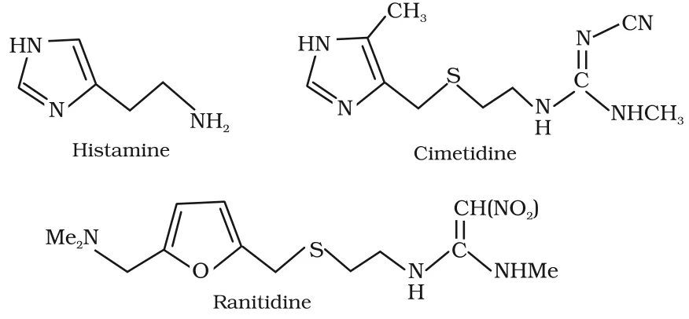
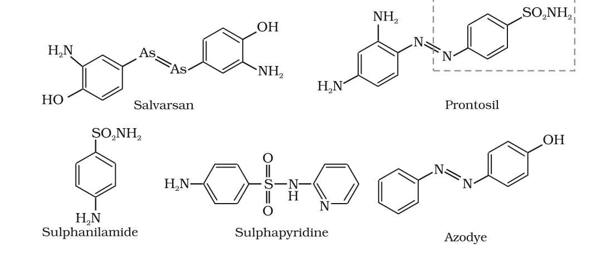
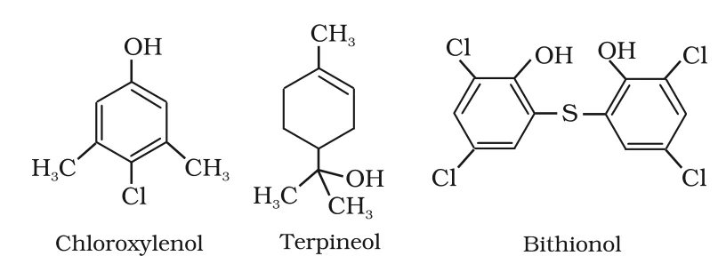

# [{ align=left, width=3.8% }](../../index.md)  Chemistry in Everyday Life | Therapeutic Action of Drugs

In this article, we will discuss how some important classes of drugs act on the body: antacids, antihistamines, neurologically active drugs, antimicrobials and antifertility drugs.

## 1. Antacids

* Overproduction of acid in the stomach causes irritation and pain. In severe cases, **ulcers** develop in the stomach.
* Until 1970, the only treatment was an **antacid** such as sodium hydrogencarbonate (NaHCO3) or a mixture of aluminium and magnesium hydroxide.

!!! tip ""

    $$NaHCO_3 + HCl &rarr; NaCl + H_2O + CO_2$$

    $$Mg(OH)_2 + 2HCl &rarr; MgCl_2 + 2H_2O$$

* **Drawback of NaHCO3**: an excess can make the stomach alkaline, which triggers the production of even more acid.
* **Metal hydroxides are better**: being insoluble, they do not raise the pH above neutrality.
* However, both treatments only control the **symptoms**, not the **cause**. In advanced stages ulcers become life-threatening, and the only remedy used to be removal of the affected part of the stomach.

### Cimetidine and Ranitidine

* A major breakthrough came with the discovery that **histamine** stimulates the secretion of pepsin and hydrochloric acid in the stomach.
* The drug **cimetidine (Tagamet)** was designed to prevent the interaction of histamine with the receptors in the stomach wall, so less acid is released. It remained the world's largest-selling drug until **ranitidine (Zantac)** was discovered.
* These drugs act on the **cause** (histamine-triggered acid release), which is why they are better antacids than NaHCO3 or metal hydroxides.

{loading=lazy}

## 2. Antihistamines

* Histamine is a potent **vasodilator**. It contracts the smooth muscles in the bronchi and gut, and relaxes other muscles such as those in the walls of fine blood vessels.
* Histamine is also responsible for the **nasal congestion** of a common cold and for the **allergic response** to pollen.
* Synthetic drugs **brompheniramine (Dimetapp)** and **terfenadine (Seldane)** act as antihistamines. They compete with histamine for the binding sites of the receptors where histamine exerts its effect.

!!! question "Why don't antihistamines affect the secretion of acid in the stomach?"

    Antiallergic drugs (antihistamines) and antacid drugs (like cimetidine) work on **different receptors**. Hence, an antihistamine that blocks the allergy receptor does not block the receptor in the stomach wall, and vice versa.

## 3. Neurologically Active Drugs

Tranquilizers and analgesics are **neurologically active drugs**. They affect the message transfer mechanism from nerve to receptor.

### (a) Tranquilizers

* Tranquilizers are used for the treatment of stress and of mild or even severe mental diseases.
* They relieve anxiety, stress, irritability or excitement by inducing a sense of well-being. They are an essential component of **sleeping pills**.
* Different tranquilizers work by different mechanisms:

#### Antidepressants

* **Noradrenaline** is a neurotransmitter that plays a role in mood changes. If its level is low, signal-sending activity falls and the person suffers from **depression**.
* **Antidepressant drugs** inhibit the enzymes which catalyse the degradation of noradrenaline. The neurotransmitter is then metabolised slowly and can activate its receptor for longer periods, counteracting depression.
* Examples: **iproniazid** and **phenelzine**.

#### Mild tranquilizers

* **Chlordiazepoxide** and **meprobamate** are relatively mild tranquilizers used for relieving tension.
* **Equanil** is used to control depression and hypertension.

#### Barbiturates

* Derivatives of **barbituric acid**, such as veronal, amytal, nembutal, luminal and seconal, are called **barbiturates**. They are an important class of tranquilizers.
* Barbiturates are **hypnotic**, i.e., sleep-producing agents.
* Other substances used as tranquilizers are **valium** and **serotonin**.

### (b) Analgesics

**Analgesics** reduce or abolish pain without causing impairment of consciousness, mental confusion, incoordination, paralysis or other disturbances of the nervous system. They are of two types:

#### (i) Non-narcotic (non-addictive) analgesics

* Examples: **aspirin** and **paracetamol**.
* Aspirin inhibits the synthesis of **prostaglandins**, chemicals which stimulate inflammation in tissue and cause pain.
* These drugs are effective in relieving skeletal pain such as that due to arthritis.
* They also reduce fever (**antipyretic** action) and prevent platelet coagulation. Because of its anti-blood-clotting action, aspirin is used to prevent **heart attacks**.

#### (ii) Narcotic analgesics

* **Morphine** and many of its homologues (such as heroin and codeine) relieve pain and produce sleep when given in medicinal doses.
* In poisonous doses they produce stupor, coma, convulsions and ultimately death.
* Morphine narcotics are also called **opiates**, since they are obtained from the opium poppy.
* They are mainly used for the relief of postoperative pain, cardiac pain, pains of terminal cancer, and in childbirth.

## 4. Antimicrobials

* Diseases may be caused by microorganisms such as bacteria, viruses, fungi and other pathogens.
* An **antimicrobial** selectively destroys, prevents the development of, or inhibits the pathogenic action of microbes. Depending on the target they are antibacterial, antifungal, antiviral or antiparasitic drugs.
* **Antibiotics, antiseptics and disinfectants** are antimicrobial drugs.

### (a) Antibiotics

* Antibiotics are used to treat infections because of their **low toxicity** to humans and animals.
* Originally, antibiotics meant chemicals **produced by microorganisms** (bacteria, fungi, moulds) that inhibit the growth of, or destroy, other microorganisms.
* Since many are now made synthetically, the definition has been modified: an **antibiotic** is a substance produced wholly or partly by chemical synthesis which, in **low concentrations**, inhibits the growth of or destroys microorganisms by intervening in their metabolic processes.

#### History of antibacterial drugs

* **Paul Ehrlich** investigated arsenic-based compounds to treat syphilis and developed **arsphenamine**, known as **salvarsan** (Nobel Prize in Medicine, 1908). It was the first effective treatment for syphilis. Salvarsan is toxic to humans, but far more toxic to the spirochete bacteria that cause syphilis.
* Ehrlich noted that the -As=As- linkage of salvarsan resembles the -N=N- linkage of **azo dyes**. He searched for azo-dye-like compounds that bind selectively to bacteria, and in 1932 the first effective antibacterial agent, **prontosil**, was prepared.
* In the body, prontosil is converted to **sulphanilamide**, which is the real active compound. This led to the **sulpha drugs**; one of the most effective is **sulphapyridine**.

{loading=lazy}

* The real revolution came with **Alexander Fleming's** discovery (1929) of the antibacterial properties of a *Penicillium* fungus. Isolating and purifying enough penicillin for clinical trials took 13 years. Fleming and H.W. Florey shared the Nobel Prize for Medicine in 1945.

#### Bactericidal and bacteriostatic antibiotics

Antibiotics have either a **cidal** (killing) effect or a **static** (inhibitory) effect on microbes.

Bactericidal (kill microbes) | Bacteriostatic (inhibit growth)
-----------------------------|--------------------------------
Penicillin                   | Erythromycin
Aminoglycosides              | Tetracycline
Ofloxacin                    | Chloramphenicol

#### Spectrum of action

The range of microorganisms affected by an antibiotic is called its **spectrum of action**.

Type                          | Effective against                                              | Examples
------------------------------|----------------------------------------------------------------|-------------------------------------------------------------
Broad spectrum antibiotics    | A wide range of Gram-positive **and** Gram-negative bacteria   | Ampicillin, amoxycillin, chloramphenicol, vancomycin, ofloxacin
Narrow spectrum antibiotics   | Mainly Gram-positive **or** Gram-negative bacteria             | Penicillin G
Limited spectrum antibiotics  | A single organism or disease                                   | -

* **Ampicillin** and **amoxycillin** are synthetic modifications of penicillin with a broad spectrum.
* Patients must be tested for sensitivity (**allergy**) to penicillin before it is given. In India, penicillin is manufactured at Hindustan Antibiotics, Pimpri, and in the private sector.
* **Chloramphenicol** (isolated in 1947) is rapidly absorbed from the gastrointestinal tract, so it can be given orally for typhoid, dysentery, acute fever, some urinary infections, meningitis and pneumonia.
* The antibiotic **dysidazirine** is believed to be toxic towards certain strains of cancer cells.

### (b) Antiseptics and Disinfectants

Both kill or prevent the growth of microorganisms. The difference lies in where they are applied.

Antiseptics                                                     | Disinfectants
----------------------------------------------------------------|----------------------------------------------------------------
Applied to **living tissues** such as wounds, cuts, ulcers and diseased skin | Applied to **inanimate objects** such as floors, drains and instruments
Safe for living tissue                                          | Harmful to living tissue
Examples: furacine, soframicine, dettol, tincture of iodine, iodoform, boric acid | Examples: 1% phenol, chlorine (0.2 - 0.4 ppm), SO2 in low concentration

#### Common antiseptics

* **Dettol** is a mixture of **chloroxylenol** and **terpineol**.
* **Bithionol** (also called bithional) is added to soaps to give them antiseptic properties.
* **Iodine** is a powerful antiseptic. A 2-3% solution of iodine in alcohol-water mixture is called **tincture of iodine** and is applied on wounds.
* **Iodoform** (CHI3) is also used as an antiseptic for wounds.
* **Boric acid** in dilute aqueous solution is a weak antiseptic for eyes.
* Antiseptics are not ingested like antibiotics.

{loading=lazy}

!!! example "Same substance as antiseptic and disinfectant"

    The same substance can act as an antiseptic or a disinfectant depending on its **concentration**. A 0.2% solution of **phenol** is an antiseptic, while a 1% solution is a disinfectant.

## 5. Antifertility Drugs

* Antibiotics have nearly doubled life expectancy. The resulting population growth has created problems of food, environment and employment, which led to the concept of **family planning**. Antifertility drugs help in this direction.
* **Birth control pills** contain a mixture of synthetic **estrogen** and **progesterone** derivatives. Both are hormones.
* Progesterone **suppresses ovulation**. Synthetic progesterone derivatives are more potent than progesterone itself.
* **Norethindrone** is the most widely used synthetic progesterone derivative in antifertility drugs.
* The estrogen derivative used in combination with it is **ethynylestradiol (novestrol)**.
