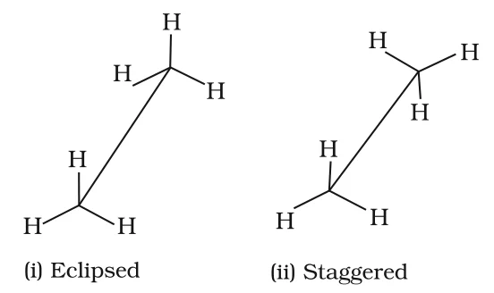
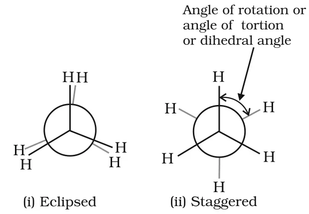

# [{ align=left, width=3.8% }](../../index.md)  Hydrocarbons | Chemical Properties and Conformations of Alkanes

Alkanes are generally inert towards acids, bases, oxidising and reducing agents. However, under certain conditions they undergo the following reactions.

## 1. Substitution Reactions

* One or more hydrogen atoms of an alkane can be replaced by halogens, nitro group or sulphonic acid group. Such reactions are called **substitution reactions**.
* Lower alkanes do not undergo nitration and sulphonation.

### Halogenation

Halogenation takes place either at high temperature (573–773 K) or in the presence of diffused sunlight or ultraviolet light. Chlorination of methane continues step by step until all four hydrogens are replaced:

!!! tip ""

    $$CH_4 + Cl_2 \xrightarrow{h\nu} CH_3Cl + HCl\ \ \ (Chloromethane)$$

    $$CH_3Cl + Cl_2 \xrightarrow{h\nu} CH_2Cl_2 + HCl\ \ \ (Dichloromethane)$$

    $$CH_2Cl_2 + Cl_2 \xrightarrow{h\nu} CHCl_3 + HCl\ \ \ (Trichloromethane)$$

    $$CHCl_3 + Cl_2 \xrightarrow{h\nu} CCl_4 + HCl\ \ \ (Tetrachloromethane)$$

    $$CH_3-CH_3 + Cl_2 \xrightarrow{h\nu} CH_3-CH_2Cl + HCl\ \ \ (Chloroethane)$$

* Rate of reaction of alkanes with halogens:

!!! tip ""

    $$F_2 > Cl_2 > Br_2 > I_2$$

* Rate of replacement of hydrogens of alkanes:

!!! tip ""

    $$3^\circ > 2^\circ > 1^\circ$$

* Fluorination is too violent to be controlled. Iodination is very slow and reversible. It is carried out in the presence of oxidising agents like HIO3 or HNO3, which destroy the HI formed:

!!! tip ""

    $$CH_4 + I_2 &#8652; CH_3I + HI$$

    $$HIO_3 + 5HI &rarr; 3I_2 + 3H_2O$$

### Mechanism of Halogenation (Free Radical Chain Mechanism)

Halogenation proceeds through a free radical chain mechanism in three steps.

#### (i) Initiation

The reaction starts with homolysis of the chlorine molecule by light or heat. The Cl–Cl bond is weaker than the C–C and C–H bonds, so it breaks most easily.

!!! tip ""

    $$Cl-Cl \xrightarrow[homolysis]{h\nu} \dot{C}l + \dot{C}l$$

#### (ii) Propagation

The chlorine free radical attacks methane, breaking a C–H bond to give a methyl free radical and HCl. The methyl radical then attacks another Cl2 molecule to give CH3Cl and a new chlorine radical.

!!! tip ""

    $$(a)\ CH_4 + \dot{C}l \xrightarrow{h\nu} \dot{C}H_3 + HCl$$

    $$(b)\ \dot{C}H_3 + Cl-Cl \xrightarrow{h\nu} CH_3-Cl + \dot{C}l$$

* Steps (a) and (b) repeat, setting up a chain. Other propagation steps explain how more highly halogenated products are formed:

!!! tip ""

    $$CH_3Cl + \dot{C}l &rarr; \dot{C}H_2Cl + HCl$$

    $$\dot{C}H_2Cl + Cl-Cl &rarr; CH_2Cl_2 + \dot{C}l$$

#### (iii) Termination

The reaction stops when reactants are used up or when free radicals combine with each other:

!!! tip ""

    $$(a)\ \dot{C}l + \dot{C}l &rarr; Cl-Cl$$

    $$(b)\ H_3\dot{C} + \dot{C}H_3 &rarr; H_3C-CH_3$$

    $$(c)\ H_3\dot{C} + \dot{C}l &rarr; H_3C-Cl$$

!!! tip "Conclusion"

    In step (c), CH3Cl is formed but the radicals are consumed, so the chain ends. Step (b) explains why **ethane is formed as a by-product** during chlorination of methane.

## 2. Combustion

Alkanes burn in air or dioxygen and are completely oxidised to CO2 and water, with the evolution of a large amount of heat. That is why alkanes are used as fuels.

!!! tip ""

    $$CH_{4(g)} + 2O_{2(g)} &rarr; CO_{2(g)} + 2H_2O_{(l)};\ \ \Delta_cH^\circ = -890\ kJ\ mol^{-1}$$

    $$C_4H_{10(g)} + {13 \over 2}O_{2(g)} &rarr; 4CO_{2(g)} + 5H_2O_{(l)};\ \ \Delta_cH^\circ = -2875.84\ kJ\ mol^{-1}$$

* General combustion equation for any alkane:

!!! tip ""

    $$C_nH_{2n+2} + \left({3n+1 \over 2}\right)O_2 &rarr; nCO_2 + (n+1)H_2O$$

* With an insufficient supply of air, incomplete combustion gives carbon black, which is used in making ink, printer ink, black pigments and as filters.

!!! tip ""

    $$CH_{4(g)} + O_{2(g)} \xrightarrow{Incomplete\ combustion} C_{(s)} + 2H_2O_{(l)}$$

## 3. Controlled Oxidation

Heating alkanes with a regulated supply of air or O2 at high pressure, in the presence of suitable catalysts, gives a variety of oxidation products:

!!! tip ""

    $$2CH_4 + O_2 \xrightarrow{Cu/523\ K/100\ atm} 2CH_3OH\ \ \ (Methanol)$$

    $$CH_4 + O_2 \xrightarrow[&Delta;]{Mo_2O_3} HCHO + H_2O\ \ \ (Methanal)$$

    $$2CH_3CH_3 + 3O_2 \xrightarrow[&Delta;]{(CH_3COO)_2Mn} 2CH_3COOH + 2H_2O\ \ \ (Ethanoic\ acid)$$

* Ordinarily alkanes resist oxidation, but alkanes having a **tertiary H atom** are oxidised to the corresponding alcohols by KMnO4:

!!! tip ""

    $$(CH_3)_3CH \xrightarrow[Oxidation]{KMnO_4} (CH_3)_3COH$$

    $$2\text{-}Methylpropane &rarr; 2\text{-}Methylpropan\text{-}2\text{-}ol$$

## 4. Isomerisation

n-Alkanes, on heating with anhydrous AlCl3 and HCl gas, isomerise to branched chain alkanes:

!!! tip ""

    $$CH_3(CH_2)_4CH_3 \xrightarrow{Anhy.\ AlCl_3/HCl} CH_3CH(CH_3)(CH_2)_2CH_3 + CH_3CH_2CH(CH_3)CH_2CH_3$$

    $$n\text{-}Hexane &rarr; 2\text{-}Methylpentane + 3\text{-}Methylpentane$$

## 5. Aromatisation (Reforming)

n-Alkanes with six or more carbon atoms, on heating to 773 K at 10–20 atm in the presence of oxides of vanadium, molybdenum or chromium supported on alumina, are **dehydrogenated** and cyclised to benzene and its homologues.

!!! tip ""

    $$CH_3(CH_2)_4CH_3 \xrightarrow[773\ K,\ 10-20\ atm]{Cr_2O_3\ or\ V_2O_5\ or\ Mo_2O_3} C_6H_6 + 4H_2$$

    $$n\text{-}Hexane &rarr; Benzene$$

* Toluene (C6H5CH3) can similarly be prepared from n-heptane.

## 6. Reaction with Steam

Methane reacts with steam at 1273 K in the presence of nickel to give CO and H2. This is used for the industrial preparation of dihydrogen.

!!! tip ""

    $$CH_4 + H_2O \xrightarrow[&Delta;]{Ni} CO + 3H_2$$

## 7. Pyrolysis (Cracking)

* Higher alkanes, on heating to high temperature, decompose into lower alkanes, alkenes, etc. This decomposition by heat is called **pyrolysis** or **cracking**. It is believed to be a free radical reaction.

!!! tip ""

    $$C_6H_{14} \xrightarrow{773\ K} C_6H_{12} + H_2$$

    $$C_6H_{14} \xrightarrow{773\ K} C_4H_8 + C_2H_6$$

    $$C_6H_{14} \xrightarrow{773\ K} C_3H_6 + C_2H_4 + CH_4$$

* Oil gas or petrol gas is prepared from kerosene or petrol on this principle. For example, dodecane (from kerosene) at 973 K with Pt, Pd or Ni gives heptane and pentene:

!!! tip ""

    $$C_{12}H_{26} \xrightarrow[973\ K]{Pt/Pd/Ni} C_7H_{16} + C_5H_{10} + other\ products$$

## Conformations of Alkanes

* The electron distribution of a C–C &sigma; bond is symmetrical about the internuclear axis and is not disturbed by rotation. This permits free rotation about C–C single bonds.
* Spatial arrangements of atoms which can be converted into one another by rotation around a C–C single bond are called **conformations**, **conformers** or **rotamers**.
* The rotation is not completely free. It is hindered by a small energy barrier of 1–20 kJ mol-1 due to weak repulsion between adjacent bonds. This repulsion is called **torsional strain**.

### Conformations of Ethane

If one carbon of ethane is kept fixed and the other is rotated about the C–C axis, an infinite number of conformations result. Two of them are extreme cases:

* **Eclipsed conformation:** the hydrogen atoms on the two carbons are as close together as possible.
* **Staggered conformation:** the hydrogen atoms are as far apart as possible.
* Any intermediate conformation is called a **skew** conformation.
* Bond angles and bond lengths remain the same in all conformations.

### 1. Sawhorse Projection

* The molecule is viewed along the C–C axis and drawn with the C–C bond as a longer slanted line.
* The front carbon is at the lower end and the rear carbon at the upper end. Each carbon has three lines (C–H bonds) at 120&deg; to each other.

{loading=lazy}

### 2. Newman Projection

* The molecule is viewed along the C–C bond head on.
* The front carbon is shown as a point with three C–H bonds at 120&deg;. The rear carbon is shown as a circle, with its three C–H bonds as shorter lines coming out of the circle.
* The angle between C–H bonds on the front and rear carbons is the **dihedral angle** (torsional angle or angle of rotation).

{loading=lazy}

### Relative Stability of Conformations

* In the staggered form, C–H bond electron clouds are as far apart as possible. So repulsion is minimum, energy is minimum and stability is maximum.
* In the eclipsed form, the electron clouds come closer, repulsion increases, and the molecule has higher energy and lower stability.
* Magnitude of torsional strain depends on the dihedral angle.

!!! tip "Conclusion"

    The staggered form has the least torsional strain and the eclipsed form has the maximum. The energy difference between them is only about 12.5 kJ mol-1. Even at ordinary temperatures, molecules gain enough energy from collisions to cross this barrier, so rotation about the C–C bond in ethane is almost free and its conformers cannot be separated.
