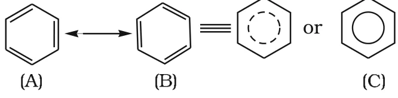
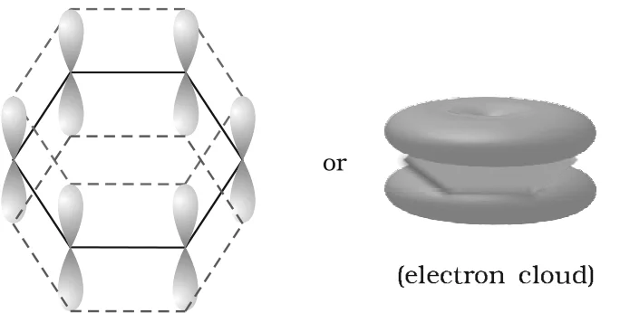

# [{ align=left, width=3.8% }](../../index.md)  Hydrocarbons | Aromatic Hydrocarbons and Structure of Benzene

Aromatic hydrocarbons, also known as **arenes**, are compounds which mostly contain a benzene ring. Since most of them have a pleasant odour (Greek: *aroma* = pleasant smelling), they were named aromatic compounds.

* The benzene ring is highly unsaturated, but in most reactions of aromatic compounds this unsaturation is retained.
* Aromatic compounds containing a benzene ring are called **benzenoids**. Those that are aromatic without a benzene ring (containing another highly unsaturated ring) are called **non-benzenoids**.
* Examples of arenes: benzene (C6H6), toluene (C6H5CH3), naphthalene (C10H8) and biphenyl (C6H5–C6H5).

## Nomenclature and Isomerism

* All six hydrogen atoms of benzene are equivalent. So benzene forms one and only one monosubstituted product, for example methylbenzene (toluene).
* When two H atoms are replaced by two similar or different groups, three position isomers are possible:

Positions          | Prefix          | Example
-------------------|-----------------|----------------------------------------
1,2 (or 1,6)       | ortho (o-)      | 1,2-Dimethylbenzene (o-xylene)
1,3 (or 1,5)       | meta (m-)       | 1,3-Dimethylbenzene (m-xylene)
1,4                | para (p-)       | 1,4-Dimethylbenzene (p-xylene)

## Structure of Benzene

* Benzene was isolated by Michael Faraday in 1825. Its molecular formula C6H6 indicates a high degree of unsaturation, yet it is a very stable molecule.
* Benzene forms a **triozonide**, which indicates the presence of three double bonds.
* It forms only one monosubstituted derivative, which shows that all six carbon and six hydrogen atoms are identical.

### Kekulé Structure

* In 1865, August Kekulé proposed a cyclic arrangement of six carbon atoms with **alternate single and double bonds**, and one hydrogen atom on each carbon.
* This structure predicts two isomeric 1,2-dibromobenzenes: one with the Br atoms on a doubly bonded pair of carbons, the other with Br atoms on a singly bonded pair. But benzene actually forms **only one** ortho disubstituted product.
* Kekulé overcame this by suggesting that the double bonds in benzene **oscillate** between the two possible positions.
* Even this modification could not explain the unusual stability of benzene and its preference for substitution over addition reactions. These were later explained by resonance.

### Resonance and Stability of Benzene

* According to valence bond theory, benzene is a resonance hybrid of various resonating structures. The two Kekulé structures (A) and (B) are the main contributors.
* The hybrid is shown by drawing a circle (or dotted circle) inside the hexagon, as in (C). The circle represents the six electrons delocalised over the six carbon atoms.

{loading=lazy}

### Orbital Picture of Benzene

* All six carbon atoms of benzene are sp2 hybridised.
* Two sp2 orbitals of each carbon overlap with those of adjacent carbons to form six C–C &sigma; bonds lying in the hexagonal plane. The third sp2 orbital of each carbon overlaps with the s orbital of hydrogen to form six C–H &sigma; bonds.
* Each carbon is left with one unhybridised p orbital perpendicular to the plane of the ring.
* These p orbitals could form three &pi; bonds in two equally likely ways: C1–C2, C3–C4, C5–C6 or C2–C3, C4–C5, C6–C1. These correspond to the two Kekulé structures with localised &pi; bonds.
* X-ray diffraction shows that all C–C internuclear distances are the same, so the p orbital of each carbon overlaps **equally** with the p orbitals of both neighbours. This forms two doughnut-shaped rings of electron cloud, one above and one below the plane of the ring.

{loading=lazy}

* The six &pi; electrons are delocalised and can move freely around the six carbon nuclei. The delocalised cloud is attracted more strongly by the nuclei than a cloud localised between two carbons. So benzene is more stable than the hypothetical cyclohexatriene.
* X-ray data shows benzene is **planar** and all six C–C bond lengths are **139 pm**, which is in between the C–C single bond (154 pm) and the C=C double bond (133 pm).

!!! tip "Conclusion"

    Benzene has no pure double bonds. This explains its reluctance to undergo addition reactions under normal conditions and its unusual stability.

## Aromaticity (Hückel Rule)

Benzene was considered the parent 'aromatic' compound. Now the term is applied to all ring systems, with or without a benzene ring, that have the following characteristics:

1. **Planarity**.
2. **Complete delocalisation** of the &pi; electrons in the ring.
3. Presence of **(4n + 2) &pi; electrons** in the ring, where n is an integer (n = 0, 1, 2, ...).

This is often called the **Hückel rule**.

Aromatic compound                | Number of &pi; electrons | n
---------------------------------|---------------------------|---
Benzene                          | 6                         | 1
Cyclopentadienyl anion           | 6                         | 1
Cycloheptatrienyl cation         | 6                         | 1
Naphthalene                      | 10                        | 2
Anthracene                       | 14                        | 3
Phenanthrene                     | 14                        | 3

!!! note "Note"

    The cyclopentadienyl anion and the cycloheptatrienyl (tropylium) cation have no benzene ring, yet they are aromatic because they are planar, fully conjugated rings with 6 &pi; electrons. They are examples of non-benzenoid aromatic species.

## Preparation of Benzene

Benzene is commercially isolated from coal tar. In the laboratory it can be prepared by the following methods.

### 1. Cyclic Polymerisation of Ethyne

!!! tip ""

    $$3HC \equiv CH \xrightarrow[873\ K]{Red\ hot\ iron\ tube} C_6H_6$$

### 2. Decarboxylation of Aromatic Acids

Sodium benzoate on heating with soda lime gives benzene.

!!! tip ""

    $$C_6H_5COONa + NaOH \xrightarrow[&Delta;]{CaO} C_6H_6 + Na_2CO_3$$

### 3. Reduction of Phenol

Phenol is reduced to benzene by passing its vapours over heated zinc dust.

!!! tip ""

    $$C_6H_5OH + Zn \xrightarrow{&Delta;} C_6H_6 + ZnO$$

## Physical Properties of Aromatic Hydrocarbons

* Aromatic hydrocarbons are non-polar molecules and are usually colourless liquids or solids with a characteristic aroma.
* Naphthalene balls are used in toilets and to preserve clothes because of their smell and moth repellent property.
* They are immiscible with water but readily miscible with organic solvents.
* They burn with a **sooty flame**.
