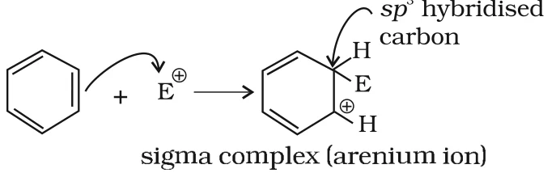
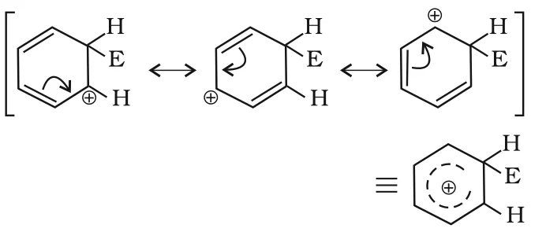
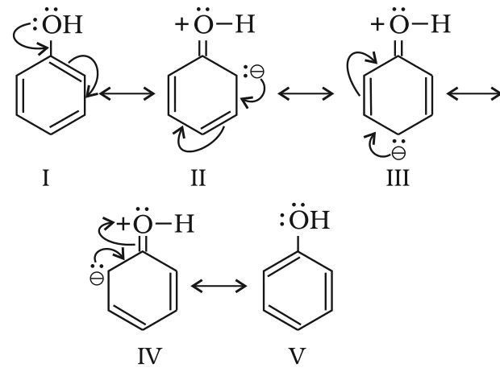
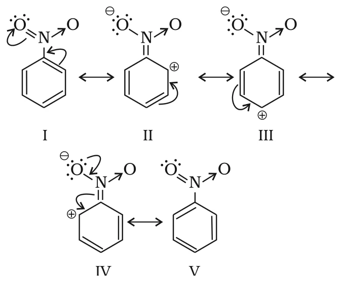
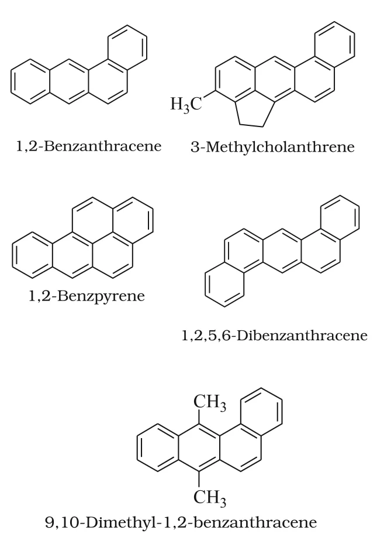

# [{ align=left, width=3.8% }](../../index.md)  Hydrocarbons | Chemical Properties of Benzene

Arenes are characterised by **electrophilic substitution reactions**. Under special conditions they can also undergo addition and oxidation reactions.

## Electrophilic Substitution Reactions

The common electrophilic substitution reactions of arenes are nitration, halogenation, sulphonation, Friedel-Crafts alkylation and acylation. In each, the attacking reagent is an electrophile (E+).

### 1. Nitration

A nitro group is introduced into the benzene ring when benzene is heated with a mixture of concentrated nitric acid and concentrated sulphuric acid (**nitrating mixture**).

!!! tip ""

    $$C_6H_6 + Conc.\ HNO_3 \xrightarrow[323-333\ K]{Conc.\ H_2SO_4} C_6H_5NO_2 + H_2O\ \ \ (Nitrobenzene)$$

### 2. Halogenation

Arenes react with halogens in the presence of a Lewis acid like anhydrous FeCl3, FeBr3 or AlCl3 to give haloarenes.

!!! tip ""

    $$C_6H_6 + Cl_2 \xrightarrow{Anhyd.\ AlCl_3} C_6H_5Cl + HCl\ \ \ (Chlorobenzene)$$

### 3. Sulphonation

Replacement of a ring hydrogen by a sulphonic acid group is called sulphonation. It is carried out by heating benzene with fuming sulphuric acid (**oleum**).

!!! tip ""

    $$C_6H_6 + H_2SO_4(SO_3) \xrightarrow{&Delta;} C_6H_5SO_3H + H_2O\ \ \ (Benzenesulphonic\ acid)$$

### 4. Friedel-Crafts Alkylation

When benzene is treated with an alkyl halide in the presence of anhydrous AlCl3, an alkylbenzene is formed.

!!! tip ""

    $$C_6H_6 + CH_3Cl \xrightarrow{Anhyd.\ AlCl_3} C_6H_5CH_3 + HCl\ \ \ (Toluene)$$

    $$C_6H_6 + C_2H_5Cl \xrightarrow{Anhyd.\ AlCl_3} C_6H_5C_2H_5 + HCl\ \ \ (Ethylbenzene)$$

!!! note "Note"

    Benzene with 1-chloropropane gives **isopropylbenzene** rather than n-propylbenzene. The primary carbocation CH3CH2CH2+ first formed rearranges (by a hydride shift) to the more stable secondary carbocation (CH3)2CH+, which then attacks the ring.

### 5. Friedel-Crafts Acylation

Benzene reacts with an acyl halide or acid anhydride in the presence of a Lewis acid (AlCl3) to give an acyl benzene.

!!! tip ""

    $$C_6H_6 + CH_3COCl \xrightarrow[&Delta;]{Anhyd.\ AlCl_3} C_6H_5COCH_3 + HCl\ \ \ (Acetophenone)$$

    $$C_6H_6 + (CH_3CO)_2O \xrightarrow[&Delta;]{Anhyd.\ AlCl_3} C_6H_5COCH_3 + CH_3COOH$$

### Further Substitution

With excess electrophilic reagent, the other ring hydrogens can be replaced one after another. For example, benzene with excess chlorine and anhydrous AlCl3 in the dark gives hexachlorobenzene:

!!! tip ""

    $$C_6H_6 + 6Cl_2 \xrightarrow[dark,\ cold]{Anhyd.\ AlCl_3} C_6Cl_6 + 6HCl$$

## Mechanism of Electrophilic Substitution

Electrophilic substitution (SE; S = substitution, E = electrophilic) reactions are believed to proceed in three steps:

1. Generation of the electrophile
2. Formation of a carbocation intermediate
3. Removal of a proton from the carbocation intermediate

### Step 1: Generation of the Electrophile (E+)

In chlorination, alkylation and acylation, anhydrous AlCl3 (a Lewis acid) combines with the attacking reagent to generate Cl+, R+ or RC+O (acylium ion) respectively:

!!! tip ""

    $$Cl-Cl + AlCl_3 &rarr; Cl^+ + [AlCl_4]^-\ \ \ (Chloronium\ ion)$$

    $$CH_3-Cl + AlCl_3 &rarr; CH_3^+ + [AlCl_4]^-$$

    $$CH_3COCl + AlCl_3 &rarr; CH_3\overset{+}{C}O + [AlCl_4]^-\ \ \ (Acylium\ ion)$$

In nitration, the electrophile is the **nitronium ion**, NO2+. It forms by transfer of a proton from sulphuric acid to nitric acid:

!!! tip ""

    $$Step\ I:\ HOSO_2O-H + H-O-NO_2 &#8652; H-\overset{+}{O}H-NO_2 + HSO_4^-$$

    $$Step\ II:\ H_2\overset{+}{O}-NO_2 &#8652; H_2O + NO_2^+$$

* Here sulphuric acid acts as an acid and nitric acid as a base. So it is a simple acid-base equilibrium.

### Step 2: Formation of the Carbocation (Arenium Ion)

The electrophile attacks the ring to form a **&sigma;-complex** or **arenium ion**, in which one carbon becomes sp3 hybridised.

{loading=lazy}

The arenium ion is stabilised by resonance:

{loading=lazy}

* The arenium ion **loses its aromatic character**, because delocalisation of electrons stops at the sp3 carbon.

### Step 3: Removal of a Proton

To restore aromaticity, the &sigma;-complex releases a proton from the sp3 carbon on attack by [AlCl4]- (in halogenation, alkylation and acylation) or [HSO4]- (in nitration).

!!! tip ""

    $$C_6H_6E^+ + [AlCl_4]^- &rarr; C_6H_5E + HCl + AlCl_3$$

    $$C_6H_6E^+ + [HSO_4]^- &rarr; C_6H_5E + H_2SO_4$$

## Addition Reactions

* Under vigorous conditions (high temperature and/or pressure, Ni catalyst), benzene is hydrogenated to cyclohexane:

!!! tip ""

    $$C_6H_6 + 3H_2 \xrightarrow[&Delta;]{Ni} C_6H_{12}\ \ \ (Cyclohexane)$$

* Under ultraviolet light, three chlorine molecules add to benzene to give **benzene hexachloride** (BHC), C6H6Cl6, also called **gammaxane**:

!!! tip ""

    $$C_6H_6 + 3Cl_2 \xrightarrow[500\ K]{UV} C_6H_6Cl_6$$

## Combustion

Benzene burns in air with a sooty flame, producing CO2 and H2O:

!!! tip ""

    $$C_6H_6 + {15 \over 2}O_2 &rarr; 6CO_2 + 3H_2O$$

General combustion equation for any hydrocarbon:

!!! tip ""

    $$C_xH_y + \left(x + {y \over 4}\right)O_2 &rarr; xCO_2 + {y \over 2}H_2O$$

## Directive Influence of a Functional Group in Monosubstituted Benzene

* When a monosubstituted benzene undergoes further substitution, the three possible disubstituted products are not formed in equal amounts. Either ortho and para products, or the meta product, are formed predominantly.
* This depends on the nature of the substituent **already present** in the ring, not on the incoming group. This is called the **directive influence** of substituents.

### 1. Ortho and Para Directing Groups

Groups that direct the incoming group to ortho and para positions. Take the –OH group of phenol as an example. Phenol is a resonance hybrid of the following structures:

{loading=lazy}

* The resonance structures show that electron density is higher at the o- and p-positions. So substitution takes place mainly at these positions.
* The –I effect of –OH slightly reduces the electron density at ortho and para positions, but the overall electron density at these positions still increases due to resonance.
* So –OH **activates** the benzene ring for attack by an electrophile.
* Other activating (o, p directing) groups: –NH2, –NHR, –NHCOCH3, –OCH3, –CH3, –C2H5, etc.

!!! note "Halogens"

    In aryl halides, halogens are moderately **deactivating**: their strong –I effect lowers the overall electron density of the ring, making further substitution difficult. But due to resonance, the electron density at o- and p-positions is greater than at the m-position. So halogens are deactivating yet **o- and p-directing**.

### 2. Meta Directing Groups

Groups that direct the incoming group to the meta position. Examples: –NO2, –CN, –CHO, –COR, –COOH, –COOR, –SO3H, etc.

Take the nitro group as an example. It reduces the electron density of the ring by its strong –I effect. Nitrobenzene is a resonance hybrid of the following structures:

{loading=lazy}

* The overall electron density of the ring decreases, making further substitution difficult. So these groups are also called **deactivating groups**.
* The positive charge appears at o- and p-positions, so their electron density is lower than at the meta position. The electrophile therefore attacks the comparatively electron rich **meta** position.

Group type                     | Examples                                                                  | Effect on ring
-------------------------------|---------------------------------------------------------------------------|--------------------------------
o, p directing (activating)    | –OH, –NH2, –NHR, –NHCOCH3, –OCH3, –CH3, –C2H5 | Increases electron density
o, p directing (deactivating)  | –Cl, –Br, –I                                                              | Decreases electron density
m directing (deactivating)     | –NO2, –CN, –CHO, –COR, –COOH, –COOR, –SO3H          | Decreases electron density

## Carcinogenicity and Toxicity

* Benzene and polynuclear hydrocarbons containing more than two fused benzene rings are toxic and are said to have cancer producing (**carcinogenic**) property.
* Such polynuclear hydrocarbons are formed by incomplete combustion of organic materials like tobacco, coal and petroleum.
* They enter the human body, undergo various biochemical reactions and finally damage DNA and cause cancer.

!!! example "Some carcinogenic hydrocarbons"

    {loading=lazy}
