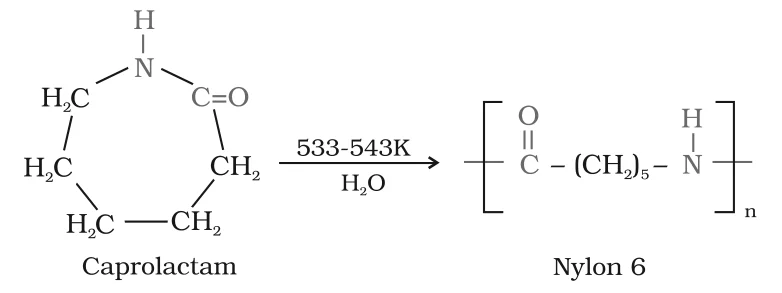
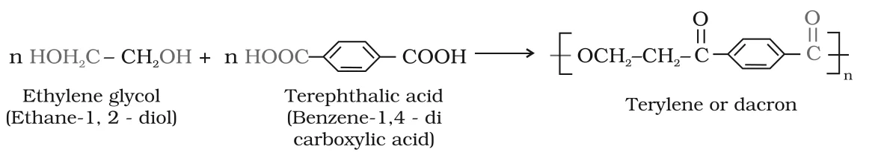
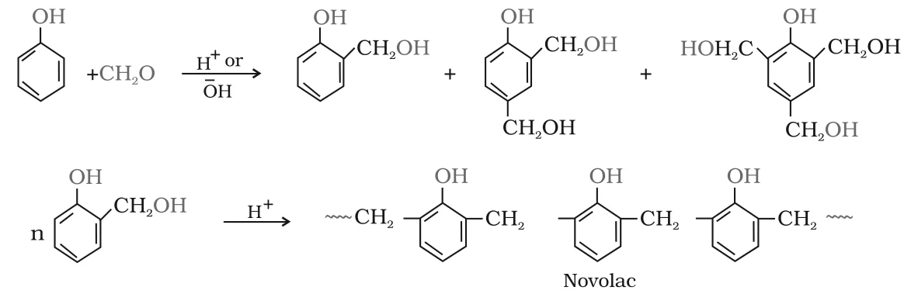
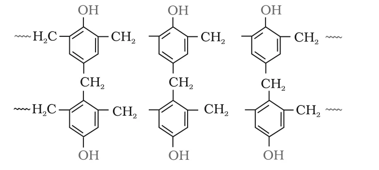
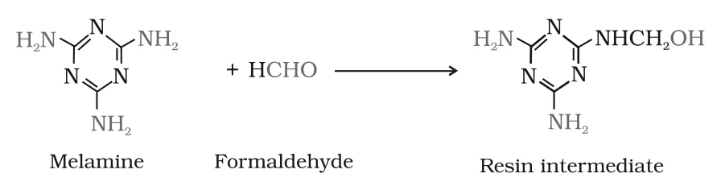
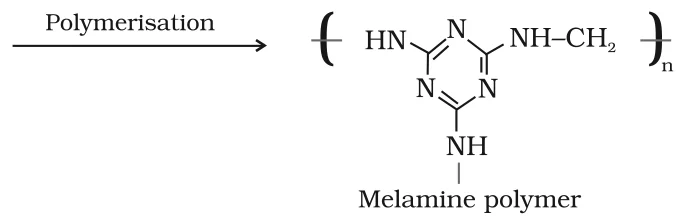

# [{ align=left, width=3.8% }](../../index.md)  Polymers | Condensation Polymerisation

## Condensation or Step Growth Polymerisation

Condensation or step growth polymerisation involves repeated condensation between two bi-functional monomers, usually with the loss of simple molecules such as water or alcohol, to form high molecular mass polymers.

* The product of each condensation step is again a bi-functional species, so it can condense further and the chain keeps growing.
* Each step produces a distinct functionalised species and is independent of the others. That is why it is called **step growth** polymerisation.
* Condensation polymers are named after their linking unit: polyamides (-CO-NH-), polyesters (-CO-O-), and so on.

Addition polymerisation                                 | Condensation polymerisation
--------------------------------------------------------|---------------------------------------------------------
Monomers are unsaturated (C=C, C&equiv;C)               | Monomers are bi- or tri-functional (-OH, -COOH, -NH2)
No small molecule is lost                               | Small molecules (H2O, CH3OH, HCl) are lost
Chain grows by adding to a reactive chain end           | Chain grows by independent condensation steps
Chain growth polymers, e.g. polythene, PVC, Teflon      | Step growth polymers, e.g. nylon 6,6, terylene, bakelite

## 1. Polyamides (Nylons)

* Polymers containing **amide linkages** (-CO-NH-). They are important synthetic fibres, called **nylons**.
* Made by condensation of diamines with dicarboxylic acids, or from amino acids and their lactams.

### (a) Nylon 6,6

* Prepared by condensation polymerisation of **hexamethylenediamine** with **adipic acid** at high pressure and high temperature (553 K).
* The name 6,6 means that each monomer contributes six carbon atoms.

!!! tip ""

    $$n\ HOOC(CH_2)_4COOH + n\ H_2N(CH_2)_6NH_2 \xrightarrow[High\ pressure]{553\ K} -[NH-(CH_2)_6-NH-CO-(CH_2)_4-CO]_n- + (2n-1)H_2O$$

    $$Adipic\ acid\ +\ Hexamethylenediamine\ &rarr;\ Nylon\ 6,6$$

* When n molecules of each monomer combine into one chain, (2n-1) molecules of water are eliminated. For a long chain this is often written loosely as n or 2n H2O.
* Uses: sheets, bristles for brushes and in the textile industry.

### (b) Nylon 6

* Obtained by heating **caprolactam** with water at a high temperature (533-543 K). The ring opens and the units join through amide links.
* Its repeating unit, -CO-(CH2)5-NH-, has six carbon atoms and comes from a single monomer, hence nylon 6.

{loading=lazy}

* Uses: tyre cords, fabrics and ropes.

## 2. Polyesters

* Polycondensation products of **dicarboxylic acids** and **diols**, joined by ester linkages.
* The best known example is **terylene** (dacron).
* It is made by heating a mixture of **ethylene glycol** and **terephthalic acid** (benzene-1,4-dicarboxylic acid) at **420 to 460 K** in the presence of a **zinc acetate-antimony trioxide** catalyst. Water is eliminated.

{loading=lazy}

!!! tip ""

    $$n\ HOCH_2CH_2OH + n\ HOOC-C_6H_4-COOH &rarr; -[OCH_2CH_2O-CO-C_6H_4-CO]_n- + (2n-1)H_2O$$

* Dacron fibre is **crease resistant**. It is blended with cotton and wool fibres and also used as glass reinforcing material in safety helmets.

## 3. Phenol-Formaldehyde Polymers (Bakelite and Related Polymers)

* These are the **oldest synthetic polymers**.
* Formed by condensation of **phenol** with **formaldehyde** in the presence of an acid or a base catalyst.
* The reaction first gives o- and/or p-hydroxymethylphenol derivatives. These react further with phenol, so that the rings get joined to each other through -CH2- groups.
* The initial product is a **linear** polymer called **Novolac**, which is used in paints.

{loading=lazy}

* When Novolac is heated with more formaldehyde, the chains become **cross linked** through -CH2- bridges at the remaining ortho/para positions, giving an infusible solid mass called **bakelite**.

{loading=lazy}

* Bakelite is a thermosetting polymer.
* Uses: combs, phonograph records, electrical switches and handles of various utensils.

## 4. Melamine-Formaldehyde Polymer

* Formed by condensation polymerisation of **melamine** (2,4,6-triamino-1,3,5-triazine) and **formaldehyde**.
* Formaldehyde first reacts with an -NH2 group to give a resin intermediate containing -NHCH2OH, which then polymerises.

{loading=lazy}

{loading=lazy}

* Uses: manufacture of unbreakable crockery.
