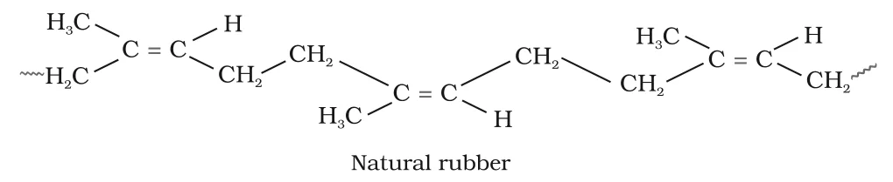
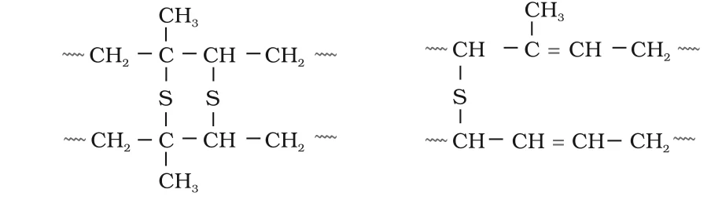

# [{ align=left, width=3.8% }](../../index.md)  Polymers | Copolymerisation and Rubber

## Copolymerisation

Copolymerisation is a polymerisation reaction in which a mixture of more than one monomeric species is allowed to polymerise and form a copolymer containing multiple units of each monomer in the same chain.

* A copolymer can be made by chain growth (addition) polymerisation as well as by step growth (condensation) polymerisation.
* Copolymers have properties quite different from the homopolymers of the individual monomers.

### Buna-S (butadiene-styrene copolymer)

* A mixture of 1,3-butadiene and styrene copolymerises to give Buna-S.

!!! tip ""

    $$n\ CH_2=CH-CH=CH_2 + n\ C_6H_5CH=CH_2 &rarr; -[CH_2-CH=CH-CH_2-CH(C_6H_5)-CH_2]_n-$$

    $$1,3-Butadiene\ +\ Styrene\ &rarr;\ Butadiene-styrene\ copolymer\ (Buna-S)$$

* Note that butadiene adds 1,4: its two ends join the chain and a new double bond appears between C-2 and C-3.
* Buna-S is quite tough and is a good substitute for natural rubber.
* Uses: autotyres, floor tiles, footwear components and cable insulation.
* The name comes from **Bu**tadiene + **Na** (sodium, once used as the catalyst) + **S**tyrene.

## Rubber

### 1. Natural Rubber

* Rubber is a natural polymer with elastic properties, so it is also called an **elastomer**.
* It is made from **rubber latex**, a colloidal dispersion of rubber in water, obtained from the bark of the rubber tree (grown in India, Sri Lanka, Indonesia, Malaysia and South America).
* Natural rubber is a linear polymer of **isoprene** (2-methyl-1,3-butadiene) and is called **cis-1,4-polyisoprene**.

!!! tip ""

    $$Isoprene:\ CH_2=\overset{\large CH_3}{\overset{|}{C}}-CH=CH_2$$

    $$n\ CH_2=C(CH_3)-CH=CH_2 &rarr; -[CH_2-C(CH_3)=CH-CH_2]_n-\ \ \ (cis)$$

{loading=lazy}

* Each repeating unit keeps one C=C double bond, with the chain continuing on the same side (cis). This causes the chains to bend and coil.
* The chains are held together only by weak van der Waals forces. Due to the coiled structure, rubber can be stretched like a spring and shows elastic properties.

### Vulcanisation of Rubber

Natural rubber has several drawbacks:

* It becomes soft at high temperature (> 335 K) and brittle at low temperature (< 283 K).
* It has a high water absorption capacity.
* It is soluble in non-polar solvents and is easily attacked by oxidising agents.

To improve these properties, rubber is **vulcanised**.

* Vulcanisation is heating raw rubber with **sulphur** and a suitable additive at **373 K to 415 K**.
* Sulphur forms **cross links** between chains at the reactive sites, i.e. at the double bonds and the allylic positions next to them. The rubber becomes stiffer and stronger.
* In the manufacture of tyre rubber, about **5% sulphur** is used as the cross linking agent.
* The probable structures of vulcanised rubber are:

{loading=lazy}

!!! tip "Conclusion"

    The double bonds in natural rubber give it a cis, coiled structure (elasticity) and also provide reactive sites where sulphur can form cross links during vulcanisation. The cross links stop the chains from slipping past each other, so vulcanised rubber is less sticky, more elastic over a wider temperature range and more resistant to solvents and oxidation.

### 2. Synthetic Rubbers

* A synthetic rubber is any vulcanisable, rubber-like polymer which can be stretched to twice its length and returns to its original shape and size as soon as the stretching force is removed.
* Synthetic rubbers are either **homopolymers of 1,3-butadiene derivatives** or **copolymers of 1,3-butadiene** (or its derivatives) with another unsaturated monomer.

#### (a) Neoprene

* Neoprene (polychloroprene) is formed by free radical polymerisation of **chloroprene** (2-chloro-1,3-butadiene).

!!! tip ""

    $$n\ CH_2=C(Cl)-CH=CH_2 \xrightarrow{Polymerisation} -[CH_2-C(Cl)=CH-CH_2]_n-$$

    $$Chloroprene\ \ \ \ \ \ \ \ \ \ \ \ \ \ \ \ \ \ \ \ \ \ \ \ \ \ \ \ Neoprene$$

* It has superior resistance to vegetable and mineral oils.
* Uses: conveyor belts, gaskets and hoses.

#### (b) Buna-N

* Obtained by copolymerisation of **1,3-butadiene** and **acrylonitrile** in the presence of a peroxide catalyst.

!!! tip ""

    $$n\ CH_2=CH-CH=CH_2 + n\ CH_2=CH(CN) \xrightarrow{Copolymerisation} -[CH_2-CH=CH-CH_2-CH_2-CH(CN)]_n-$$

    $$1,3-Butadiene\ +\ Acrylonitrile\ &rarr;\ Buna-N$$

* It is resistant to petrol, lubricating oil and organic solvents.
* Uses: oil seals and tank linings.

Rubber        | Monomer(s)                          | Type           | Special property / Uses
--------------|-------------------------------------|----------------|----------------------------------------------
Natural rubber| Isoprene                            | Homopolymer    | Elastic; cis-1,4-polyisoprene
Neoprene      | Chloroprene                         | Homopolymer    | Resists oils; conveyor belts, gaskets, hoses
Buna-S        | 1,3-Butadiene + Styrene             | Copolymer      | Tough; autotyres, floor tiles, footwear
Buna-N        | 1,3-Butadiene + Acrylonitrile       | Copolymer      | Resists petrol and solvents; oil seals, tank linings
