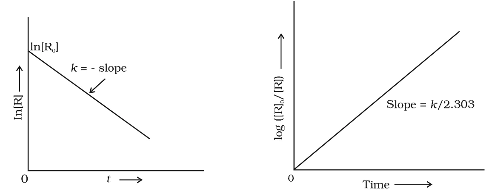

# [{ align=left, width=3.8% }](../../index.md)  Chemical Kinetics | Integrated Rate Equations

Integrated rate equations relate the concentration of reactants at different times directly to the rate constant, and are obtained by integrating the differential rate equation.

## Why Integrated Rate Equations?

* The differential rate equation needs the instantaneous rate, which is found from the slope of a tangent on a concentration vs time curve. This is difficult to measure accurately, so finding the rate law and order this way is not easy.
* To avoid this, the differential rate equation is integrated. This gives a relation between quantities we can measure directly: concentrations at different times and the rate constant.
* The integrated equations are different for reactions of different orders. Here we derive them for zero and first order reactions.

## Zero Order Reactions

In a zero order reaction, the rate is proportional to the zero power of the concentration of reactants, i.e. the rate does not depend on concentration.

!!! tip ""

    $$R &rarr; P$$

    $$Rate = -{d[R] \over dt} = k[R]^0 = k$$

    $$d[R] = -k\ dt$$

* Integrating both sides:

!!! tip ""

    $$[R] = -kt + I$$

    Where, I is the constant of integration.

* At t = 0, [R] = [R]0 (initial concentration). So, [R]0 = -k &times; 0 + I, i.e. I = [R]0.

!!! tip ""

    $$[R] = -kt + [R]_0$$

    $$k = {[R]_0 - [R] \over t}$$

* Comparing with y = mx + c, a plot of [R] against t is a straight line with slope = -k and intercept = [R]0.

### Examples of Zero Order Reactions

* Zero order reactions are uncommon but occur under special conditions. Some enzyme catalysed reactions and reactions on metal surfaces are zero order.
* Decomposition of gaseous ammonia on a hot platinum surface at high pressure:

!!! tip ""

    $$2NH_{3(g)} \xrightarrow[Pt\ catalyst]{1130\ K} N_{2(g)} + 3H_{2(g)}$$

    $$Rate = k[NH_3]^0 = k$$

* At high pressure, the platinum surface is fully covered (saturated) with gas molecules. A further change in conditions cannot change the amount of ammonia on the surface. So the rate becomes independent of concentration.
* Thermal decomposition of HI on a gold surface is another zero order reaction.

## First Order Reactions

In a first order reaction, the rate is proportional to the first power of the concentration of reactant R.

!!! tip ""

    $$R &rarr; P$$

    $$Rate = -{d[R] \over dt} = k[R]$$

    $${d[R] \over [R]} = -k\ dt$$

* Integrating both sides:

!!! tip ""

    $$ln[R] = -kt + I$$

* At t = 0, [R] = [R]0, so I = ln[R]0.

!!! tip ""

    $$ln[R] = -kt + ln[R]_0$$

    $$ln{[R] \over [R]_0} = -kt$$

    $$k = {1 \over t} ln{[R]_0 \over [R]}$$

    $$k = {2.303 \over t} log{[R]_0 \over [R]}$$

* Taking antilog, the concentration falls exponentially with time:

!!! tip ""

    $$[R] = [R]_0\ e^{-kt}$$

* If [R]1 and [R]2 are concentrations at times t1 and t2, subtracting the two equations gives:

!!! tip ""

    $$ln[R]_1 - ln[R]_2 = -kt_1 - (-kt_2)$$

    $$k = {1 \over (t_2 - t_1)} ln{[R]_1 \over [R]_2} = {2.303 \over (t_2 - t_1)} log{[R]_1 \over [R]_2}$$

### Graphs for a First Order Reaction

* A plot of ln[R] against t is a straight line with slope = -k and intercept = ln[R]0.
* A plot of log([R]0/[R]) against t is a straight line through the origin with slope = k/2.303.

!!! tip ""

    $$log{[R]_0 \over [R]} = {kt \over 2.303}$$

{loading=lazy}

### Examples of First Order Reactions

* Hydrogenation of ethene:

!!! tip ""

    $$C_2H_{4(g)} + H_{2(g)} &rarr; C_2H_{6(g)}$$

    $$Rate = k[C_2H_4]$$

* All natural and artificial radioactive decay of unstable nuclei:

!!! tip ""

    $$^{226}_{88}Ra &rarr; ^4_2He + ^{222}_{86}Rn$$

    $$Rate = k[Ra]$$

* Decomposition of N2O5 and N2O.

## First Order Gas Phase Reactions

* For gas phase reactions, it is easier to measure the total pressure than concentration. Consider:

!!! tip ""

    $$A_{(g)} &rarr; B_{(g)} + C_{(g)}$$

* Let pi be the initial pressure of A and pt the total pressure at time t. If the pressure of A decreases by x atm, the pressures of B and C each increase by x atm.

Time | pA | pB | pC
-----|-----|-----|-----
t = 0 | pi | 0 | 0
t | pi - x | x | x

!!! tip ""

    $$p_t = (p_i - x) + x + x = p_i + x$$

    $$x = p_t - p_i$$

    $$p_A = p_i - x = p_i - (p_t - p_i) = 2p_i - p_t$$

    $$k = {2.303 \over t} log{p_i \over p_A} = {2.303 \over t} log{p_i \over (2p_i - p_t)}$$

!!! note "Note"

    The relation pA = 2pi - pt holds only for this particular stoichiometry (1 mole gas &rarr; 2 moles gas). For any other reaction, write the pressure table again and find pA in terms of pt.

## Questions

!!! question "The initial concentration of N2O5 in the first order reaction N2O5(g) &rarr; 2NO2(g) + 1/2 O2(g) was 1.24 &times; 10-2 mol L-1 at 318 K. The concentration of N2O5 after 60 minutes was 0.20 &times; 10-2 mol L-1. Calculate the rate constant of the reaction at 318 K."

    $$k = {2.303 \over (t_2 - t_1)} log{[R]_1 \over [R]_2}$$

    $$k = {2.303 \over (60 - 0)\ min} log{1.24 \times 10^{-2} \over 0.20 \times 10^{-2}}$$

    $$k = {2.303 \over 60} log\ 6.2$$

    $$k = 0.0304\ min^{-1}$$

!!! question "The following data were obtained during the first order thermal decomposition of N2O5(g) at constant volume: 2N2O5(g) &rarr; 2N2O4(g) + O2(g) At t = 0 s, total pressure = 0.5 atm; at t = 100 s, total pressure = 0.512 atm. Calculate the rate constant."

    * Let the pressure of N2O5 decrease by 2x atm. Then N2O4 increases by 2x atm and O2 by x atm.

    $$At\ t = 0:\ p_{N_2O_5} = 0.5,\ p_{N_2O_4} = 0,\ p_{O_2} = 0$$

    $$At\ time\ t:\ p_{N_2O_5} = 0.5 - 2x,\ p_{N_2O_4} = 2x,\ p_{O_2} = x$$

    $$p_t = (0.5 - 2x) + 2x + x = 0.5 + x$$

    $$x = p_t - 0.5$$

    $$p_{N_2O_5} = 0.5 - 2(p_t - 0.5) = 1.5 - 2p_t$$

    $$At\ t = 100\ s:\ p_{N_2O_5} = 1.5 - 2 \times 0.512 = 0.476\ atm$$

    $$k = {2.303 \over t} log{p_i \over p_A} = {2.303 \over 100\ s} log{0.5 \over 0.476}$$

    $$k = {2.303 \over 100} \times 0.0216 = 4.98 \times 10^{-4}\ s^{-1}$$
