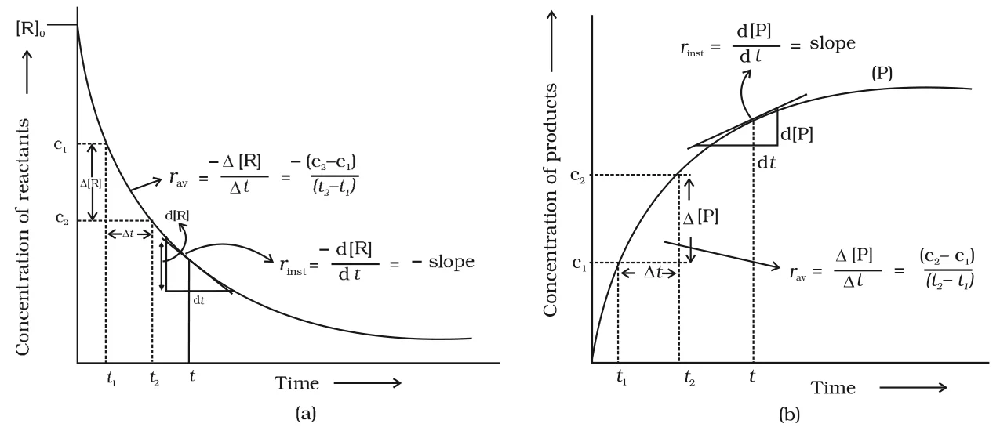

# [{ align=left, width=3.8% }](../../index.md)  Chemical Kinetics | Introduction

Chemical kinetics is the branch of chemistry which deals with the study of rates of chemical reactions, the factors affecting them and the mechanism by which reactions occur. The word kinetics comes from the Greek word 'kinesis', which means movement.

## Why Study Kinetics?

For any chemical reaction, chemists try to find out three things:

* **Feasibility:** Whether the reaction can take place at all. This is predicted by thermodynamics. A reaction with &Delta;G < 0 at constant temperature and pressure is feasible.
* **Extent:** How far the reaction will proceed. This is found from chemical equilibrium.
* **Speed:** How fast the reaction takes place, i.e. the time it takes to reach equilibrium. This is the subject of chemical kinetics.

Thermodynamics tells us only whether a reaction is feasible, whereas kinetics tells us how fast it goes.

!!! example "Example"

    Thermodynamic data shows that diamond should convert into graphite. In reality, this conversion is so slow that it cannot be noticed at all. That is why we say "diamond is forever".

* Kinetics helps us find the rate of a reaction and also the conditions (concentration, temperature, pressure, catalyst) by which the rate can be changed.
* At the macroscopic level, we study the amounts of substances reacted or formed and how fast they are consumed or formed.
* At the molecular level, we study the reaction mechanism, i.e. the orientation and energy of molecules undergoing collisions.

## Rate of a Chemical Reaction

Reactions take place at very different speeds:

* **Very fast reactions:** Ionic reactions, e.g. precipitation of AgCl on mixing aqueous solutions of AgNO3 and NaCl occurs instantly.
* **Very slow reactions:** Rusting of iron in the presence of air and moisture.
* **Moderate reactions:** Inversion of cane sugar and hydrolysis of starch.

Just as the speed of a car is the distance covered per unit time, the rate of a reaction is the change in concentration of a reactant or a product per unit time. It can be expressed as:

* the rate of decrease in concentration of any one of the reactants, or
* the rate of increase in concentration of any one of the products.

Consider a hypothetical reaction at constant volume, in which one mole of reactant R gives one mole of product P:

!!! tip ""

    $$R &rarr; P$$

* Let [R]1 and [P]1 be the molar concentrations of R and P at time t1, and [R]2 and [P]2 at time t2. Square brackets denote molar concentration.

!!! tip ""

    $$&Delta;t = t_2 - t_1$$

    $$&Delta;[R] = [R]_2 - [R]_1$$

    $$&Delta;[P] = [P]_2 - [P]_1$$

    $$Rate\ of\ disappearance\ of\ R = {Decrease\ in\ concentration\ of\ R \over Time\ taken} = -{&Delta;[R] \over &Delta;t}$$

    $$Rate\ of\ appearance\ of\ P = {Increase\ in\ concentration\ of\ P \over Time\ taken} = +{&Delta;[P] \over &Delta;t}$$

* Since the concentration of reactant decreases, &Delta;[R] is negative. It is multiplied by -1 so that the rate comes out as a positive quantity.

## Average Rate of a Reaction

* The expressions above give the **average rate** (rav) of a reaction over the time interval &Delta;t.
* Average rate depends on the change in concentration and the time taken for that change.
* As a reaction proceeds, the concentration of reactants falls and so the rate usually decreases with time. Hence, the average rate is different for different time intervals.

{loading=lazy}

## Instantaneous Rate of a Reaction

* An average rate cannot tell us the rate at a particular moment because it is assumed to be constant over the whole interval.
* The rate at a particular instant of time is called the **instantaneous rate** (rinst). It is the average rate over an infinitesimally small time interval dt, i.e. when &Delta;t approaches zero.

!!! tip ""

    $$r_{av} = {-&Delta;[R] \over &Delta;t} = {&Delta;[P] \over &Delta;t}$$

    $$As\ &Delta;t &rarr; 0:\ \ r_{inst} = {-d[R] \over dt} = {d[P] \over dt}$$

* Graphically, the instantaneous rate at time t is found by drawing a tangent to the concentration vs time curve at time t and finding its slope.
* For a reactant curve, rinst = -slope. For a product curve, rinst = +slope.

!!! example "Example"

    For the hydrolysis of butyl chloride, a tangent drawn on the [C4H9Cl] vs time curve at t = 600 s passes through 0.037 mol L-1 at 400 s and 0.0165 mol L-1 at 800 s.

    $$r_{inst}\ at\ 600\ s = -{(0.0165 - 0.037) \over (800 - 400)}\ mol\ L^{-1}s^{-1}$$

    $$r_{inst} = 5.12 \times 10^{-5}\ mol\ L^{-1}s^{-1}$$

## Units of Rate of Reaction

* Rate has the units of concentration time-1.
* If concentration is in mol L-1 and time is in seconds, the unit of rate is mol L-1s-1.
* For gaseous reactions, concentration is often expressed as partial pressure. Then the unit of rate is atm s-1. This works because, at constant temperature, the concentration of a gas is directly proportional to its partial pressure.

## Rate in Terms of Stoichiometric Coefficients

* When the stoichiometric coefficients of all reactants and products are equal, the rate of disappearance of any reactant is equal to the rate of appearance of any product.

!!! tip ""

    $$Hg_{(l)} + Cl_{2(g)} &rarr; HgCl_{2(s)}$$

    $$Rate = -{&Delta;[Hg] \over &Delta;t} = -{&Delta;[Cl_2] \over &Delta;t} = {&Delta;[HgCl_2] \over &Delta;t}$$

* When the coefficients are not equal, the rate of disappearance of each reactant or rate of appearance of each product is divided by its stoichiometric coefficient. This gives one single value for the rate of reaction.
* For example, in the decomposition of HI, two moles of HI are used to form one mole each of H2 and I2. So HI is consumed twice as fast as H2 is formed, and &Delta;[HI] is divided by 2.

!!! tip ""

    $$2HI_{(g)} &rarr; H_{2(g)} + I_{2(g)}$$

    $$Rate = -{1 \over 2}{&Delta;[HI] \over &Delta;t} = {&Delta;[H_2] \over &Delta;t} = {&Delta;[I_2] \over &Delta;t}$$

    $$5Br^-_{(aq)} + BrO^-_{3(aq)} + 6H^+_{(aq)} &rarr; 3Br_{2(aq)} + 3H_2O_{(l)}$$

    $$Rate = -{1 \over 5}{&Delta;[Br^-] \over &Delta;t} = -{&Delta;[BrO_3^-] \over &Delta;t} = -{1 \over 6}{&Delta;[H^+] \over &Delta;t} = {1 \over 3}{&Delta;[Br_2] \over &Delta;t} = {1 \over 3}{&Delta;[H_2O] \over &Delta;t}$$

!!! tip "Conclusion"

    For a general reaction aA + bB &rarr; cC + dD:

    $$Rate = -{1 \over a}{d[A] \over dt} = -{1 \over b}{d[B] \over dt} = {1 \over c}{d[C] \over dt} = {1 \over d}{d[D] \over dt}$$

## Questions

!!! question "From the concentrations of C4H9Cl (butyl chloride) at different times given below, calculate the average rate of the reaction C4H9Cl + H2O &rarr; C4H9OH + HCl during different intervals of time. t/s: 0, 50, 100, 150, 200, 300, 400, 700, 800 [C4H9Cl]/mol L-1: 0.100, 0.0905, 0.0820, 0.0741, 0.0671, 0.0549, 0.0439, 0.0210, 0.017"

    * The average rate for each interval is found by dividing the decrease in concentration by the time interval.

    $$r_{av} = -{[C_4H_9Cl]_{t_2} - [C_4H_9Cl]_{t_1} \over t_2 - t_1}$$

    $$For\ 0-50\ s:\ r_{av} = -{0.0905 - 0.100 \over 50} = 1.90 \times 10^{-4}\ mol\ L^{-1}s^{-1}$$

    * Similarly, for the other intervals:

    t1/s | t2/s | rav &times; 104 / mol L-1s-1
    ----|-----|-----
    0   | 50  | 1.90
    50  | 100 | 1.70
    100 | 150 | 1.58
    150 | 200 | 1.40
    200 | 300 | 1.22
    300 | 400 | 1.10
    700 | 800 | 0.4

    * The average rate falls from 1.90 &times; 10-4 to 0.4 &times; 10-4 mol L-1s-1 as the reactant is used up.

!!! question "The decomposition of N2O5 in CCl4 at 318 K has been studied by monitoring the concentration of N2O5. Initially the concentration of N2O5 is 2.33 mol L-1 and after 184 minutes, it is reduced to 2.08 mol L-1. The reaction is: 2N2O5(g) &rarr; 4NO2(g) + O2(g). Calculate the average rate of this reaction in terms of hours, minutes and seconds. What is the rate of production of NO2 during this period?"

    $$Average\ rate = {1 \over 2}\left\{-{&Delta;[N_2O_5] \over &Delta;t}\right\} = -{1 \over 2}\left[{(2.08 - 2.33)\ mol\ L^{-1} \over 184\ min}\right]$$

    $$Average\ rate = 6.79 \times 10^{-4}\ mol\ L^{-1}min^{-1}$$

    $$In\ hours = 6.79 \times 10^{-4} \times 60 = 4.07 \times 10^{-2}\ mol\ L^{-1}h^{-1}$$

    $$In\ seconds = {6.79 \times 10^{-4} \over 60} = 1.13 \times 10^{-5}\ mol\ L^{-1}s^{-1}$$

    * Rate of production of NO2:

    $$Rate = {1 \over 4}{&Delta;[NO_2] \over &Delta;t}$$

    $${&Delta;[NO_2] \over &Delta;t} = 4 \times 6.79 \times 10^{-4} = 2.72 \times 10^{-3}\ mol\ L^{-1}min^{-1}$$

!!! question "For the reaction R &rarr; P, the concentration of a reactant changes from 0.03 M to 0.02 M in 25 minutes. Calculate the average rate of reaction using units of time both in minutes and seconds."

    $$r_{av} = -{&Delta;[R] \over &Delta;t} = -{(0.02 - 0.03)\ M \over 25\ min}$$

    $$r_{av} = 4 \times 10^{-4}\ M\ min^{-1}$$

    $$r_{av} = {4 \times 10^{-4} \over 60} = 6.67 \times 10^{-6}\ M\ s^{-1}$$

!!! question "In a reaction, 2A &rarr; Products, the concentration of A decreases from 0.5 mol L-1 to 0.4 mol L-1 in 10 minutes. Calculate the rate during this interval."

    $$Rate = -{1 \over 2}{&Delta;[A] \over &Delta;t} = -{1 \over 2} \times {(0.4 - 0.5) \over 10}$$

    $$Rate = 0.005\ mol\ L^{-1}min^{-1}$$

    * Note that the rate of disappearance of A is twice this value, i.e. 0.01 mol L-1min-1.
