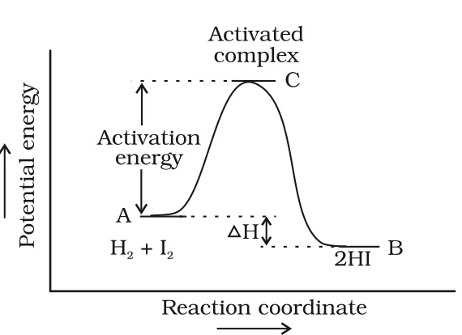
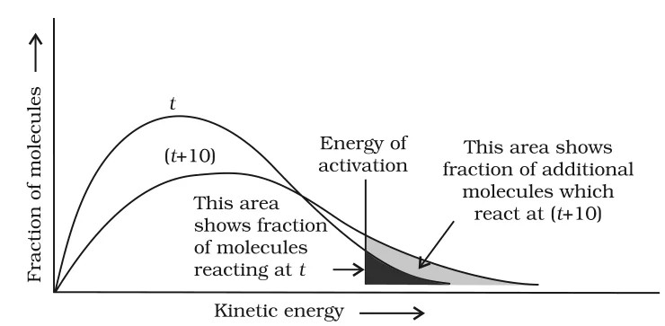
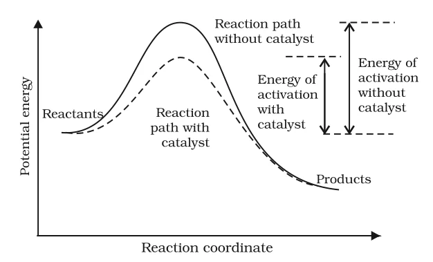
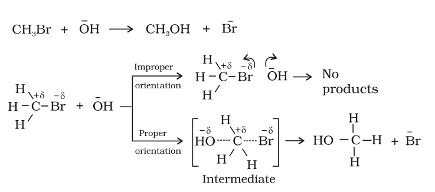

# [{ align=left, width=3.8% }](../../index.md)  Chemical Kinetics | Temperature Dependence, Catalysis and Collision Theory

Most chemical reactions are accelerated by an increase in temperature, and the temperature dependence of the rate constant is explained by the Arrhenius equation.

## Effect of Temperature on Rate

!!! example "Examples"

    * In the decomposition of N2O5, the time taken for half of the original amount to decompose is 12 min at 50 &deg;C, 5 h at 25 &deg;C and 10 days at 0 &deg;C.

    * In a mixture of KMnO4 and oxalic acid (H2C2O4), the permanganate is decolourised faster at a higher temperature.

* For a chemical reaction, a rise in temperature by 10&deg; nearly doubles the rate constant.
* The ratio of rate constants at two temperatures differing by 10&deg; is called the **temperature coefficient**. Its value is usually between 2 and 3.

!!! tip ""

    $$Temperature\ coefficient = {k_{T + 10} \over k_T} &asymp; 2$$

## Arrhenius Equation

The temperature dependence of the rate of a chemical reaction is accurately explained by the Arrhenius equation. It was first proposed by the Dutch chemist J.H. van't Hoff, but the Swedish chemist Arrhenius gave its physical justification and interpretation.

!!! tip ""

    $$k = A\ e^{-E_a/RT}$$

* A is the **Arrhenius factor** or **frequency factor**. It is also called the **pre-exponential factor**. It is a constant specific to a particular reaction.
* R is the gas constant (8.314 J K-1mol-1).
* Ea is the **activation energy**, measured in J mol-1.

## Activation Energy and Activated Complex

* Consider the reaction:

!!! tip ""

    $$H_{2(g)} + I_{2(g)} &rarr; 2HI_{(g)}$$

* According to Arrhenius, this reaction takes place only when a molecule of H2 and a molecule of I2 collide to form an unstable intermediate. This intermediate exists for a very short time and then breaks up into two molecules of HI.

!!! tip ""

    $$H_2 + I_2 &rarr; [H \cdots I \cdots H \cdots I]\ (intermediate) &rarr; 2HI$$

* This intermediate is called the **activated complex** (C).
* The energy required to form the activated complex is called the **activation energy** (Ea).
* A plot of potential energy against reaction coordinate shows this energy barrier. The reaction coordinate shows the energy profile as reactants change into products.

{loading=lazy}

* Some energy is released when the activated complex decomposes to form products. So, the final heat of reaction (&Delta;H) depends on the nature of reactants and products.

## Maxwell-Boltzmann Distribution of Energies

* Not all molecules in a reacting mixture have the same kinetic energy. Ludwig Boltzmann and James Clerk Maxwell used statistics to describe the behaviour of a large number of molecules.
* The distribution is shown by plotting the fraction of molecules (NE/NT) with a given kinetic energy E against the kinetic energy. NE is the number of molecules with energy E and NT is the total number of molecules.
* The peak of the curve corresponds to the **most probable kinetic energy**, i.e. the kinetic energy of the largest fraction of molecules. Fewer molecules have energies higher or lower than this value.
* When the temperature is raised, the peak shifts to a higher energy value and the curve broadens out, i.e. spreads to the right. So a greater fraction of molecules has much higher energies.
* The total area under the curve stays constant, because the total probability is always one.

{loading=lazy}

* Increasing the temperature increases the fraction of molecules which collide with energy greater than Ea.
* At (t + 10), the area showing the fraction of molecules with energy equal to or greater than Ea roughly doubles. This doubles the rate of reaction.
* In the Arrhenius equation, the factor e-Ea/RT is the fraction of molecules having kinetic energy greater than Ea.

## Calculating Ea and A

* Taking natural log of both sides of the Arrhenius equation:

!!! tip ""

    $$ln\ k = -{E_a \over RT} + ln\ A$$

    $$log\ k = -{E_a \over 2.303RT} + log\ A$$

* A plot of ln k against 1/T is a straight line with slope = -Ea/R and intercept = ln A. So Ea and A can be found from this graph.
* Hence, increasing the temperature or decreasing the activation energy increases the rate of reaction, and the rate constant increases exponentially.

### Rate constants at two temperatures

* Let k1 and k2 be the rate constants at temperatures T1 and T2. Since A is constant for a given reaction:

!!! tip ""

    $$ln\ k_1 = -{E_a \over RT_1} + ln\ A$$

    $$ln\ k_2 = -{E_a \over RT_2} + ln\ A$$

    $$ln\ k_2 - ln\ k_1 = {E_a \over RT_1} - {E_a \over RT_2}$$

    $$ln{k_2 \over k_1} = {E_a \over R}\left[{1 \over T_1} - {1 \over T_2}\right]$$

    $$log{k_2 \over k_1} = {E_a \over 2.303R}\left[{T_2 - T_1 \over T_1T_2}\right]$$

## Effect of Catalyst

A catalyst is a substance which alters the rate of a reaction without itself undergoing any permanent chemical change.

!!! example "Example"

    MnO2 greatly increases the rate of decomposition of potassium chlorate:

    $$2KClO_3 \xrightarrow{MnO_2} 2KCl + 3O_2$$

* The action of a catalyst is explained by the **intermediate complex theory**. The catalyst takes part in the reaction by forming temporary bonds with the reactants, giving an intermediate complex. This complex exists only for a short time and then decomposes to give the products and the catalyst back.
* A catalyst provides an alternate pathway (reaction mechanism) with a lower activation energy between reactants and products. This lowers the potential energy barrier.

{loading=lazy}

* From the Arrhenius equation, the lower the activation energy, the faster the reaction.

### Important points about a catalyst

* A small amount of catalyst can catalyse a large amount of reactants.
* A catalyst does not change the Gibbs energy (&Delta;G) of a reaction. It catalyses spontaneous reactions but cannot make a non-spontaneous reaction happen.
* A catalyst does not change the equilibrium constant of a reaction. It speeds up the forward and backward reactions to the same extent, so equilibrium is reached faster but the equilibrium state stays the same.

## Collision Theory of Chemical Reactions

* Collision theory was developed by Max Trautz and William Lewis in 1916-18. It gives a deeper insight into the energy and mechanism of reactions, and is based on the kinetic theory of gases.
* Reactant molecules are assumed to be hard spheres, and a reaction occurs when molecules collide with each other.
* The number of collisions per second per unit volume of the reaction mixture is called the **collision frequency** (Z).
* For a bimolecular elementary reaction A + B &rarr; Products:

!!! tip ""

    $$Rate = Z_{AB}\ e^{-E_a/RT}$$

* ZAB is the collision frequency of A and B, and e-Ea/RT is the fraction of molecules with energy equal to or greater than Ea.
* Comparing with the Arrhenius equation, the factor A is related to the collision frequency.

### Effective Collisions

* The above equation works well for atoms and simple molecules, but shows large deviations for complex molecules. This is because not all collisions form products.
* Collisions in which molecules collide with sufficient kinetic energy (called **threshold energy**) and proper orientation, so that old bonds break and new bonds form, are called **effective collisions**.

!!! tip ""

    $$Threshold\ energy = Activation\ energy + Energy\ possessed\ by\ reacting\ species$$

!!! example "Example"

    In the formation of methanol from bromomethane, CH3Br + OH- &rarr; CH3OH + Br-, the OH- must approach the carbon atom from the side opposite to Br. Proper orientation leads to bond formation, while improper orientation makes the molecules simply bounce back and no products are formed.

    {loading=lazy}

* To account for orientation, a **probability factor** or **steric factor** (P) is introduced:

!!! tip ""

    $$Rate = P\ Z_{AB}\ e^{-E_a/RT}$$

!!! tip "Conclusion"

    In collision theory, activation energy and proper orientation of molecules together decide whether a collision is effective, and hence the rate of a chemical reaction.

* **Drawback:** Collision theory treats atoms and molecules as hard spheres and ignores their structural aspects.

## Questions

!!! question "The rate constants of a reaction at 500 K and 700 K are 0.02 s-1 and 0.07 s-1 respectively. Calculate the values of Ea and A."

    $$log{k_2 \over k_1} = {E_a \over 2.303R}\left[{T_2 - T_1 \over T_1T_2}\right]$$

    $$log{0.07 \over 0.02} = {E_a \over 2.303 \times 8.314}\left[{700 - 500 \over 700 \times 500}\right]$$

    $$0.544 = {E_a \times 5.714 \times 10^{-4} \over 19.15}$$

    $$E_a = {0.544 \times 19.15 \over 5.714 \times 10^{-4}} = 18230.8\ J\ mol^{-1}$$

    * Calculation of A:

    $$k = A\ e^{-E_a/RT}$$

    $$0.02 = A\ e^{-18230.8/(8.314 \times 500)} = A \times 0.012$$

    $$A = {0.02 \over 0.012} = 1.61\ s^{-1}$$

!!! question "The first order rate constant for the decomposition of ethyl iodide by the reaction C2H5I(g) &rarr; C2H4(g) + HI(g) at 600 K is 1.60 &times; 10-5 s-1. Its energy of activation is 209 kJ/mol. Calculate the rate constant of the reaction at 700 K."

    $$log\ k_2 = log\ k_1 + {E_a \over 2.303R}\left[{1 \over T_1} - {1 \over T_2}\right]$$

    $$log\ k_2 = log(1.60 \times 10^{-5}) + {209000 \over 2.303 \times 8.314}\left[{1 \over 600} - {1 \over 700}\right]$$

    $$log\ k_2 = -4.796 + 2.599 = -2.197$$

    $$k_2 = 6.36 \times 10^{-3}\ s^{-1}$$

!!! question "What will be the effect of temperature on rate constant?"

    * The rate constant increases with increase in temperature. For a 10&deg; rise in temperature, the rate constant nearly doubles.
    * This is because more molecules have energy equal to or greater than the activation energy at higher temperature. The dependence is given by the Arrhenius equation, k = Ae-Ea/RT.

!!! question "The rate of the chemical reaction doubles for an increase of 10 K in absolute temperature from 298 K. Calculate Ea."

    $$T_1 = 298\ K,\ T_2 = 308\ K,\ {k_2 \over k_1} = 2$$

    $$log\ 2 = {E_a \over 2.303 \times 8.314}\left[{308 - 298 \over 298 \times 308}\right]$$

    $$E_a = {2.303 \times 8.314 \times 0.3010 \times 298 \times 308 \over 10}$$

    $$E_a = 52903\ J\ mol^{-1} = 52.9\ kJ\ mol^{-1}$$

!!! question "The activation energy for the reaction 2HI(g) &rarr; H2 + I2(g) is 209.5 kJ mol-1 at 581 K. Calculate the fraction of molecules of reactants having energy equal to or greater than activation energy."

    * The fraction of molecules with energy &ge; Ea is x = e-Ea/RT.

    $$log\ x = -{E_a \over 2.303RT} = -{209500 \over 2.303 \times 8.314 \times 581}$$

    $$log\ x = -18.83$$

    $$x = 1.47 \times 10^{-19}$$
