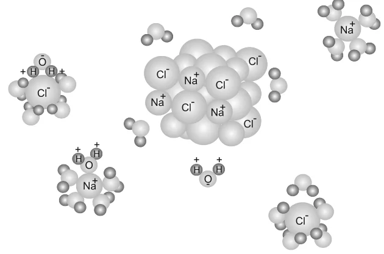
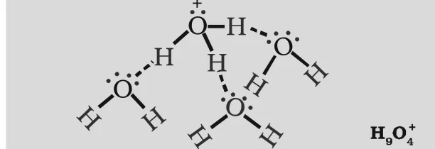

# [{ align=left, width=3.8% }](../../index.md)  Ionic Equilibrium | Introduction

Ionic equilibrium is the equilibrium established between the ions and the unionized molecules of a weak electrolyte in aqueous solution. Acids, bases and salts are electrolytes, so the study of ionic equilibrium is largely the study of how acids, bases and salts behave in water.

* A simple example of an equilibrium involving only ions is:

!!! tip ""

    $$Fe^{3+}_{(aq)} + SCN^-_{(aq)} &#8652; [Fe(SCN)]^{2+}_{(aq)}$$

## Electrolytes and Non-Electrolytes

* An aqueous solution of sugar does not conduct electricity, but a solution of common salt (NaCl) does. Its conductance also increases as more salt is dissolved.
* Michael Faraday classified substances into two categories on the basis of their ability to conduct electricity in aqueous solution.

### 1. Electrolytes

* Substances which conduct electricity in their aqueous solutions are called electrolytes. Example: NaCl, HCl, CH3COOH, NaOH.

### 2. Non-Electrolytes

* Substances which do not conduct electricity in their aqueous solutions are called non-electrolytes. Example: sugar, urea.

Faraday further divided electrolytes into strong and weak electrolytes.

### 3. Strong Electrolytes

* Strong electrolytes ionize almost completely (nearly 100%) on dissolution in water.
* Example: An aqueous solution of NaCl contains only Na+ and Cl- ions. HCl is also completely ionized in water.

### 4. Weak Electrolytes

* Weak electrolytes are only partially ionized in water.
* Example: An aqueous solution of acetic acid mainly contains unionized CH3COOH molecules and only a few CH3COO- and H+ ions (less than 5% ionization).
* In a weak electrolyte, an equilibrium is set up between the ions and the unionized molecules. This is the ionic equilibrium.

!!! tip ""

    $$CH_3COOH_{(aq)} &#8652; CH_3COO^-_{(aq)} + H^+_{(aq)}$$

## Why do ionic compounds dissolve in water?

* Solid NaCl is a cluster of Na+ and Cl- ions held together by electrostatic forces.
* The electrostatic force between two charges is inversely proportional to the dielectric constant of the medium. Water has a very high dielectric constant of 80.
* So, when NaCl is dissolved in water, the attraction between the ions is reduced by a factor of 80. The ions move freely in the solution and are kept apart by hydration with polar water molecules.

{loading=lazy}

* Both HCl and CH3COOH are polar covalent molecules, yet HCl is completely ionized while acetic acid is only partially ionized. The extent of ionization depends on the strength of the bond and the extent of solvation of the ions produced.

!!! note "Dissociation and Ionization"

    * **Dissociation** is the separation of ions that already exist in the solid solute, as in NaCl.

    * **Ionization** is the process in which a neutral molecule splits into charged ions in solution, as in HCl.

    * In this chapter, the two terms are used interchangeably.

## Acids, Bases and Salts

* Acids taste sour (the word comes from the Latin *acidus*, meaning sour), turn blue litmus red and liberate H2 on reacting with metals. Example: HCl in gastric juice, acetic acid in vinegar, citric and ascorbic acid in lemon, tartaric acid in tamarind.
* Bases taste bitter, feel soapy and turn red litmus blue. Example: washing soda.
* When acids and bases react in the right proportion, they form salts. Example: NaCl, BaSO4, NaNO3.

## Arrhenius Concept of Acids and Bases

* According to Arrhenius, acids are substances that dissociate in water to give hydrogen ions, H+(aq), and bases are substances that produce hydroxyl ions, OH-(aq).

!!! tip ""

    $$HX_{(aq)} &rarr; H^+_{(aq)} + X^-_{(aq)}$$

    $$HX_{(aq)} + H_2O_{(l)} &rarr; H_3O^+_{(aq)} + X^-_{(aq)}$$

    $$MOH_{(aq)} &rarr; M^+_{(aq)} + OH^-_{(aq)}$$

### Hydronium and hydroxyl ions

* A bare proton, H+, is extremely small (about 10-15 m radius) and has an intense electric field. So it cannot exist freely in water.
* It binds to a lone pair on the oxygen atom of a water molecule to give the trigonal pyramidal hydronium ion, H3O+. In this chapter, H+(aq) and H3O+(aq) mean the same thing, a hydrated proton.
* In solution, H3O+ is further hydrated to species like H5O2+, H7O3+ and H9O4+. Similarly, OH- is hydrated to H3O2-, H5O3-, H7O4- etc.

{loading=lazy}

### Limitations of Arrhenius concept

* It applies only to aqueous solutions.
* It cannot explain the basic nature of substances like ammonia (NH3), which do not contain a hydroxyl group.

## Brönsted-Lowry Concept of Acids and Bases

* According to Brönsted and Lowry, an acid is a substance that can donate a proton (H+) and a base is a substance that can accept a proton. In short, acids are proton donors and bases are proton acceptors.

!!! example "Dissolution of NH3 in water"

    $$NH_{3(aq)} + H_2O_{(l)} &#8652; NH^+_{4(aq)} + OH^-_{(aq)}$$

    $$(Base)\ \ \ \ (Acid)\ \ \ \ (Conjugate\ acid)\ \ \ \ (Conjugate\ base)$$

    * Water donates a proton, so it acts as an acid. NH3 accepts a proton, so it acts as a base.

    * In the reverse reaction, NH4+ donates a proton to OH-. So NH4+ is a Brönsted acid and OH- is a Brönsted base.

### Conjugate acid-base pair

* An acid-base pair that differs only by one proton is called a conjugate acid-base pair.
* A conjugate acid has one extra proton and a conjugate base has one less proton.
* In the above example, OH- is the conjugate base of the acid H2O and NH4+ is the conjugate acid of the base NH3.
* If a Brönsted acid is strong, its conjugate base is weak, and vice-versa.

!!! example "Ionization of HCl in water"

    $$HCl_{(aq)} + H_2O_{(l)} &#8652; H_3O^+_{(aq)} + Cl^-_{(aq)}$$

    $$(Acid)\ \ \ \ (Base)\ \ \ \ (Conjugate\ acid)\ \ \ \ (Conjugate\ base)$$

    * Here water accepts a proton, so it acts as a base. Cl- is the conjugate base of HCl and H3O+ is the conjugate acid of H2O.

!!! tip "Conclusion"

    Water is amphoteric: it acts as a base towards HCl and as an acid towards NH3.

## Lewis Concept of Acids and Bases

* G.N. Lewis (1923) defined an acid as a species which accepts an electron pair and a base as a species which donates an electron pair.
* For bases, the Lewis and Brönsted-Lowry concepts are nearly the same, because a base provides a lone pair in both cases.
* For acids, the Lewis concept is much wider, since many Lewis acids have no proton at all. Example: BF3 has no proton but accepts a lone pair from NH3.

!!! tip ""

    $$BF_3 + :NH_3 &rarr; BF_3:NH_3$$

* Lewis acids: electron deficient species like BF3, AlCl3, Co3+, Mg2+, H+.
* Lewis bases: species with a lone pair to donate, like H2O, NH3, OH-, F-.

## Questions

!!! question "What will be the conjugate bases for the following Brönsted acids: HF, H2SO4 and HCO3-?"

    A conjugate base has one proton less than the acid. So the conjugate bases are:

    * HF &rarr; F-

    * H2SO4 &rarr; HSO4-

    * HCO3- &rarr; CO32-

!!! question "Write the conjugate acids for the following Brönsted bases: NH2-, NH3 and HCOO-."

    A conjugate acid has one proton more than the base. So the conjugate acids are:

    * NH2- &rarr; NH3

    * NH3 &rarr; NH4+

    * HCOO- &rarr; HCOOH

!!! question "The species H2O, HCO3-, HSO4- and NH3 can act both as Brönsted acids and bases. For each case give the corresponding conjugate acid and conjugate base."

    Species                         | Conjugate acid                  | Conjugate base
    --------------------------------|---------------------------------|--------------------------------
    H2O                  | H3O+      | OH-
    HCO3-     | H2CO3     | CO32-
    HSO4-     | H2SO4     | SO42-
    NH3                  | NH4+      | NH2-

!!! question "Find the conjugate acid/base for the following species: HNO2, CN-, HClO4, F-, OH-, CO32- and S2-."

    * HNO2 is an acid, its conjugate base is NO2-.

    * CN- is a base, its conjugate acid is HCN.

    * HClO4 is an acid, its conjugate base is ClO4-.

    * F- is a base, its conjugate acid is HF.

    * OH- is a base, its conjugate acid is H2O (it can also act as an acid, with conjugate base O2-).

    * CO32- is a base, its conjugate acid is HCO3-.

    * S2- is a base, its conjugate acid is HS-.

!!! question "Classify the following species into Lewis acids and Lewis bases and show how these act as such: (a) OH- (b) F- (c) H+ (d) BCl3"

    * (a) OH- is a Lewis base, as it can donate an electron lone pair (:OH-).

    * (b) F- is a Lewis base, as it can donate any one of its four electron lone pairs.

    * (c) H+ is a Lewis acid, as it can accept a lone pair of electrons from bases like OH- and F-.

    * (d) BCl3 is a Lewis acid, as it can accept a lone pair of electrons from species like ammonia or amines.

!!! question "Which of the following are Lewis acids? H2O, BF3, H+ and NH4+"

    * BF3 and H+ are Lewis acids, as both can accept an electron pair.

    * NH4+ is also listed as a Lewis acid, since it can transfer H+ (an electron pair acceptor) to a base.

    * H2O has two lone pairs on oxygen and acts as a Lewis base.
