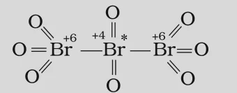
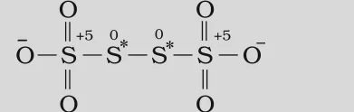

# [{ align=left, width=3.8% }](../../index.md)  Redox Reactions | Oxidation Number

## Why do we need Oxidation Number?

* In ionic reactions like the formation of NaCl, electron transfer is easy to see. But many redox reactions form covalent compounds, where no complete transfer of electrons takes place.

!!! tip ""

    $$2H_{2(g)} + O_{2(g)} &rarr; 2H_2O_{(l)}$$

    $$H_{2(g)} + Cl_{2(g)} &rarr; 2HCl_{(g)}$$

    $$CH_{4(g)} + 4Cl_{2(g)} &rarr; CCl_{4(l)} + 4HCl_{(g)}$$

* In H2O, the shared electrons are only shifted towards oxygen; hydrogen does not lose its electron completely. Still, we can think of H going from a zero state in H2 to a positive state in H2O, and O going from zero in O2 to a negative state in H2O.
* To keep track of such electron shifts, chemists use **oxidation number**. In this method, we always **assume** a complete transfer of electrons from the less electronegative atom to the more electronegative atom.

!!! tip ""

    $$2\overset{0}{H_2} + \overset{0}{O_2} &rarr; 2\overset{+1}{H_2}\overset{-2}{O}$$

    $$\overset{0}{H_2} + \overset{0}{Cl_2} &rarr; 2\overset{+1}{H}\overset{-1}{Cl}$$

    $$\overset{-4}{C}\overset{+1}{H_4} + 4\overset{0}{Cl_2} &rarr; \overset{+4}{C}\overset{-1}{Cl_4} + 4\overset{+1}{H}\overset{-1}{Cl}$$

* This assumption is only for book-keeping, but it makes the description of redox reactions very simple.

!!! tip "Definition"

    **Oxidation number** denotes the oxidation state of an element in a compound, ascertained according to a set of rules formulated on the basis that the electrons in a covalent bond belong entirely to the more electronegative element.

* If an element is present more than once in a molecule or ion (e.g. S in Na2S2O3, Cr in Cr2O72-), the oxidation number calculated is the **average** for all atoms of that element.

## Rules for Assigning Oxidation Number

### 1. Free elements

* In the free or uncombined state, every atom has an oxidation number of **zero**. Example: each atom in H2, O2, Cl2, O3, P4, S8, Na, Mg and Al has oxidation number 0.

### 2. Monoatomic ions

* For an ion made of only one atom, the oxidation number equals the charge on the ion. Example: Na+ = +1, Mg2+ = +2, Fe3+ = +3, Cl- = -1, O2- = -2.
* In their compounds, alkali metals always have +1, alkaline earth metals have +2 and aluminium has +3.

### 3. Oxygen

* Oxygen has an oxidation number of **-2** in most compounds. There are two exceptions:
* **Peroxides and superoxides:** Here oxygen atoms are directly linked to each other. In peroxides (H2O2, Na2O2) each oxygen is -1, and in superoxides (KO2, RbO2) each oxygen is $-{1 \over 2}$.
* **Compounds with fluorine:** Since fluorine is more electronegative, oxygen gets a positive value. In OF2 oxygen is +2 and in O2F2 it is +1.

### 4. Hydrogen

* Hydrogen has an oxidation number of **+1**, except in binary compounds with metals (metal hydrides) like LiH, NaH and CaH2, where it is **-1**.

### 5. Halogens

* Fluorine is **-1** in all its compounds.
* Cl, Br and I are -1 when they occur as halide ions. But when combined with oxygen (in oxoacids and oxoanions), they have positive oxidation numbers.

### 6. Sum of oxidation numbers

* The algebraic sum of oxidation numbers of all atoms in a neutral compound is **zero**.
* In a polyatomic ion, the sum equals the **charge on the ion**. Example: in CO32-, the sum for one C and three O atoms is -2.

!!! example "Example: Oxidation number of Cr in K2Cr2O7"

    Let the oxidation number of Cr be x.

    $$2(+1) + 2x + 7(-2) = 0$$

    $$2x = 12$$

    $$x = +6$$

## Trends in Oxidation Number

* Metals have positive oxidation numbers, while non-metals can have positive or negative oxidation numbers.
* Transition elements usually show several positive oxidation states.
* The highest oxidation number of a representative element is equal to its group number for groups 1 and 2, and (group number - 10) for the other groups. So, the highest oxidation number increases across a period:

Group                      | 1    | 2                  | 13                | 14                 | 15                               | 16               | 17
---------------------------|------|--------------------|-------------------|--------------------|----------------------------------|------------------|-------------------
Element                    | Na   | Mg                 | Al                | Si                 | P                                | S                | Cl
Compound                   | NaCl | MgSO4   | AlF3   | SiCl4   | P4O10      | SF6   | HClO4
Highest oxidation number   | +1   | +2                 | +3                | +4                 | +5                               | +6               | +7

* The term **oxidation state** is often used interchangeably with oxidation number. In CO2, the oxidation state (and oxidation number) of carbon is +4 and of oxygen is -2.

## Stock Notation

* In Stock notation (given by German chemist Alfred Stock), the oxidation number of a metal is written as a Roman numeral in parentheses after the symbol of the metal.
* Examples: aurous chloride = Au(I)Cl, auric chloride = Au(III)Cl3, stannous chloride = Sn(II)Cl2, stannic chloride = Sn(IV)Cl4.
* It quickly tells us whether a species is in its oxidised or reduced form. Example: Hg2(I)Cl2 is the reduced form of Hg(II)Cl2.

## Redox Terms in terms of Oxidation Number

!!! tip "Definitions"

    * **Oxidation:** An increase in the oxidation number of an element in a given substance.

    * **Reduction:** A decrease in the oxidation number of an element in a given substance.

    * **Oxidising agent (oxidant):** A reagent which can increase the oxidation number of an element in a given substance.

    * **Reducing agent (reductant):** A reagent which lowers the oxidation number of an element in a given substance.

    * **Redox reaction:** A reaction which involves change in oxidation number of the interacting species.

## Fractional Oxidation Number

* Sometimes the oxidation number of an element comes out as a fraction:

!!! tip ""

    $$C_3O_2:\ Oxidation\ number\ of\ C = {4 \over 3}$$

    $$Br_3O_8:\ Oxidation\ number\ of\ Br = {16 \over 3}$$

    $$Na_2S_4O_6:\ Oxidation\ number\ of\ S = 2.5$$

* Electrons are never shared or transferred in fractions. A fractional value is only the **average** oxidation number; the structure shows that the element is actually present in different oxidation states.

### 1. Carbon suboxide (C3O2)

!!! tip ""

    $$O = \overset{+2}{C} = \overset{0}{C} = \overset{+2}{C} = O$$

* The two terminal carbons are +2 and the middle carbon is 0. Average = $(2 + 0 + 2)/3 = 4/3$.

### 2. Tribromooctaoxide (Br3O8)

{loading=lazy}

* The two terminal bromines are +6 and the middle bromine is +4. Average = $(6 + 4 + 6)/3 = 16/3$.

### 3. Tetrathionate ion (S4O62-)

{loading=lazy}

* The two terminal sulphurs are +5 and the two middle sulphurs are 0. Average = $(5 + 0 + 0 + 5)/4 = 2.5$.

!!! note "Note"

    Fe3O4, Mn3O4 and Pb3O4 are mixed oxides which also show fractional average oxidation numbers of the metal. However, in O2+ and O2- the oxidation number is genuinely $+{1 \over 2}$ and $-{1 \over 2}$ respectively.

## Questions

!!! question "Using Stock notation, represent the following compounds: HAuCl4, Tl2O, FeO, Fe2O3, CuI, CuO, MnO and MnO2."

    Applying the rules, the oxidation number of the metal in each compound is:

    Compound | Oxidation number of metal | Stock notation
    ---------|---------------------------|---------------
    HAuCl4 | +3 | HAu(III)Cl4
    Tl2O | +1 | Tl2(I)O
    FeO | +2 | Fe(II)O
    Fe2O3 | +3 | Fe2(III)O3
    CuI | +1 | Cu(I)I
    CuO | +2 | Cu(II)O
    MnO | +2 | Mn(II)O
    MnO2 | +4 | Mn(IV)O2

!!! question "Justify that the reaction 2Cu2O(s) + Cu2S(s) &rarr; 6Cu(s) + SO2(g) is a redox reaction. Identify the species oxidised/reduced, the oxidant and the reductant."

    * Assigning oxidation numbers:

    $$2\overset{+1}{Cu_2}\overset{-2}{O} + \overset{+1}{Cu_2}\overset{-2}{S} &rarr; 6\overset{0}{Cu} + \overset{+4}{S}\overset{-2}{O_2}$$

    * Copper is **reduced** from +1 to 0 and sulphur is **oxidised** from -2 to +4. So it is a redox reaction.

    * Cu2O helps sulphur in Cu2S to increase its oxidation number, so Cu(I) is the **oxidant**.

    * Sulphur of Cu2S helps copper (in both Cu2S and Cu2O) to decrease its oxidation number, so sulphur of Cu2S is the **reductant**.
