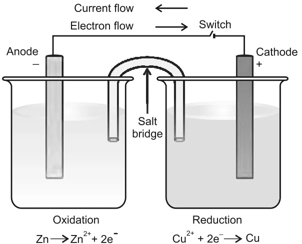

# [{ align=left, width=3.8% }](../../index.md)  Redox Reactions | Redox Titrations and Electrode Processes

## Redox Titrations

* In acid-base titrations, the strength of one solution is found against another using a pH sensitive indicator.
* Similarly, in a **redox titration**, the strength of a reductant or oxidant is determined using a **redox sensitive indicator**.
* The end point can be detected in three ways, depending on the reagent used.

### 1. Self indicator: Permanganate titrations

* The permanganate ion, MnO4-, is intensely coloured, so it acts as its **own indicator**.
* When the last of the reductant (Fe2+ or C2O42-) is oxidised, the first lasting tinge of pink colour appears. This is visible at an MnO4- concentration as low as 10-6 mol dm-3 (10-6 mol L-1).
* This ensures only a minimal "overshoot" in colour beyond the **equivalence point**, i.e. the point where the reductant and oxidant are equal in terms of their mole stoichiometry.

### 2. External redox indicator: Dichromate titrations

* Cr2O72- is not a self indicator because it gives no dramatic colour change.
* Instead, an indicator such as **diphenylamine** is added. Just after the equivalence point, dichromate oxidises diphenylamine to produce an intense blue colour, which signals the end point.

### 3. Iodometric titrations

* This method is used for reagents that can oxidise I- ions, for example Cu(II):

!!! tip ""

    $$2Cu^{2+}_{(aq)} + 4I^-_{(aq)} &rarr; Cu_2I_{2(s)} + I_{2(aq)}$$

* The liberated iodine is then titrated with thiosulphate ions, which is also a redox reaction:

!!! tip ""

    $$I_{2(aq)} + 2S_2O_3^{2-}{}_{(aq)} &rarr; 2I^-_{(aq)} + S_4O_6^{2-}{}_{(aq)}$$

* Iodine is insoluble in water but stays in solution containing KI as KI3.
* Starch gives an intense blue colour with iodine. This colour disappears as soon as all the iodine is consumed by thiosulphate, so the end point is easy to track. The rest is only stoichiometric calculation.

## Limitations of the Concept of Oxidation Number

* The concept of redox processes has kept evolving: from addition/removal of oxygen, to electron transfer, to change in oxidation number.
* In the modern view, **oxidation** is a **decrease in electron density** and **reduction** is an **increase in electron density** around the atom(s) involved in the reaction.

## Redox Couple

* When a zinc rod is dipped in copper sulphate solution, electrons are transferred **directly** from zinc to Cu2+ ions, and heat is evolved.
* If instead the zinc and copper are kept in separate beakers (zinc in ZnSO4, copper in CuSO4), both the oxidised and reduced forms of the same species are present at each metal-solution interface.

!!! tip "Definition"

    A **redox couple** is the oxidised and reduced forms of a substance taking part in an oxidation or reduction half reaction.

* It is written with the oxidised form first, separated from the reduced form by a vertical line or slash that represents an interface (e.g. solid/solution). Examples: Zn2+/Zn and Cu2+/Cu.

## Electrode Processes: Daniell Cell

* The two beakers are connected by a **salt bridge** (a U-tube containing KCl or NH4NO3 solution set in agar-agar jelly), and the two rods are connected by a metallic wire through an ammeter and a switch. This set-up is the **Daniell cell**.

{loading=lazy}

* With the switch off, no reaction occurs. With the switch on:
* Electrons now flow from Zn to Cu2+ **indirectly**, through the external wire. The direction of current is opposite to the direction of electron flow.
* Inside the cell, the circuit is completed by migration of ions through the salt bridge.
* Current flows only because there is a potential difference between the two rods, which are called **electrodes**.

!!! tip ""

    $$Anode\ (oxidation):\ Zn_{(s)} &rarr; Zn^{2+}_{(aq)} + 2e^-$$

    $$Cathode\ (reduction):\ Cu^{2+}_{(aq)} + 2e^- &rarr; Cu_{(s)}$$

    $$Overall:\ Zn_{(s)} + Cu^{2+}_{(aq)} &rarr; Zn^{2+}_{(aq)} + Cu_{(s)}$$

* So the same redox reaction now produces electrical energy instead of only heat.

## Electrode Potential and Redox Strength

* The potential associated with each electrode is its **electrode potential**. When all species are at unit concentration (gases at 1 atm) and 298 K, it is called the **standard electrode potential**, E0. By convention, E0 of the hydrogen electrode (H+/H2) is 0.00 V.
* E0 (written as a reduction potential) measures the tendency of a redox couple to stay in the reduced or oxidised form:
* A **negative** E0 means the couple is a **stronger reducing agent** than H+/H2.
* A **positive** E0 means the couple is a **weaker reducing agent** (i.e. a better oxidising agent) than H+/H2.

Some standard reduction potentials at 298 K:

Reaction (Oxidised form + ne- &rarr; Reduced form) | E0 / V
--------------------------------------------------------------|--------
F2(g) + 2e- &rarr; 2F- | 2.87
MnO4- + 8H+ + 5e- &rarr; Mn2+ + 4H2O | 1.51
Cl2(g) + 2e- &rarr; 2Cl- | 1.36
Cr2O72- + 14H+ + 6e- &rarr; 2Cr3+ + 7H2O | 1.33
Br2 + 2e- &rarr; 2Br- | 1.09
Ag+ + e- &rarr; Ag(s) | 0.80
Fe3+ + e- &rarr; Fe2+ | 0.77
I2(s) + 2e- &rarr; 2I- | 0.54
Cu2+ + 2e- &rarr; Cu(s) | 0.34
2H+ + 2e- &rarr; H2(g) | 0.00
Fe2+ + 2e- &rarr; Fe(s) | -0.44
Zn2+ + 2e- &rarr; Zn(s) | -0.76
Al3+ + 3e- &rarr; Al(s) | -1.66
Mg2+ + 2e- &rarr; Mg(s) | -2.36
Na+ + e- &rarr; Na(s) | -2.71
K+ + e- &rarr; K(s) | -2.93
Li+ + e- &rarr; Li(s) | -3.05

* Going **up** the table, the strength of the oxidising agent (left side) increases. Going **down**, the strength of the reducing agent (right side) increases.
* A redox reaction is feasible when the oxidising agent of a couple higher in the table reacts with the reducing agent of a couple lower in the table (i.e. when the resulting E0cell is positive).

!!! note "Note"

    The detailed theory of electrode potential, the standard hydrogen electrode, cell EMF and the Nernst equation is covered in the Electrochemistry chapter: [Electrode Potential](../electrochemistry/electrode-potential.md), [EMF of a Cell](../electrochemistry/emf-of-a-cell.md) and [Nernst Equation](../electrochemistry/nernst-equation.md).
