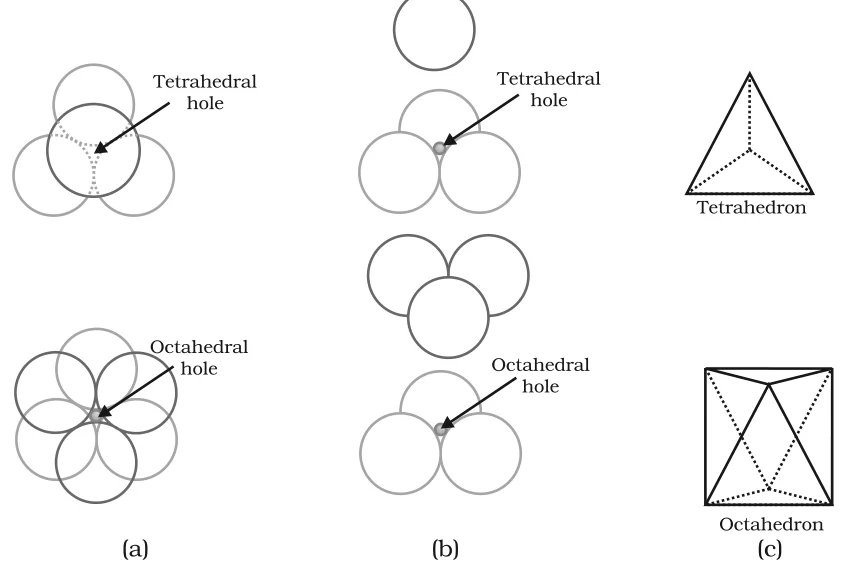
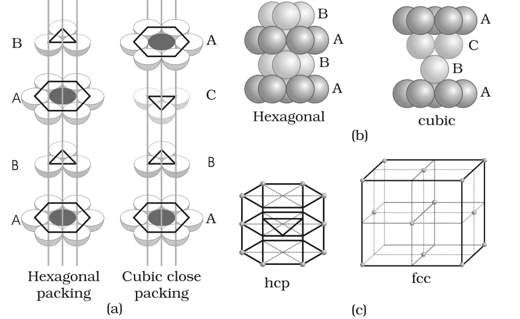

# [{ align=left, width=3.8% }](../../index.md)  Solid State | Close Packed Structures and Voids

In solids, the constituent particles are close-packed, leaving the minimum vacant space. To understand this, we treat the particles as identical hard spheres and build the structure in three steps: one dimension, two dimensions and three dimensions.

## Coordination Number

The number of nearest neighbours of a particle is called its **coordination number**.

## Close Packing in One Dimension

* There is only one way to arrange spheres in one dimension: in a row, each touching the next.
* Each sphere touches two neighbours. So the coordination number is **2**.

## Close Packing in Two Dimensions

A two dimensional layer is made by placing rows of close-packed spheres next to each other. This can be done in two ways.

### 1. Square Close Packing (AAA type)

* The second row is placed exactly above the first row, so the spheres are aligned both horizontally and vertically.
* If the first row is called 'A', the second row is also 'A', giving an **AAA** arrangement.
* Each sphere touches four neighbours, so the two dimensional coordination number is **4**.
* Joining the centres of these four neighbours gives a square. Hence this is called **square close packing**.

### 2. Hexagonal Close Packing (ABAB type)

* The second row is placed in a staggered manner so that its spheres fit into the depressions of the first row. The second row is called 'B'.
* The third row lines up with the first ('A'), the fourth with the second ('B'), giving an **ABAB** arrangement.
* Each sphere touches six neighbours, so the two dimensional coordination number is **6**. The centres of these six spheres lie at the corners of a regular hexagon. Hence this is called **two dimensional hexagonal close packing**.
* This packing has less free space and is more efficient than square close packing.
* The layer has triangular voids. In one row the apex of the triangles points upwards and in the next row downwards.

## Close Packing in Three Dimensions

Three dimensional structures are made by stacking two dimensional layers one above the other.

### 1. From Square Close-Packed Layers

* The second layer is placed exactly above the first, so the spheres of all layers are aligned horizontally and vertically.
* This gives an **AAA...** pattern. The lattice formed is a **simple cubic lattice** and its unit cell is the primitive cubic unit cell.

### 2. From Hexagonal Close-Packed Layers

#### (a) Placing the second layer over the first

* A hexagonal close-packed layer 'A' is taken and a similar layer 'B' is placed over it so that the spheres of layer B sit in the depressions of layer A.
* Not all triangular voids of the first layer are covered by the second layer. This creates two types of voids:
    * **Tetrahedral void:** Wherever a sphere of the second layer is directly above a void of the first layer (or vice versa), a void surrounded by four spheres is formed. Joining the centres of these four spheres gives a tetrahedron.
    * **Octahedral void:** Wherever a triangular void of the second layer lies above a triangular void of the first layer with the triangles pointing in opposite directions (not overlapping), a void surrounded by six spheres is formed. Joining the centres of these six spheres gives an octahedron.

{loading=lazy}

* If the number of close-packed spheres is N:

!!! tip ""

    $$Number\ of\ octahedral\ voids = N$$

    $$Number\ of\ tetrahedral\ voids = 2N$$

#### (b) Placing the third layer over the second

There are two possibilities:

**(i) Covering tetrahedral voids - hcp structure**

* The spheres of the third layer are placed over the tetrahedral voids of the second layer. They are then exactly above the spheres of the first layer.
* The pattern repeats in alternate layers: **ABAB...**
* This is called the **hexagonal close-packed (hcp)** structure. Examples: Magnesium, zinc.

**(ii) Covering octahedral voids - ccp structure**

* The spheres of the third layer are placed over the octahedral voids of the second layer. They are then aligned with neither the first nor the second layer, so this layer is called 'C'.
* Only the fourth layer lines up with the first. The pattern is **ABCABC...**
* This is called the **cubic close-packed (ccp)** or **face-centred cubic (fcc)** structure. Examples: Copper, silver.

{loading=lazy}

!!! tip "Conclusion"

    * Both hcp and ccp are highly efficient: **74%** of the space in the crystal is filled.
    * In both structures, each sphere is in contact with twelve spheres. So the coordination number is **12**.

| Arrangement | Pattern | Coordination number |
| --- | --- | --- |
| One dimension | Single row | 2 |
| Square close packing (2D) | AAA | 4 |
| Hexagonal close packing (2D) | ABAB | 6 |
| Simple cubic (3D) | AAA | 6 |
| hcp (3D) | ABAB | 12 |
| ccp or fcc (3D) | ABCABC | 12 |

## Formula of a Compound and Number of Voids Filled

* In ionic solids, the bigger ions (usually anions) form the close-packed structure and the smaller ions (usually cations) occupy the voids.
* If the cation is small enough, it occupies tetrahedral voids. If it is bigger, it occupies octahedral voids.
* Not all voids are filled. The fraction of tetrahedral or octahedral voids occupied depends on the chemical formula of the compound.

!!! question "A compound is formed by two elements X and Y. Atoms of Y (as anions) make ccp and those of X (as cations) occupy all the octahedral voids. What is the formula of the compound?"

    * Let the number of Y atoms in ccp = N.
    * Number of octahedral voids = N.
    * All octahedral voids are occupied by X, so number of X atoms = N.

    $$X : Y = N : N = 1 : 1$$

    Hence, the formula of the compound is XY.

!!! question "Atoms of element B form hcp lattice and those of element A occupy 2/3rd of tetrahedral voids. What is the formula of the compound formed by A and B?"

    * Let the number of B atoms = N.
    * Number of tetrahedral voids = 2N.

    $$Number\ of\ A\ atoms = {2 \over 3} \times 2N = {4N \over 3}$$

    $$A : B = {4N \over 3} : N = 4 : 3$$

    Hence, the formula of the compound is A4B3.

## Locating Voids in a ccp (fcc) Unit Cell

### 1. Tetrahedral Voids

* Divide the fcc unit cell into eight small cubes.
* Each small cube has atoms at alternate corners, i.e. 4 atoms. Joining them gives a regular tetrahedron, so there is one tetrahedral void in each small cube.
* So there are **8 tetrahedral voids** per unit cell. Since a ccp unit cell has 4 atoms, the number of tetrahedral voids is twice the number of atoms.

### 2. Octahedral Voids

* The **body-centre** of the cube is not occupied, but it is surrounded by six atoms at the face-centres. Joining these gives an octahedron. So there is one octahedral void at the body-centre.
* There is also an octahedral void at the centre of each of the **12 edges**. Each edge is shared between four unit cells, so only 1/4 of each such void belongs to one unit cell.

!!! tip ""

    $$Octahedral\ void\ at\ body\ centre = 1$$

    $$Octahedral\ voids\ at\ edge\ centres = 12 \times {1 \over 4} = 3$$

    $$&Therefore;\ Total\ octahedral\ voids = 4$$

* So the number of octahedral voids per ccp unit cell (4) equals the number of atoms (4).

!!! tip "Conclusion"

    For a ccp (fcc) unit cell with 4 atoms: tetrahedral voids = 8 and octahedral voids = 4.
