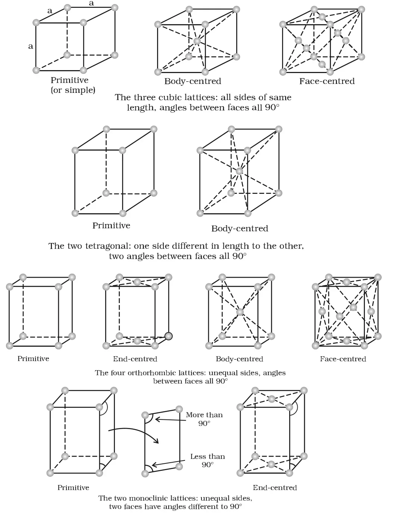
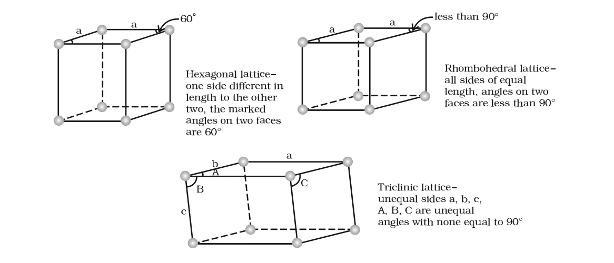
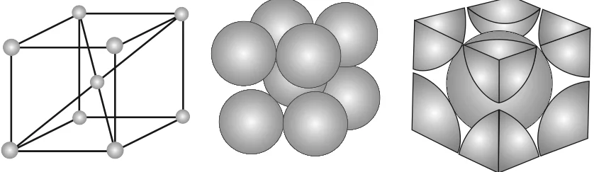
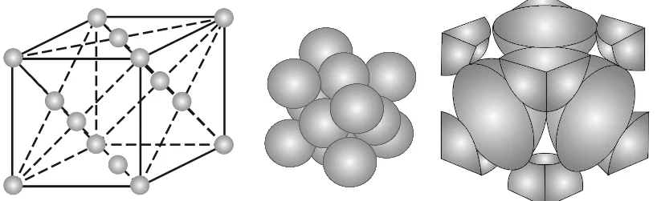

# [{ align=left, width=3.8% }](../../index.md)  Solid State | Crystal Lattices and Unit Cells

The main characteristic of a crystalline solid is a regular and repeating pattern of its constituent particles. If each particle is shown as a point, the resulting regular three dimensional arrangement of points in space is called a **crystal lattice**.

## Crystal Lattice

* Each point in a lattice is called a **lattice point** or **lattice site**.
* Each lattice point represents one constituent particle, which may be an atom, a molecule (group of atoms) or an ion.
* Lattice points are joined by straight lines to bring out the geometry of the lattice.
* There are only **14** possible three dimensional lattices. These are called **Bravais lattices**, after the French mathematician who first described them.

## Unit Cell

A unit cell is the smallest portion of a crystal lattice which, when repeated in different directions, generates the entire lattice.

A unit cell is characterised by six parameters:

* Its three edge lengths: **a**, **b** and **c**. These edges may or may not be mutually perpendicular.
* The three angles between the edges:
    * **&alpha;** - angle between edges b and c
    * **&beta;** - angle between edges a and c
    * **&gamma;** - angle between edges a and b

!!! tip ""

    $$Unit\ cell\ parameters:\ a,\ b,\ c,\ \alpha,\ \beta,\ \gamma$$

## Primitive and Centred Unit Cells

### 1. Primitive Unit Cell

When constituent particles are present only at the corner positions of a unit cell, it is called a **primitive** (or simple) unit cell.

### 2. Centred Unit Cells

When a unit cell has one or more particles at positions other than the corners, in addition to those at the corners, it is called a **centred unit cell**. These are of three types:

* **Body-centred unit cell:** One particle at the body-centre, besides the ones at the corners.
* **Face-centred unit cell:** One particle at the centre of each face, besides the ones at the corners.
* **End-centred unit cell:** One particle at the centre of any two opposite faces, besides the ones at the corners.

## Seven Crystal Systems

* There are seven types of primitive unit cells, called the **seven crystal systems**.
* Some of these systems can also form centred unit cells. Counting all possible primitive and centred variations gives the 14 Bravais lattices.

| Crystal system | Possible variations | Edge lengths | Axial angles | Examples |
| --- | --- | --- | --- | --- |
| Cubic | Primitive, Body-centred, Face-centred | a = b = c | &alpha; = &beta; = &gamma; = 90&deg; | NaCl, Zinc blende, Cu |
| Tetragonal | Primitive, Body-centred | a = b &ne; c | &alpha; = &beta; = &gamma; = 90&deg; | White tin, SnO2, TiO2, CaSO4 |
| Orthorhombic | Primitive, Body-centred, Face-centred, End-centred | a &ne; b &ne; c | &alpha; = &beta; = &gamma; = 90&deg; | Rhombic sulphur, KNO3, BaSO4 |
| Hexagonal | Primitive | a = b &ne; c | &alpha; = &beta; = 90&deg;, &gamma; = 120&deg; | Graphite, ZnO, CdS |
| Rhombohedral or Trigonal | Primitive | a = b = c | &alpha; = &beta; = &gamma; &ne; 90&deg; | Calcite (CaCO3), HgS (cinnabar) |
| Monoclinic | Primitive, End-centred | a &ne; b &ne; c | &alpha; = &gamma; = 90&deg;, &beta; &ne; 90&deg; | Monoclinic sulphur, Na2SO4.10H2O |
| Triclinic | Primitive | a &ne; b &ne; c | &alpha; &ne; &beta; &ne; &gamma; &ne; 90&deg; | K2Cr2O7, CuSO4.5H2O, H3BO3 |

!!! tip "Number of Bravais lattices in each system"

    Cubic (3) + Tetragonal (2) + Orthorhombic (4) + Monoclinic (2) + Hexagonal (1) + Rhombohedral (1) + Triclinic (1) = 14

### Unit Cells of the 14 Bravais Lattices

{loading=lazy}

{loading=lazy}

## Number of Atoms in a Unit Cell

* A crystal lattice is made of a very large number of unit cells, and every lattice point is occupied by one particle.
* A particle at a corner, face or edge is **shared** between neighbouring unit cells. So only a fraction of it belongs to one unit cell.

| Position of atom | Shared between | Contribution to one unit cell |
| --- | --- | --- |
| Corner | 8 unit cells | 1/8 |
| Face-centre | 2 unit cells | 1/2 |
| Edge-centre | 4 unit cells | 1/4 |
| Body-centre | 1 unit cell (not shared) | 1 |

### 1. Primitive (Simple) Cubic Unit Cell

* Atoms are present only at the 8 corners. Each corner atom is shared between 8 unit cells.

!!! tip ""

    $$Number\ of\ atoms = 8 \times {1 \over 8} = 1\ atom$$

### 2. Body-Centred Cubic (bcc) Unit Cell

* Atoms are present at the 8 corners and one atom at the body-centre. The body-centre atom wholly belongs to the unit cell.

{loading=lazy}

!!! tip ""

    $$8\ corners \times {1 \over 8} = 1\ atom$$

    $$1\ body\ centre\ atom = 1 \times 1 = 1\ atom$$

    $$&Therefore;\ Total\ atoms\ per\ unit\ cell = 2$$

### 3. Face-Centred Cubic (fcc) Unit Cell

* Atoms are present at the 8 corners and at the centre of all 6 faces. Each face-centre atom is shared between two adjacent unit cells.

{loading=lazy}

!!! tip ""

    $$8\ corners \times {1 \over 8} = 1\ atom$$

    $$6\ face\ centres \times {1 \over 2} = 3\ atoms$$

    $$&Therefore;\ Total\ atoms\ per\ unit\ cell = 4$$

!!! tip "Conclusion"

    | Unit cell | Atoms per unit cell (z) |
    | --- | --- |
    | Simple cubic | 1 |
    | Body-centred cubic | 2 |
    | Face-centred cubic | 4 |
