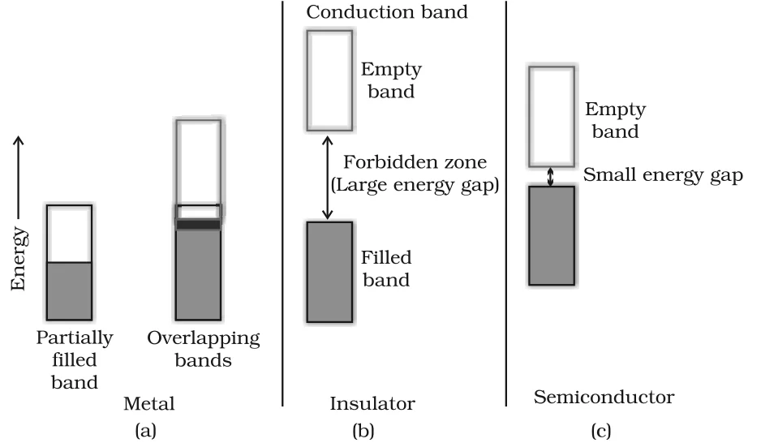
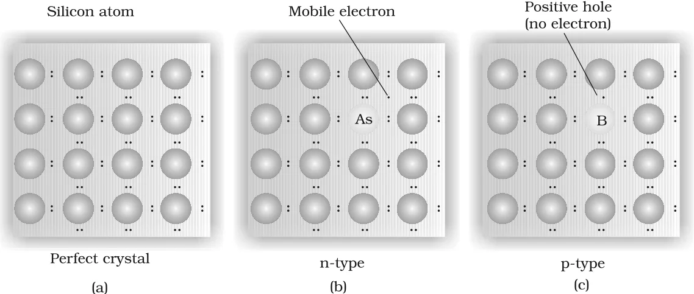

# [{ align=left, width=3.8% }](../../index.md)  Solid State | Electrical and Magnetic Properties

Solids show an amazing range of electrical conductivities, extending over 27 orders of magnitude, from 10-20 to 107 ohm-1 m-1. Their magnetic behaviour also varies widely. Both properties can be explained from their structure and electronic configuration.

## Electrical Properties

On the basis of conductivity, solids are classified into three types:

| Type | Conductivity range (ohm-1 m-1) | Examples |
| --- | --- | --- |
| Conductors | 104 to 107 | Metals (about 107) |
| Semiconductors | 10-6 to 104 | Silicon, germanium |
| Insulators | 10-20 to 10-10 | Glass, rubber |

* A conductor may conduct electricity by movement of **electrons** (metallic conductors) or **ions** (electrolytes).

## Band Theory

* In a metal, the atomic orbitals of metal atoms form molecular orbitals that are so close in energy that they form a **band**.
* The filled band of valence electrons is called the **valence band**. The next higher, unoccupied band is called the **conduction band**.
* The energy gap between them is called the **forbidden zone** or **band gap**.

{loading=lazy}

### 1. Conduction of Electricity in Metals

* Metals conduct electricity in solid as well as molten state.
* Conductivity depends on the number of valence electrons available per atom.
* If the band is **partially filled**, or it **overlaps** with a higher unoccupied conduction band, electrons can flow easily under an applied electric field. So the metal conducts.

### 2. Insulators

* The gap between the filled valence band and the conduction band is **large**.
* Electrons cannot jump to the conduction band, so the substance has very small conductivity.

### 3. Conduction of Electricity in Semiconductors

* The gap between the valence band and conduction band is **small**, so some electrons can jump to the conduction band and show some conductivity.
* Conductivity of semiconductors **increases with rise in temperature**, since more electrons can jump to the conduction band. (In metals, conductivity decreases with temperature.)
* Pure substances like silicon and germanium that behave this way are called **intrinsic semiconductors**.

## Doping

* The conductivity of intrinsic semiconductors is too low to be of practical use.
* It is increased by adding an appropriate amount of a suitable impurity. This process is called **doping**.
* The impurity can be electron-rich or electron-deficient compared to silicon or germanium. Such impurities introduce **electronic defects**.

{loading=lazy}

### 1. n-type Semiconductors (Electron-rich impurities)

* Silicon and germanium belong to group 14 and have four valence electrons. In their crystals each atom forms four covalent bonds with its neighbours.
* When doped with a **group 15** element like P or As (five valence electrons), the impurity atom occupies some lattice sites.
* Four of its five electrons form four covalent bonds with neighbouring silicon atoms. The **fifth electron is extra** and becomes delocalised.
* These delocalised electrons increase the conductivity. Since the conductivity is due to **negatively** charged electrons, this is called an **n-type** semiconductor.

### 2. p-type Semiconductors (Electron-deficit impurities)

* When silicon or germanium is doped with a **group 13** element like B, Al or Ga (three valence electrons), the place where the fourth electron is missing is called an **electron hole** or **electron vacancy**.
* An electron from a neighbouring atom can fill the hole, but it leaves a new hole at its original position. So it looks as if the hole is moving in the direction opposite to the electron.
* Under an electric field, electrons move towards the positive plate through the holes, but it appears as if **positively** charged holes are moving towards the negative plate. This is called a **p-type** semiconductor.

| Property | n-type | p-type |
| --- | --- | --- |
| Dopant | Group 15 (P, As) | Group 13 (B, Al, Ga) |
| Nature of impurity | Electron-rich | Electron-deficient |
| Charge carriers | Extra electrons | Holes |

### Applications of n-type and p-type Semiconductors

* **Diode:** A combination of n-type and p-type semiconductors, used as a rectifier.
* **Transistors:** Made by sandwiching a layer of one type of semiconductor between two layers of the other type. npn and pnp transistors are used to detect or amplify radio or audio signals.
* **Solar cell:** An efficient photo-diode used to convert light energy into electrical energy.

### 13-15 and 12-16 Compounds

* Combinations of groups 13 and 15, or 12 and 16, are prepared to simulate the average valence of four as in Ge or Si.
* **13-15 compounds:** InSb, AlP, GaAs. Gallium arsenide (GaAs) semiconductors have very fast response and have revolutionised the design of semiconductor devices.
* **12-16 compounds:** ZnS, CdS, CdSe, HgTe.
* In these compounds, the bonds are not perfectly covalent. Their ionic character depends on the electronegativities of the two elements.

### Electrical Properties of Transition Metal Oxides

* TiO, CrO2 and ReO3 behave like metals. ReO3 is like metallic copper in its conductivity and appearance.
* VO, VO2, VO3 and TiO3 show metallic or insulating properties depending on temperature.

## Magnetic Properties

* Every substance has some magnetic property, which originates from its electrons. Each electron behaves like a tiny magnet.
* The magnetic moment of an electron comes from two types of motion:
    * its **orbital motion** around the nucleus
    * its **spin** around its own axis
* A moving charge acts like a small loop of current, which has a magnetic moment. So each electron has a permanent spin and an orbital magnetic moment.
* This magnetic moment is very small and is measured in **Bohr magneton**, &mu;B.

!!! tip ""

    $$1\ \mu_B = 9.27 \times 10^{-24}\ A\ m^2$$

On the basis of magnetic properties, substances are classified into five categories:

### 1. Paramagnetism

* Paramagnetic substances are **weakly attracted** by a magnetic field and are magnetised in the same direction as the field.
* They lose their magnetism when the field is removed.
* Paramagnetism is due to the presence of one or more **unpaired electrons**, which are attracted by the magnetic field.
* Examples: O2, Cu2+, Fe3+, Cr3+.

### 2. Diamagnetism

* Diamagnetic substances are **weakly repelled** by a magnetic field and are weakly magnetised in the opposite direction.
* They have all electrons **paired**. Pairing cancels their magnetic moments.
* Examples: H2O, NaCl, C6H6.

### 3. Ferromagnetism

* Substances like iron, cobalt, nickel, gadolinium and CrO2 are **very strongly attracted** by a magnetic field. They can also be **permanently magnetised**.
* In the solid state, the metal ions are grouped together into small regions called **domains**. Each domain acts as a tiny magnet.
* In an unmagnetised piece, the domains are randomly oriented and their moments cancel.
* In a magnetic field, all domains orient in the direction of the field and a strong magnetic effect is produced. This ordering persists even after the field is removed, so the substance becomes a permanent magnet.

### 4. Antiferromagnetism

* Substances like MnO have a domain structure similar to ferromagnetic substances, but their domains are **oppositely oriented** and cancel each other's magnetic moment.
* So the net magnetic moment is zero.

### 5. Ferrimagnetism

* The magnetic moments of the domains are aligned in parallel and anti-parallel directions in **unequal numbers**, so there is a net magnetic moment.
* They are weakly attracted by a magnetic field compared to ferromagnetic substances.
* Examples: Fe3O4 (magnetite) and ferrites like MgFe2O4 and ZnFe2O4.
* They lose ferrimagnetism on heating and become paramagnetic.

!!! tip "Alignment of magnetic moments in domains"

    $$Ferromagnetic:\ \uparrow\ \uparrow\ \uparrow\ \uparrow\ \uparrow\ \uparrow$$

    $$Antiferromagnetic:\ \uparrow\ \downarrow\ \uparrow\ \downarrow\ \uparrow\ \downarrow$$

    $$Ferrimagnetic:\ \uparrow\ \uparrow\ \downarrow\ \uparrow\ \uparrow\ \downarrow$$

| Type | Behaviour in magnetic field | Reason | Examples |
| --- | --- | --- | --- |
| Paramagnetic | Weakly attracted | Unpaired electrons | O2, Cu2+, Fe3+, Cr3+ |
| Diamagnetic | Weakly repelled | All electrons paired | H2O, NaCl, C6H6 |
| Ferromagnetic | Strongly attracted, permanently magnetised | All domains aligned in same direction | Fe, Co, Ni, Gd, CrO2 |
| Antiferromagnetic | Net moment zero | Equal domains aligned opposite | MnO |
| Ferrimagnetic | Weakly attracted (compared to ferromagnetic) | Unequal parallel and anti-parallel domains | Fe3O4, MgFe2O4, ZnFe2O4 |
