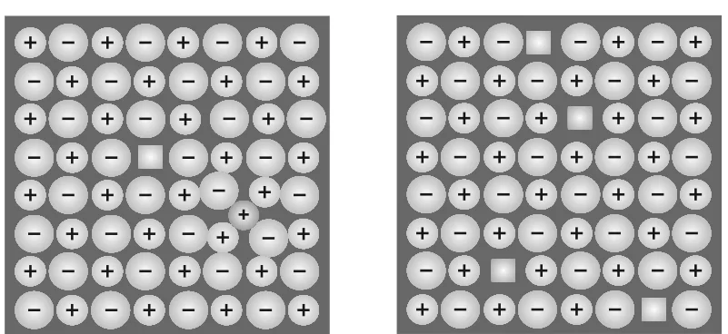

# [{ align=left, width=3.8% }](../../index.md)  Solid State | Imperfections in Solids

Although crystalline solids have both short range and long range order, real crystals are never perfect. Irregularities in the arrangement of constituent particles are called **crystal defects** or **imperfections**.

* A solid usually consists of a large number of small crystals, which have defects in them. This happens when crystallisation takes place at a fast or moderate rate.
* Single crystals are formed when crystallisation is extremely slow. Even these are not free of defects.

## Types of Defects

* **Point defects:** Irregularities or deviations from ideal arrangement around a point or an atom in a crystal.
* **Line defects:** Irregularities or deviations from ideal arrangement in entire rows of lattice points.

Here we discuss only point defects. Point defects are of three types:

1. Stoichiometric defects
2. Impurity defects
3. Non-stoichiometric defects

## 1. Stoichiometric Defects

* These point defects do not disturb the stoichiometry (ratio of constituent particles) of the solid.
* They are also called **intrinsic** or **thermodynamic defects**.

### (a) Vacancy Defect

* When some of the lattice sites are vacant, the crystal is said to have a **vacancy defect**.
* It **decreases the density** of the substance, since some mass is missing from the same volume.
* This defect can also develop when a substance is heated.

### (b) Interstitial Defect

* When some constituent particles (atoms or molecules) occupy an **interstitial site** (a position between the normal lattice sites), the crystal is said to have an **interstitial defect**.
* It **increases the density** of the substance.

!!! note "Note"

    Simple vacancy and interstitial defects are shown by non-ionic solids. Ionic solids must always remain electrically neutral, so they show these defects as **Frenkel** and **Schottky** defects.

### (c) Frenkel Defect

* The smaller ion (usually the cation) is dislocated from its normal site to an interstitial site.
* It creates a vacancy defect at the original site and an interstitial defect at the new site. So it is also called a **dislocation defect**.
* It **does not change the density** of the solid, since no ion leaves the crystal.
* Shown by ionic substances with a large difference in the size of ions. Examples: ZnS, AgCl, AgBr and AgI (due to the small size of Zn2+ and Ag+ ions).

### (d) Schottky Defect

* It is basically a vacancy defect in ionic solids. To keep the crystal electrically neutral, the number of missing cations and anions is equal.
* Like a simple vacancy defect, it **decreases the density** of the substance.
* The number of such defects is significant. In NaCl there are about 106 Schottky pairs per cm3 at room temperature. Since 1 cm3 has about 1022 ions, there is one Schottky defect per 1016 ions.
* Shown by ionic substances in which cation and anion are of almost similar sizes. Examples: NaCl, KCl, CsCl and AgBr.

{loading=lazy}

!!! note "Note"

    AgBr shows both Frenkel and Schottky defects.

| Property | Frenkel defect | Schottky defect |
| --- | --- | --- |
| What happens | Smaller ion moves to an interstitial site | Equal number of cations and anions are missing |
| Effect on density | No change | Decreases |
| Shown by | Ions of very different sizes | Ions of almost similar sizes |
| Examples | ZnS, AgCl, AgBr, AgI | NaCl, KCl, CsCl, AgBr |

## 2. Impurity Defects

* These arise when foreign ions are present in a crystal.
* If molten NaCl containing a little SrCl2 is crystallised, some Na+ sites are occupied by Sr2+ ions.
* Each Sr2+ replaces **two** Na+ ions to keep the crystal neutral. It occupies the site of one ion and the other site remains vacant.
* So the number of cationic vacancies produced equals the number of Sr2+ ions.
* Another similar example is the solid solution of CdCl2 in AgCl.

!!! tip ""

    $$One\ Sr^{2+}\ ion\ replaces\ two\ Na^+\ ions\ &rarr;\ one\ cation\ vacancy$$

## 3. Non-Stoichiometric Defects

* Many inorganic solids contain their constituent elements in a non-stoichiometric ratio because of defects in their crystal structures.
* These defects are of two types: metal excess defect and metal deficiency defect.

### (a) Metal Excess Defect

#### (i) Due to anionic vacancies

* Shown by alkali halides like NaCl and KCl.
* When NaCl crystals are heated in an atmosphere of sodium vapour, sodium atoms are deposited on the surface. Cl- ions diffuse to the surface and combine with Na atoms to give NaCl.
* For this, sodium atoms lose electrons to form Na+ ions. The released electrons diffuse into the crystal and occupy the anionic sites left vacant.

!!! tip ""

    $$Na &rarr; Na^+ + e^-$$

    $$Na^+ + Cl^- &rarr; NaCl$$

* The crystal now has an excess of sodium.
* The anionic sites occupied by unpaired electrons are called **F-centres** (from the German word *Farbenzenter* for colour centre).
* F-centres give colour to the crystal. The colour is due to excitation of these electrons when they absorb energy from visible light.

| Crystal heated with excess of | Colour |
| --- | --- |
| Sodium (NaCl) | Yellow |
| Lithium (LiCl) | Pink |
| Potassium (KCl) | Violet (or lilac) |

#### (ii) Due to extra cations at interstitial sites

* Zinc oxide is white at room temperature. On heating, it loses oxygen and turns yellow.

!!! tip ""

    $$ZnO \xrightarrow{heating} Zn^{2+} + {1 \over 2}O_2 + 2e^-$$

* Now there is excess zinc in the crystal and its formula becomes Zn1+xO.
* The excess Zn2+ ions move to interstitial sites and the electrons move to neighbouring interstitial sites.

### (b) Metal Deficiency Defect

* Some solids are difficult to prepare in the stoichiometric composition and contain less metal than the ideal ratio.
* A typical example is FeO, which is mostly found with the composition Fe0.95O. It may actually range from Fe0.93O to Fe0.96O.
* In FeO crystals, some Fe2+ cations are missing. The loss of positive charge is made up by the presence of the required number of Fe3+ ions.

!!! tip ""

    $$3\ Fe^{2+}\ ions\ are\ replaced\ by\ 2\ Fe^{3+}\ ions + 1\ cation\ vacancy$$
