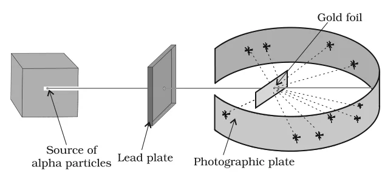

# [{ align=left, width=3.8% }](../../index.md)  Structure of Atom | Atomic Models

Atomic models were proposed to explain how the positively and negatively charged particles are distributed inside an atom. Many of these models could not explain the stability of the atom. Two important models were given by J.J. Thomson and Ernest Rutherford.

## Thomson Model of Atom

* J.J. Thomson (1898) proposed that an atom is a sphere (radius about 10-10 m) in which the positive charge is uniformly distributed.
* The electrons are embedded in this positive sphere in such a way that the most stable electrostatic arrangement is obtained.
* The model is also called the **plum pudding**, **raisin pudding** or **watermelon** model. The atom is like a pudding or watermelon of positive charge, with plums or seeds (electrons) embedded in it.
* An important feature of this model is that the **mass of the atom is assumed to be uniformly distributed** over the whole atom.
* The model could explain the overall neutrality of the atom, but it was not consistent with later experiments (Rutherford's scattering experiment).

## Rutherford's Nuclear Model of Atom

### α-Particle Scattering Experiment

* Rutherford and his students (Hans Geiger and Ernest Marsden) bombarded a very thin gold foil (thickness about 100 nm) with a stream of high energy α-particles from a radioactive source.
* A circular fluorescent zinc sulphide screen was placed around the foil. Whenever an α-particle struck the screen, a tiny flash of light was produced at that point.

{loading=lazy}

* According to the Thomson model, the mass of each gold atom is spread evenly. So all α-particles were expected to pass through, slowing down and changing direction only by small angles.

### Observations

1. Most of the α-particles passed through the gold foil **undeflected**.
2. A small fraction of the α-particles was deflected by small angles.
3. A very few α-particles (about 1 in 20,000) **bounced back**, i.e. were deflected by nearly 180°.

### Conclusions

1. **Most of the space in the atom is empty**, since most α-particles passed through undeflected.
2. The few deflections must be due to an enormous repulsive force. So the positive charge is not spread throughout the atom, but is **concentrated in a very small volume** which repels the positively charged α-particles.
3. The volume of the nucleus is negligible compared to the volume of the atom. The radius of the atom is about 10-10 m, while that of the nucleus is about 10-15 m. If a cricket ball were the nucleus, the atom would have a radius of about 5 km.

### Postulates of Rutherford's Nuclear Model

1. The positive charge and most of the mass of the atom is densely concentrated in an extremely small region called the **nucleus**.
2. The nucleus is surrounded by electrons that move around it with very high speed in circular paths called **orbits**. The model resembles the solar system, with the nucleus as the sun and the electrons as the planets.
3. Electrons and the nucleus are held together by electrostatic forces of attraction.

## Atomic Number and Mass Number

* The positive charge of the nucleus is due to protons. The number of protons in the nucleus is equal to the **atomic number (Z)**.
* An atom is electrically neutral, so the number of electrons in a neutral atom equals the number of protons.
* For example, hydrogen has 1 proton and sodium has 11 protons, so their atomic numbers are 1 and 11. They also have 1 and 11 electrons respectively.

!!! tip ""

    $$Atomic\ number\ (Z) = Number\ of\ protons\ in\ the\ nucleus$$

    $$Atomic\ number\ (Z) = Number\ of\ electrons\ in\ a\ neutral\ atom$$

* The mass of the nucleus is due to protons and neutrons. Protons and neutrons together are called **nucleons**.
* The total number of nucleons is called the **mass number (A)** of the atom.

!!! tip ""

    $$Mass\ number\ (A) = Number\ of\ protons\ (Z) + Number\ of\ neutrons\ (n)$$

    $$Number\ of\ neutrons = A - Z$$

## Isobars and Isotopes

* The composition of an atom is written using the element symbol X with the mass number A as a left superscript and the atomic number Z as a left subscript: $^A_ZX$.

### 1. Isobars

* Isobars are atoms with the **same mass number but different atomic number**.
* Example: $^{14}_6C$ and $^{14}_7N$.

### 2. Isotopes

* Isotopes are atoms with the **same atomic number but different mass number**. They differ only in the number of neutrons in the nucleus.
* Isotopes of hydrogen:

Isotope   | Symbol      | Protons | Neutrons | Abundance       |
----------|-------------|---------|----------|-----------------|
Protium   | $^1_1H$     | 1       | 0        | 99.985%         |
Deuterium | $^2_1D$     | 1       | 1        | 0.015%          |
Tritium   | $^3_1T$     | 1       | 2        | Trace amounts   |

* Other examples: carbon atoms with 6, 7 and 8 neutrons ($^{12}_6C$, $^{13}_6C$, $^{14}_6C$) and chlorine atoms with 18 and 20 neutrons ($^{35}_{17}Cl$, $^{37}_{17}Cl$).

!!! note "Note"

    Chemical properties of atoms are controlled by the number of electrons, which is decided by the number of protons. The number of neutrons has very little effect on chemical properties. Therefore, **all isotopes of an element show the same chemical behaviour**.

!!! tip "How to find protons, neutrons and electrons in a species $^A_ZX$"

    * Number of protons = Z and number of neutrons = A – Z, whether the species is neutral or an ion.

    * For a neutral atom, number of electrons = Z.

    * For a cation (positive ion), number of electrons is less than Z. For an anion (negative ion), number of electrons is more than Z.

## Drawbacks of Rutherford Model

### 1. Cannot explain stability of the atom

* The Coulomb force between the electron and the nucleus ($kq_1q_2/r^2$) is mathematically similar to the gravitational force between the sun and planets ($Gm_1m_2/r^2$). So the electrons were expected to move in well defined orbits like planets.
* However, a body moving in an orbit is always accelerating, because its direction keeps changing.
* According to Maxwell's electromagnetic theory, an **accelerated charged particle emits electromagnetic radiation**. (Planets are uncharged, so this does not apply to them.)
* So an orbiting electron should continuously lose energy, its orbit should keep shrinking and it should spiral into the nucleus in only about 10-8 s. This does not happen.
* If the electrons were stationary instead, they would be pulled into the nucleus by electrostatic attraction, forming a miniature Thomson model.

### 2. Says nothing about electronic structure

* The model does not tell how the electrons are distributed around the nucleus or what their energies are.

## Questions

!!! question "Calculate the number of protons, neutrons and electrons in $^{80}_{35}Br$."

    $$Z = 35,\ A = 80,\ species\ is\ neutral$$

    $$Number\ of\ protons = Number\ of\ electrons = Z = 35$$

    $$Number\ of\ neutrons = A - Z = 80 - 35 = 45$$

!!! question "The number of electrons, protons and neutrons in a species are equal to 18, 16 and 16 respectively. Assign the proper symbol to the species."

    * Atomic number = number of protons = 16. So the element is sulphur (S).

    $$Mass\ number = protons + neutrons = 16 + 16 = 32$$

    * The species is not neutral as protons are not equal to electrons. It has 18 – 16 = 2 extra electrons, so it is an anion with charge –2.

    $$Symbol:\ ^{32}_{16}S^{2-}$$

!!! question "How many neutrons and protons are there in the following nuclei?  $^{13}_6C$, $^{16}_8O$, $^{24}_{12}Mg$"

    Nucleus      | Protons (Z) | Neutrons (A – Z) |
    -------------|-------------|------------------|
    $^{13}_6C$   | 6           | 7                |
    $^{16}_8O$   | 8           | 8                |
    $^{24}_{12}Mg$ | 12        | 12               |

!!! question "An element with mass number 81 contains 31.7% more neutrons as compared to protons. Assign the atomic symbol."

    $$Let\ protons = x,\ then\ neutrons = x + 0.317x = 1.317x$$

    $$x + 1.317x = 81$$

    $$x = {81 \over 2.317} = 34.96 &asymp; 35$$

    * Atomic number 35 corresponds to bromine. Neutrons = 81 – 35 = 46.

    $$Symbol:\ ^{81}_{35}Br$$
