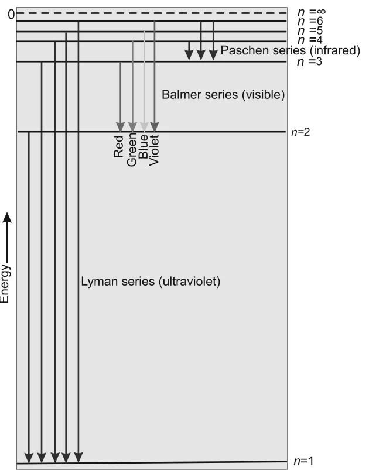

# [{ align=left, width=3.8% }](../../index.md)  Structure of Atom | Bohr's Model and Hydrogen Spectrum

## Atomic Spectra

* When white light passes through a prism, waves of shorter wavelength bend more than waves of longer wavelength. So the light spreads into a series of coloured bands called a **spectrum**. Red light (longest wavelength) is deviated least and violet light (shortest wavelength) is deviated most.
* In the spectrum of white light, violet merges into blue, blue into green and so on, from 7.50 × 1014 Hz (violet) to 4 × 1014 Hz (red). Such a spectrum is called a **continuous spectrum**. A rainbow is an example.
* When atoms absorb energy, they move to a higher energy (excited) state, which is unstable. On returning to a lower energy state, they emit radiation.

### 1. Emission Spectrum

* The spectrum of radiation emitted by a substance that has absorbed energy is called an **emission spectrum**.
* Energy is supplied by heating or irradiating the sample and the wavelengths of emitted radiation are recorded.

### 2. Absorption Spectrum

* A continuum of radiation is passed through a sample. The wavelengths absorbed by the sample are missing and appear as dark spaces in the bright continuous spectrum.
* An absorption spectrum is like a photographic negative of an emission spectrum.
* The study of emission or absorption spectra is called **spectroscopy**.

### 3. Line Spectrum

* Atoms in the gas phase do not give a continuous spread of wavelengths. They emit light only at **specific wavelengths** with dark spaces in between. Such spectra are called **line spectra** or **atomic spectra**.
* Every element has a unique line emission spectrum, so line spectra are used like fingerprints to identify unknown atoms.
* Elements like rubidium (Rb), caesium (Cs), thallium (Tl), indium (In), gallium (Ga) and scandium (Sc) were discovered through spectroscopy. Helium was discovered in the sun by the same method.

## Line Spectrum of Hydrogen

* When an electric discharge is passed through hydrogen gas, H2 molecules dissociate and the excited hydrogen atoms emit radiation of discrete frequencies. The lines form several series named after their discoverers.
* Balmer (1885) found that the visible lines obey:

!!! tip ""

    $$\bar{\nu} = 109,677 \left({1 \over 2^2} - {1 \over n^2}\right) cm^{-1},\ where\ n = 3, 4, 5, ...$$

* These lines are called the **Balmer series**. They are the only lines of hydrogen in the visible region.
* Rydberg showed that **all** series of hydrogen can be described by:

!!! tip ""

    $$\bar{\nu} = 109,677 \left({1 \over n_1^2} - {1 \over n_2^2}\right) cm^{-1}$$

    Where, n1 = 1, 2, 3, ... and n2 = n1 + 1, n1 + 2, ...

* The value 109,677 cm-1 is called the **Rydberg constant** for hydrogen.

Series   | n1 | n2 | Spectral Region |
---------|---------------|---------------|-----------------|
Lyman    | 1             | 2, 3, ...     | Ultraviolet     |
Balmer   | 2             | 3, 4, ...     | Visible         |
Paschen  | 3             | 4, 5, ...     | Infrared        |
Brackett | 4             | 5, 6, ...     | Infrared        |
Pfund    | 5             | 6, 7, ...     | Infrared        |

{loading=lazy}

* Two features are common to all line spectra: (i) the line spectrum of each element is unique and (ii) there is regularity in the line spectrum of each element. These features are explained by the electronic structure of the atom.

## Bohr's Model for Hydrogen Atom

Niels Bohr (1913) was the first to explain quantitatively the structure and spectrum of the hydrogen atom. His model is based on the following postulates:

* **Postulate 1:** The electron in the hydrogen atom moves around the nucleus in a circular path of fixed radius and energy. These paths are called **orbits**, **stationary states** or **allowed energy states**. They are arranged concentrically around the nucleus.
* **Postulate 2:** The energy of an electron in an orbit does not change with time. The electron moves to a higher stationary state when it absorbs the required energy, and moves to a lower one when it emits energy. The energy change is not continuous.
* **Postulate 3:** The frequency of radiation absorbed or emitted in a transition between two stationary states differing in energy by ΔE is given by **Bohr's frequency rule**:

!!! tip ""

    $$&nu; = {&Delta;E \over h} = {E_2 - E_1 \over h}$$

    Where, E1 and E2 are the energies of the lower and higher energy states.

* **Postulate 4:** The angular momentum of an electron in a stationary state is quantized. It is an integral multiple of h/2π:

!!! tip ""

    $$m_evr = n{h \over 2&pi;},\ where\ n = 1, 2, 3, ...$$

!!! note "Angular Momentum"

    Angular momentum = I × ω, where I = mer2 is the moment of inertia and ω = v/r is the angular velocity. So angular momentum = mer2 × v/r = mevr.

### Results of Bohr's Theory

#### (a) Principal quantum number

* The stationary states are numbered n = 1, 2, 3, ... These integers are called **principal quantum numbers**.

#### (b) Radius of orbits

!!! tip ""

    $$r_n = n^2a_0,\ where\ a_0 = 52.9\ pm$$

* The radius of the first orbit (n = 1), 52.9 pm, is called the **Bohr radius**. As n increases, r increases, so the electron is farther from the nucleus.

#### (c) Energy of orbits

!!! tip ""

    $$E_n = -R_H\left({1 \over n^2}\right),\ where\ R_H = 2.18 \times 10^{-18}\ J$$

    $$E_1 = -2.18 \times 10^{-18}\ J,\ \ E_2 = -0.545 \times 10^{-18}\ J$$

* RH is called the Rydberg constant (in energy units). The lowest energy state (n = 1) is called the **ground state**.

!!! note "Why is the energy negative?"

    * A free electron at rest, infinitely far from the nucleus (n = ∞), is assigned zero energy. Such an atom is called an **ionized hydrogen atom**.

    * When the electron is attracted by the nucleus and present in orbit n, energy is released and its energy becomes lower than zero, i.e. negative.

    * As n decreases, En becomes larger in magnitude and more negative. The most negative value (n = 1) corresponds to the most stable orbit.

#### (d) Hydrogen like species

* Bohr's theory also applies to ions with only one electron, like He+, Li2+, Be3+. These are called **hydrogen like species**.

!!! tip ""

    $$E_n = -2.18 \times 10^{-18}\left({Z^2 \over n^2}\right) J$$

    $$r_n = {52.9\ (n^2) \over Z}\ pm$$

    Where, Z is the atomic number (2 for He, 3 for Li).

* As Z increases, energy becomes more negative and radius becomes smaller, so the electron is more tightly bound to the nucleus.

#### (e) Velocity of electron

* The velocity of the electron increases with increase in positive charge on the nucleus and decreases with increase in principal quantum number.

## Explanation of Line Spectrum of Hydrogen

* Radiation is **absorbed** when the electron moves from an orbit of smaller n to one of higher n, and **emitted** when it moves from a higher orbit to a lower one.

!!! tip ""

    $$&Delta;E = E_f - E_i$$

    $$&Delta;E = \left(-{R_H \over n_f^2}\right) - \left(-{R_H \over n_i^2}\right)$$

    $$&Delta;E = R_H\left({1 \over n_i^2} - {1 \over n_f^2}\right) = 2.18 \times 10^{-18}\left({1 \over n_i^2} - {1 \over n_f^2}\right) J$$

    Where, ni and nf are the initial and final orbits.

* The frequency and wavenumber of the photon are:

!!! tip ""

    $$&nu; = {&Delta;E \over h} = {2.18 \times 10^{-18} \over 6.626 \times 10^{-34}}\left({1 \over n_i^2} - {1 \over n_f^2}\right)$$

    $$&nu; = 3.29 \times 10^{15}\left({1 \over n_i^2} - {1 \over n_f^2}\right) Hz$$

    $$\bar{\nu} = {&nu; \over c} = {3.29 \times 10^{15} \over 3 \times 10^8}\left({1 \over n_i^2} - {1 \over n_f^2}\right)$$

    $$\bar{\nu} = 1.09677 \times 10^7\left({1 \over n_i^2} - {1 \over n_f^2}\right) m^{-1}$$

* In absorption, nf > ni, ΔE is positive and energy is absorbed. In emission, ni > nf, ΔE is negative and energy is released.
* This expression is the same as the empirical Rydberg formula. Each spectral line corresponds to a particular transition. With a large number of atoms, many transitions occur together, giving many lines. The brightness of a line depends on the number of photons of that wavelength.

!!! tip "Maximum number of spectral lines"

    When an electron falls from orbit n to the ground state, the maximum number of lines emitted is:

    $$Number\ of\ lines = {n(n-1) \over 2}$$

## Limitations of Bohr's Model

1. It cannot explain the finer details (doublets, i.e. two closely spaced lines) of the hydrogen spectrum seen with sophisticated spectroscopic techniques.
2. It cannot explain the spectrum of atoms other than hydrogen, even helium which has only two electrons.
3. It cannot explain the splitting of spectral lines in a magnetic field (**Zeeman effect**) or an electric field (**Stark effect**).
4. It cannot explain the ability of atoms to form molecules by chemical bonds.

## Questions

!!! question "What are the frequency and wavelength of a photon emitted during a transition from n = 5 state to the n = 2 state in the hydrogen atom?"

    * Since ni = 5 and nf = 2, this is a line of the Balmer series in the visible region.

    $$&Delta;E = 2.18 \times 10^{-18}\left({1 \over 5^2} - {1 \over 2^2}\right) = -4.58 \times 10^{-19}\ J$$

    * The negative sign shows it is emission energy. Taking magnitude:

    $$&nu; = {&Delta;E \over h} = {4.58 \times 10^{-19} \over 6.626 \times 10^{-34}} = 6.91 \times 10^{14}\ Hz$$

    $$&lambda; = {c \over &nu;} = {3.0 \times 10^8 \over 6.91 \times 10^{14}} = 434\ nm$$

!!! question "Calculate the energy associated with the first orbit of He+. What is the radius of this orbit?"

    $$E_n = -{2.18 \times 10^{-18} \times Z^2 \over n^2}\ J\ atom^{-1}$$

    $$For\ He^+,\ n = 1,\ Z = 2$$

    $$E_1 = -{2.18 \times 10^{-18} \times 2^2 \over 1^2} = -8.72 \times 10^{-18}\ J$$

    $$r_n = {0.0529\ n^2 \over Z}\ nm = {0.0529 \times 1^2 \over 2} = 0.02645\ nm$$
