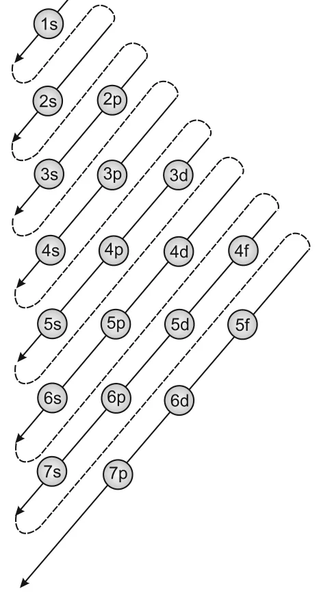

# [{ align=left, width=3.8% }](../../index.md)  Structure of Atom | Electronic Configuration

The filling of electrons into the orbitals of different atoms follows the **Aufbau principle**, which is based on **Pauli's exclusion principle**, **Hund's rule of maximum multiplicity** and the relative energies of the orbitals.

## Aufbau Principle

* 'Aufbau' is a German word meaning 'building up'. Here it means the filling up of orbitals with electrons.
* **In the ground state of an atom, the orbitals are filled in order of their increasing energies.** Electrons first occupy the lowest energy orbital available, and enter higher energy orbitals only after the lower ones are filled.
* The order of filling (based on the (n + l) rule) is:

!!! tip ""

    $$1s, 2s, 2p, 3s, 3p, 4s, 3d, 4p, 5s, 4d, 5p, 4f, 5d, 6p, 7s, ...$$

* This order can be remembered using the diagram below. Starting from the top, follow the arrows from right top to bottom left.

{loading=lazy}

## Pauli Exclusion Principle

* Given by the Austrian scientist Wolfgang Pauli (1926).
* **No two electrons in an atom can have the same set of four quantum numbers.**
* It can also be stated as: **Only two electrons may exist in the same orbital and these electrons must have opposite spin.**
* So two electrons in the same orbital have the same n, l and ml, but opposite ms.
* This principle fixes the capacity of each sub-shell: s can hold 2, p can hold 6, d can hold 10 and f can hold 14 electrons.

!!! tip ""

    $$Maximum\ electrons\ in\ a\ shell = 2n^2$$

    $$Maximum\ electrons\ in\ a\ sub\text{-}shell = 2(2l + 1)$$

## Hund's Rule of Maximum Multiplicity

* This rule deals with filling electrons into orbitals of the same sub-shell, i.e. orbitals of equal energy, called **degenerate orbitals**.
* **Pairing of electrons in the orbitals belonging to the same sub-shell (p, d or f) does not take place until each orbital of that sub-shell has got one electron each, i.e. it is singly occupied.**
* Since there are three p, five d and seven f orbitals, pairing starts with the entry of the 4th, 6th and 8th electron respectively.
* Half filled and completely filled degenerate sets of orbitals have extra stability.

## Writing Electronic Configurations

The electronic configuration can be represented in two ways:

### 1. sapbdc notation

* Each sub-shell is written with its letter, and the number of electrons is shown as a superscript. The principal quantum number is written before the sub-shell. Example: 1s22s22p3.

### 2. Orbital diagram

* Each orbital is shown as a box and each electron as an arrow: ↑ for positive spin and ↓ for negative spin. This shows all four quantum numbers.

### Elements Hydrogen to Neon

* Hydrogen has one electron in 1s: **1s1**. Helium: **1s2**, the two electrons having opposite spins.
* The third electron of lithium cannot go into 1s (Pauli exclusion principle), so it goes into 2s: **1s22s1**. Beryllium: **1s22s2**.
* In the next six elements, 2p orbitals are filled progressively, following Hund's rule:

Element | Z  | Configuration                                   | 2p orbital diagram |
--------|----|-------------------------------------------------|--------------------|
B       | 5  | 1s22s22p1      | ↑, –, –     |
C       | 6  | 1s22s22p2      | ↑, ↑, –      |
N       | 7  | 1s22s22p3      | ↑, ↑, ↑       |
O       | 8  | 1s22s22p4      | ↑↓, ↑, ↑      |
F       | 9  | 1s22s22p5      | ↑↓, ↑↓, ↑     |
Ne      | 10 | 1s22s22p6      | ↑↓, ↑↓, ↑↓    |

### Core and Valence Electrons

* From sodium (1s22s22p63s1) to argon (1s22s22p63s23p6), the 3s and 3p orbitals fill in the same pattern as Li to Ne.
* The first two shells can be written as [Ne]. So Na is [Ne]3s1 and Ar is [Ne]3s23p6.
* Electrons in completely filled shells are called **core electrons**. Electrons added to the outermost shell (highest n) are called **valence electrons**.

### Elements beyond Argon

* In potassium and calcium, 4s is lower in energy than 3d, so it is filled first: K is [Ar]4s1 and Ca is [Ar]4s2.
* From scandium (Sc) to zinc (Zn), the 3d orbitals are filled, since 3d is lower in energy than 4p.
* From gallium (Ga) to krypton (Kr), 4p is filled. Rubidium (Rb) to xenon (Xe) fill 5s, 4d and 5p in a similar way.
* Caesium (Cs) and barium (Ba) fill 6s. From lanthanum (La) to mercury (Hg), 4f and 5d are filled. Then 6p, 7s, and finally 5f and 6d are filled.
* Elements after uranium (U) are short-lived and are produced artificially.

## Stability of Completely Filled and Half Filled Sub-shells

* The ground state configuration of an atom always corresponds to the lowest total electronic energy.
* In some elements like Cr and Cu, the 4s and 3d sub-shells differ only slightly in energy. An electron shifts from 4s to 3d if this makes the 3d sub-shell exactly half filled or completely filled.
* Configurations like p3, p6, d5, d10, f7, f14 are more stable.

!!! example "Exceptional configurations"

    $$Cr\ (Z = 24):\ [Ar]3d^54s^1\ and\ not\ [Ar]3d^44s^2$$

    $$Cu\ (Z = 29):\ [Ar]3d^{10}4s^1\ and\ not\ [Ar]3d^94s^2$$

### Causes of Extra Stability

#### 1. Symmetrical distribution of electrons

* Symmetry leads to stability. Completely filled or half filled sub-shells have a symmetrical distribution of electrons.
* Electrons in the same sub-shell have equal energy but different spatial distribution. So they shield one another relatively little and are more strongly attracted by the nucleus.

#### 2. Exchange energy

* When two or more electrons with the same spin are present in degenerate orbitals, they tend to exchange their positions. The energy released by this exchange is called **exchange energy**.
* The number of possible exchanges is maximum when the sub-shell is half filled or completely filled. So exchange energy, and hence stability, is maximum.
* For a d5 configuration, electron 1 can make 4 exchanges, electron 2 can make 3, electron 3 can make 2 and electron 4 can make 1. Total = 10 exchanges.
* Exchange energy is the basis of Hund's rule: electrons entering degenerate orbitals keep parallel spins as far as possible.

!!! tip "Conclusion"

    The extra stability of half filled and completely filled sub-shells is due to: (i) relatively small shielding, (ii) smaller coulombic repulsion energy and (iii) larger exchange energy.

## Importance of Electronic Configuration

The electronic configuration explains many questions that Dalton's model could not, such as why atoms combine to form molecules, why some elements are metals and others non-metals, and why helium and argon are unreactive while halogens are reactive.

## Questions

!!! question "Write the electronic configurations of the following ions: (a) H– (b) Na+ (c) O2– (d) F–"

    $$(a)\ H^-\ (2\ electrons):\ 1s^2$$

    $$(b)\ Na^+\ (10\ electrons):\ 1s^22s^22p^6$$

    $$(c)\ O^{2-}\ (10\ electrons):\ 1s^22s^22p^6$$

    $$(d)\ F^-\ (10\ electrons):\ 1s^22s^22p^6$$

!!! question "Which atoms are indicated by the following configurations?  (a) [He]2s1 (b) [Ne]3s23p3 (c) [Ar]4s23d1"

    * (a) 2 + 1 = 3 electrons: Lithium (Li)

    * (b) 10 + 5 = 15 electrons: Phosphorus (P)

    * (c) 18 + 3 = 21 electrons: Scandium (Sc)

!!! question "An atom of an element contains 29 electrons and 35 neutrons. Deduce (i) the number of protons and (ii) the electronic configuration of the element."

    * For a neutral atom, number of protons = number of electrons = 29. The element is copper (Cu).

    * Due to the extra stability of a completely filled 3d sub-shell:

    $$Cu:\ 1s^22s^22p^63s^23p^63d^{10}4s^1$$

!!! question "Indicate the number of unpaired electrons in: (a) P (b) Si (c) Cr (d) Fe (e) Kr"

    Element | Configuration                          | Unpaired electrons |
    --------|----------------------------------------|--------------------|
    P       | [Ne]3s23p3       | 3                  |
    Si      | [Ne]3s23p2       | 2                  |
    Cr      | [Ar]3d54s1       | 6                  |
    Fe      | [Ar]3d64s2       | 4                  |
    Kr      | [Ar]3d104s24p6 | 0         |
