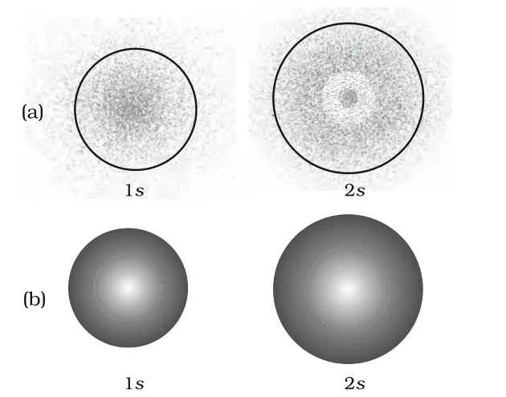
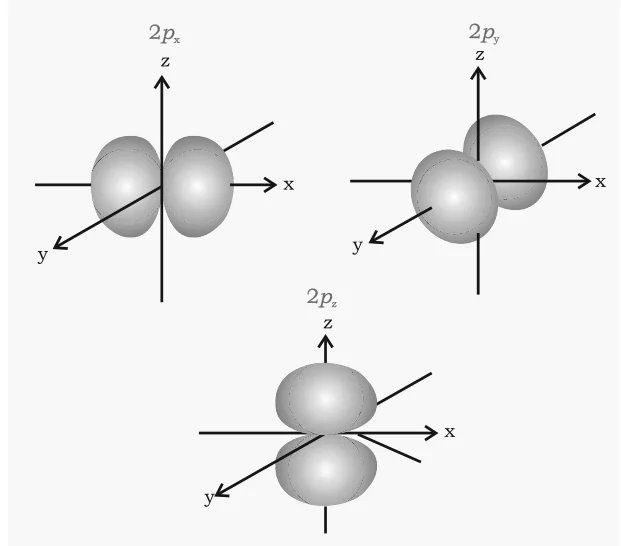
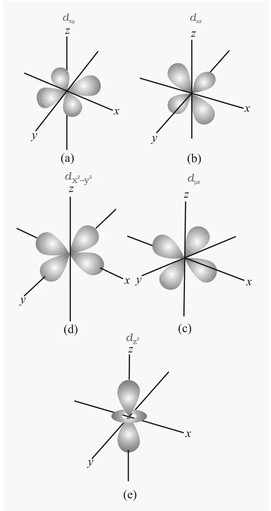
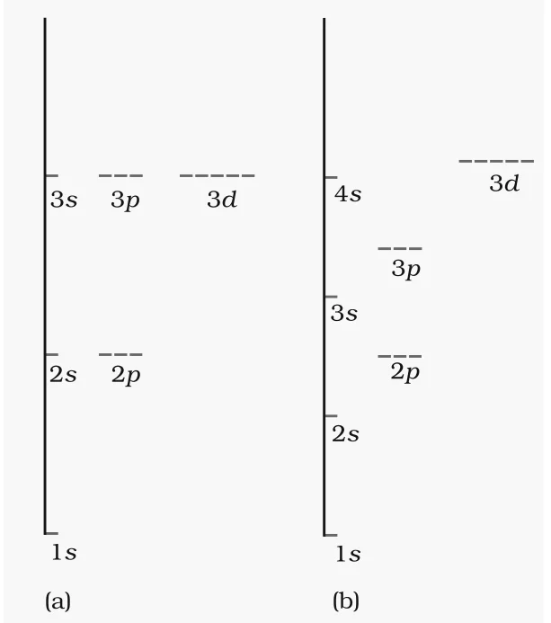

# [{ align=left, width=3.8% }](../../index.md)  Structure of Atom | Quantum Mechanical Model of Atom

* Classical mechanics (based on Newton's laws) describes macroscopic objects like a falling stone or orbiting planets very well. It fails for microscopic objects like electrons, atoms and molecules because it ignores dual behaviour of matter and the uncertainty principle.
* **Quantum mechanics** is a theoretical science that deals with the study of the motions of microscopic objects that have both observable wave like and particle like properties.
* When quantum mechanics is applied to macroscopic objects (where wave properties are insignificant), it gives the same results as classical mechanics.
* Quantum mechanics was developed independently in 1926 by Werner Heisenberg and Erwin Schrödinger.

## Schrödinger Equation

* The fundamental equation of quantum mechanics, developed by Schrödinger, incorporates the wave-particle duality of matter. For a system whose energy does not change with time, it is written as:

!!! tip ""

    $$\hat{H}&psi; = E&psi;$$

    Where, $\hat{H}$ is a mathematical operator called the Hamiltonian, E is the total energy and ψ is the wave function.

* The Hamiltonian is built from the total energy of the system: kinetic energies of all particles (electrons and nuclei), attraction between electrons and nuclei, and repulsion among electrons and among nuclei.
* Solving this equation gives E and ψ.

### Hydrogen Atom and the Schrödinger Equation

* For the hydrogen atom, the solution gives the allowed energy levels and the corresponding wave functions (ψ) of the electron.
* These quantized energy states are characterised by three quantum numbers: **principal quantum number n**, **azimuthal quantum number l** and **magnetic quantum number ml**. They arise naturally from the solution.
* The wave function is a mathematical function of the electron's coordinates and has no physical meaning by itself.
* Wave functions of hydrogen or hydrogen like species (one electron systems) are called **atomic orbitals**.
* The probability of finding an electron at a point is proportional to |ψ|2 at that point.
* For multi-electron atoms, the Schrödinger equation cannot be solved exactly, but approximate methods show that their orbitals are similar to hydrogen orbitals, only somewhat contracted due to higher nuclear charge. Unlike hydrogen, their orbital energies depend on both n and l.

## Important Features of the Quantum Mechanical Model

1. The energy of electrons in atoms is **quantized**, i.e. it can only have certain specific values.
2. Quantized energy levels are a direct result of the wave like properties of electrons and are allowed solutions of the Schrödinger equation.
3. The exact position and exact velocity of an electron cannot be found simultaneously. So the path of an electron can never be known, and we only talk of the **probability** of finding the electron at different points.
4. **An atomic orbital is the wave function ψ for an electron in an atom.** An orbital cannot contain more than two electrons. In a multi-electron atom, electrons fill orbitals in order of increasing energy. All information about the electron is stored in its orbital wave function.
5. The probability of finding an electron at a point is proportional to |ψ|2, which is called the **probability density** and is always positive. From |ψ|2 at different points, we can predict the region where the electron will most probably be found.

!!! note "Orbit vs Orbital"

    Orbit                                                         | Orbital                                                                     |
    --------------------------------------------------------------|-----------------------------------------------------------------------------|
    A circular path around the nucleus in which electron moves (Bohr). | A quantum mechanical concept: the one electron wave function ψ in an atom. |
    Its exact description is impossible due to uncertainty principle, so it has no real meaning. | Characterised by three quantum numbers n, l and ml.           |
    Cannot be demonstrated experimentally.                        | ψ has no physical meaning, but ψ2 gives the probability density, which has physical meaning. |

## Quantum Numbers

Orbitals are distinguished by their size, shape and orientation. These are described by quantum numbers. Each orbital is designated by three quantum numbers n, l and ml.

### 1. Principal Quantum Number (n)

* It is a positive integer: n = 1, 2, 3, ...
* It determines the **size and, to a large extent, the energy** of the orbital. For hydrogen and hydrogen like species, energy and size depend only on n.
* It identifies the **shell**. The number of orbitals in a shell is n2.

n     | 1 | 2 | 3 | 4 |
------|---|---|---|---|
Shell | K | L | M | N |

* As n increases, the electron is located farther from the nucleus and its energy increases.

### 2. Azimuthal Quantum Number (l)

* It is also called the **orbital angular momentum** or **subsidiary quantum number**. It defines the **three dimensional shape** of the orbital.
* For a given n, l can have n values: l = 0, 1, 2, ..., (n – 1).
* Each shell contains one or more **sub-shells** (sub-levels). The number of sub-shells in a shell equals n.

Value of l          | 0 | 1 | 2 | 3 | 4 | 5  |
--------------------|---|---|---|---|---|----|
Sub-shell notation  | s | p | d | f | g | h  |
Number of orbitals  | 1 | 3 | 5 | 7 | 9 | 11 |

n | l | Sub-shell |
--|---|-----------|
1 | 0 | 1s        |
2 | 0, 1 | 2s, 2p |
3 | 0, 1, 2 | 3s, 3p, 3d |
4 | 0, 1, 2, 3 | 4s, 4p, 4d, 4f |

### 3. Magnetic Quantum Number (ml)

* It gives the **spatial orientation of the orbital** with respect to a standard set of coordinate axes.
* For a given l, there are (2l + 1) values of ml:

!!! tip ""

    $$m_l = -l, -(l-1), ..., 0, ..., (l-1), +l$$

* For l = 0, ml = 0 (one s orbital). For l = 1, ml = –1, 0, +1 (three p orbitals). For l = 2, ml = –2, –1, 0, +1, +2 (five d orbitals).
* Values of l are derived from n, and values of ml are derived from l. For example, n = 2, l = 1, ml = 0 is an orbital in the p sub-shell of the second shell.

### 4. Electron Spin Quantum Number (ms)

* The three quantum numbers above could not explain why some lines in spectra of multi-electron atoms appear as doublets or triplets. This suggested more energy levels.
* George Uhlenbeck and Samuel Goudsmit (1925) proposed a fourth quantum number, the **electron spin quantum number (ms)**.
* An electron spins around its own axis, like the earth. Its spin angular momentum can have two orientations relative to a chosen axis, given by ms = +½ (spin up, ↑) or –½ (spin down, ↓).
* An orbital cannot hold more than two electrons, and the two must have opposite spins.

!!! tip "Summary of quantum numbers"

    * **n** defines the shell and determines the size and, to a large extent, the energy of the orbital.

    * **l** identifies the sub-shell and determines the shape of the orbital. There are n sub-shells in the nth shell. To some extent l also determines energy in multi-electron atoms.

    * **ml** designates the orientation of the orbital. There are (2l + 1) orbitals in a sub-shell.

    * **ms** refers to the orientation of the spin of the electron.

## Shapes of Atomic Orbitals

* According to Max Born, ψ2 at a point gives the probability density of the electron at that point.
* For a 1s orbital, the probability density is maximum at the nucleus and decreases sharply away from it.
* For a 2s orbital, the probability density first decreases sharply to zero, then increases to a small maximum, and then approaches zero again.

### Nodes

* The region where the probability density reduces to zero is called a **nodal surface** or simply a **node**.

!!! tip ""

    $$Radial\ nodes = n - l - 1$$

    $$Angular\ nodes = l$$

    $$Total\ nodes = n - 1$$

* An ns orbital has (n – 1) radial nodes: one for 2s, two for 3s and so on.

### Boundary Surface Diagrams

* In **charge cloud diagrams**, the density of dots in a region represents the electron probability density there.
* A **boundary surface diagram** is a surface of constant probability density that encloses the region where the probability of finding the electron is very high (about 90%).
* We cannot draw a boundary enclosing 100% probability, because |ψ|2 has some value, however small, at any finite distance from the nucleus.

{loading=lazy}

### 1. s-Orbitals

* All s orbitals are **spherically symmetric**: the probability of finding the electron at a given distance is the same in all directions.
* Size of s orbitals increases with n: 4s > 3s > 2s > 1s.

### 2. p-Orbitals

* Each p orbital consists of **two lobes** on either side of a plane passing through the nucleus. The probability density is zero on this plane.
* For l = 1 there are three values of ml, so there are three p orbitals with mutually perpendicular axes: **px, py and pz**. Their size, shape and energy are identical; they differ only in orientation.
* There is no simple relation between the values of ml (–1, 0, +1) and the x, y, z directions.
* p orbitals increase in size and energy with n: 4p > 3p > 2p.
* Number of radial nodes = n – 2: one for 3p, two for 4p.

{loading=lazy}

### 3. d-Orbitals

* For l = 2, the orbital is a d orbital. The minimum value of n is 3, since l cannot be greater than n – 1.
* There are five ml values (–2, –1, 0, +1, +2), so there are five d orbitals: **dxy, dyz, dxz, dx2–y2 and dz2**.
* The first four have similar shapes (four lobes). dz2 is different, but all five 3d orbitals have equal energy.
* 4d, 5d, ... orbitals have similar shapes to 3d but differ in size and energy.

{loading=lazy}

### Angular Nodes (Nodal Planes)

* Besides radial nodes, p and d orbitals have zero probability density on planes passing through the nucleus. These are **angular nodes**.
* For pz, the xy-plane is a nodal plane. For dxy, there are two nodal planes passing through the origin and bisecting the xy plane containing the z-axis.
* Number of angular nodes = l: one for p orbitals, two for d orbitals.

## Energies of Orbitals

### 1. Hydrogen Atom

* The energy of an electron in a hydrogen atom depends **only on n**:

!!! tip ""

    $$1s < 2s = 2p < 3s = 3p = 3d < 4s = 4p = 4d = 4f < ...$$

* Orbitals having the same energy are called **degenerate**. The 1s orbital is the most stable, called the **ground state**. An electron in 2s, 2p or higher orbitals is in an **excited state**.

### 2. Multi-electron Atoms

* The energy depends on **both n and l**. For a given n, s, p, d, f have different energies.
* The reason is the mutual repulsion among electrons. In hydrogen there is only attraction between the electron and the nucleus.
* Inner shell electrons partially screen the outer electrons from the nucleus. This is called **shielding of outer shell electrons by inner shell electrons**. The net positive charge felt by an electron is called the **effective nuclear charge (Zeffe)**.
* Being spherical, an s orbital shields more effectively than p, and p more than d. Also, an s electron spends more time near the nucleus than p, and p more than d.
* So for a given n, Zeff decreases with increase in l. **The s orbital is more tightly bound than p, and p more than d.** Energies follow s < p < d < f within a shell.

{loading=lazy}

!!! tip "(n + l) Rule"

    * **The lower the value of (n + l) for an orbital, the lower is its energy.**

    * **If two orbitals have the same (n + l), the one with lower n has lower energy.**

Orbital | n | l | n + l | Comment                    |
--------|---|---|-------|----------------------------|
1s      | 1 | 0 | 1     |                            |
2s      | 2 | 0 | 2     |                            |
2p      | 2 | 1 | 3     | 2p (n = 2) is lower than 3s |
3s      | 3 | 0 | 3     |                            |
3p      | 3 | 1 | 4     | 3p (n = 3) is lower than 4s |
4s      | 4 | 0 | 4     |                            |
3d      | 3 | 2 | 5     | 3d (n = 3) is lower than 4p |
4p      | 4 | 1 | 5     |                            |

* Energies of orbitals in the same sub-shell decrease with increase in atomic number (Zeff). For example: E2s(H) > E2s(Li) > E2s(Na) > E2s(K).

## Questions

!!! question "What is the total number of orbitals associated with the principal quantum number n = 3?"

    * For n = 3, l = 0, 1 and 2.

    * One 3s orbital (l = 0, ml = 0), three 3p orbitals (l = 1, ml = –1, 0, +1) and five 3d orbitals (l = 2, ml = –2, –1, 0, +1, +2).

    $$Total\ orbitals = 1 + 3 + 5 = 9$$

    The same result is obtained from n2 = 32 = 9.

!!! question "Using s, p, d, f notations, describe the orbital with the following quantum numbers:  (a) n = 2, l = 1 (b) n = 4, l = 0 (c) n = 5, l = 3 (d) n = 3, l = 2"

    Option | n | l | Orbital |
    -------|---|---|---------|
    (a)    | 2 | 1 | 2p      |
    (b)    | 4 | 0 | 4s      |
    (c)    | 5 | 3 | 5f      |
    (d)    | 3 | 2 | 3d      |
