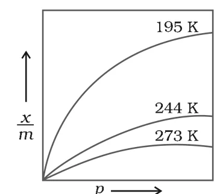
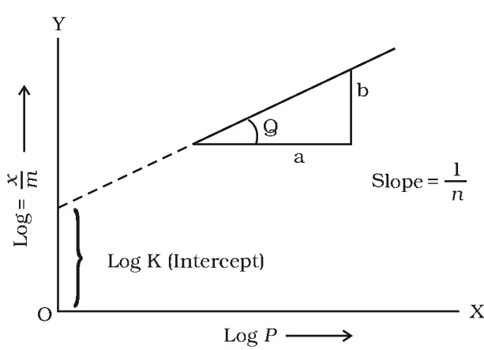

# [{ align=left, width=3.8% }](../../index.md)  Surface Chemistry | Adsorption Isotherms

## Adsorption Isotherm

The variation in the amount of gas adsorbed by the adsorbent with pressure at constant temperature can be expressed by means of a curve termed as adsorption isotherm.

## Freundlich Adsorption Isotherm

* In 1909, Freundlich gave an empirical relationship between the quantity of gas adsorbed by unit mass of solid adsorbent and pressure, at a particular temperature:

!!! tip ""

    $$ {x \over m} = k.P^{1/n}\ \ (n > 1)$$

    Where, x = mass of gas adsorbed on mass m of the adsorbent at pressure P; k and n are constants which depend on the nature of the adsorbent and the gas at a particular temperature.

* The relationship is shown by plotting mass of gas adsorbed per gram of adsorbent (x/m) against pressure (P):

{loading=lazy}

* At a fixed pressure, x/m decreases with increase in temperature (195 K > 244 K > 273 K). This shows physisorption decreases with rise in temperature.
* The curves always approach saturation at high pressure.

### Linear form of Freundlich isotherm

* Taking logarithm of the Freundlich equation:

!!! tip ""

    $$log{x \over m} = log\ k + {1 \over n}log\ P$$

* This is the equation of a straight line (y = c + mx). If log(x/m) is plotted on the y-axis against log P on the x-axis and a straight line is obtained, the Freundlich isotherm is valid.

{loading=lazy}

!!! tip ""

    $$Slope = {1 \over n}$$

    $$Intercept\ on\ y\ axis = log\ k$$

### Limitations of Freundlich isotherm

* Freundlich isotherm explains adsorption only approximately.
* The factor 1/n can have values between 0 and 1 (probable range 0.1 to 0.5). So the equation holds good only over a limited range of pressure.

!!! tip ""

    $$When\ {1 \over n} = 0:\ {x \over m} = k\ (constant),\ adsorption\ is\ independent\ of\ pressure$$

    $$When\ {1 \over n} = 1:\ {x \over m} = kP,\ i.e.,\ {x \over m} &Proportional; P$$

* Both conditions are supported by experiment. However, the experimental isotherms always approach saturation at high pressure, which Freundlich isotherm cannot explain. Thus, it fails at high pressure.

## Adsorption from Solution Phase

Solids can adsorb solutes from solutions also.

!!! example "Examples"

    * When a solution of acetic acid in water is shaken with charcoal, part of the acid is adsorbed and its concentration in solution decreases.

    * Litmus solution shaken with charcoal becomes colourless.

    * The precipitate of Mg(OH)2 becomes blue when precipitated in the presence of magneson reagent, due to adsorption of magneson.

* Observations for adsorption from solution:
    * The extent of adsorption decreases with an increase in temperature.
    * The extent of adsorption increases with an increase of surface area of the adsorbent.
    * The extent of adsorption depends on the concentration of the solute in solution.
    * The extent of adsorption depends on the nature of the adsorbent and the adsorbate.
* The exact mechanism is not known. Freundlich's equation approximately describes it, with concentration in place of pressure:

!!! tip ""

    $$ {x \over m} = kC^{1/n}$$

    $$log{x \over m} = log\ k + {1 \over n}log\ C$$

    Where, C is the equilibrium concentration (when adsorption is complete).

* A plot of log(x/m) against log C gives a straight line. This can be checked by adding equal volumes of acetic acid solutions of different concentrations to equal amounts of charcoal in different flasks. The difference between the initial and final concentration in each flask gives x.

## Applications of Adsorption

### 1. Production of high vacuum

The remaining traces of air in a vessel evacuated by a vacuum pump can be adsorbed by charcoal to give a very high vacuum.

### 2. Gas masks

Gas masks contain activated charcoal (or a mixture of adsorbents) which adsorbs poisonous gases. They are used for breathing in coal mines.

### 3. Control of humidity

Silica gel and aluminium gel are used as adsorbents to remove moisture and control humidity.

### 4. Removal of colouring matter from solutions

Animal charcoal removes colours of solutions by adsorbing coloured impurities.

### 5. Heterogeneous catalysis

Adsorption of reactants on the solid catalyst surface increases the rate of reaction. Examples: manufacture of NH3 using iron, manufacture of H2SO4 by contact process, and hydrogenation of oils using finely divided nickel.

### 6. Separation of inert gases

Noble gases are adsorbed to different extents by coconut charcoal at different temperatures, so a mixture of noble gases can be separated.

### 7. In curing diseases

Many drugs kill germs by getting adsorbed on them.

### 8. Froth floatation process

A low grade sulphide ore is concentrated by separating it from silica and other earthy matter using pine oil and a frothing agent.

### 9. Adsorption indicators

Surfaces of precipitates like silver halides adsorb dyes such as eosin and fluorescein, giving a characteristic colour at the end point.

### 10. Chromatographic analysis

Chromatography is based on adsorption and has many applications in analytical and industrial fields.

## Questions

!!! question "What is an adsorption isotherm? Describe Freundlich adsorption isotherm."

    The variation in the amount of gas adsorbed by the adsorbent with pressure at constant temperature, expressed as a curve, is called an adsorption isotherm.

    Freundlich gave the empirical relation:

    $$ {x \over m} = kP^{1/n}\ \ (n > 1)$$

    Taking logarithm:

    $$log{x \over m} = log\ k + {1 \over n}log\ P$$

    A plot of log(x/m) vs log P is a straight line with slope 1/n and intercept log k. Since 1/n lies between 0 and 1, the isotherm holds only over a limited range of pressure and fails at high pressure, where adsorption reaches saturation.

!!! question "What are the factors which influence the adsorption of a gas on a solid?"

    * **Nature of the gas:** Easily liquefiable gases (high critical temperature) are adsorbed more in physisorption. In chemisorption, gases that can react with the adsorbent are adsorbed.
    * **Nature of the adsorbent:** Porous and finely divided solids like charcoal and silica gel adsorb more.
    * **Surface area of the adsorbent:** Greater the surface area, greater the adsorption.
    * **Pressure:** Adsorption increases with pressure (x/m = kP1/n) until saturation.
    * **Temperature:** Physisorption decreases with rise in temperature; chemisorption first increases and then decreases.

!!! question "Discuss the effect of pressure and temperature on the adsorption of gases on solids."

    * **Effect of pressure:** At constant temperature, x/m increases with pressure. At low pressure x/m is nearly proportional to P, at intermediate pressure x/m = kP1/n, and at high pressure x/m becomes independent of pressure (saturation).

    * **Effect of temperature:** Adsorption is exothermic. So by Le Chatelier's principle, physisorption decreases with rise in temperature. Chemisorption needs activation energy, so it first increases with temperature and then decreases at still higher temperature.

!!! question "Why are substances like platinum and palladium often used for carrying out electrolysis of aqueous solutions?"

    Platinum and palladium are chemically inert. They are not attacked by the electrolyte or by the products of electrolysis, so they act only as surfaces for electron transfer. They are also good adsorbents of gases like hydrogen and oxygen, which helps the electrode reactions occur easily on their surface.
