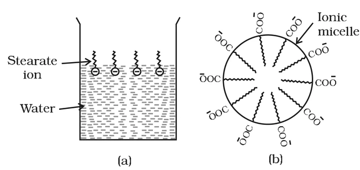

# [{ align=left, width=3.8% }](../../index.md)  Surface Chemistry | Colloids and their Classification

## Colloids

A colloid is a heterogeneous system in which one substance is dispersed (dispersed phase) as very fine particles in another substance called dispersion medium.

* Solutions are homogeneous, while a suspension (like sand stirred in water) slowly settles down. Colloids lie between these two extremes.
* The essential difference between a solution and a colloid is **particle size**.
* In a solution, the particles are ions or small molecules. In a colloid, the dispersed phase may be a single macromolecule (like a protein or synthetic polymer) or an aggregate of many atoms, ions or molecules.
* Colloidal particles are larger than simple molecules but small enough to remain suspended. Their diameter lies between 1 and 1000 nm (10-9 to 10-6 m).

Property      | True solution  | Colloid           | Suspension     |
--------------|----------------|-------------------|----------------|
Particle size | Less than 1 nm | 1 nm to 1000 nm   | More than 1000 nm |
Nature        | Homogeneous    | Heterogeneous     | Heterogeneous  |
Settling      | Does not settle | Does not settle (remains suspended) | Settles down with time |

### Large surface area of colloids

Colloidal particles have an enormous surface area per unit mass because of their small size.

!!! example "Example"

    A cube of 1 cm side has a total surface area of 6 cm2. If it is divided equally into 1012 cubes, each cube becomes the size of a large colloidal particle and the total surface area becomes 60,000 cm2 or 6 m2.

    $$Side\ of\ each\ small\ cube = {1\ cm \over 10^4} = 10^{-4}\ cm$$

    $$Total\ area = 10^{12} \times 6 \times (10^{-4})^2 = 6 \times 10^4\ cm^2$$

This huge surface area is the reason for many special properties of colloids.

## Classification of Colloids

Colloids are classified on the basis of:

* Physical state of dispersed phase and dispersion medium.
* Nature of interaction between dispersed phase and dispersion medium.
* Type of particles of the dispersed phase.

## 1. Classification Based on Physical State

* The dispersed phase and the dispersion medium can each be a solid, liquid or gas, so eight types of colloidal systems are possible.
* A gas mixed with another gas forms a homogeneous mixture, so it is not a colloid.

Dispersed phase | Dispersion medium | Type of colloid | Examples                              |
----------------|-------------------|-----------------|---------------------------------------|
Solid           | Solid             | Solid sol       | Some coloured glasses and gem stones  |
Solid           | Liquid            | Sol             | Paints, cell fluids                   |
Solid           | Gas               | Aerosol         | Smoke, dust                           |
Liquid          | Solid             | Gel             | Cheese, butter, jellies               |
Liquid          | Liquid            | Emulsion        | Milk, hair cream                      |
Liquid          | Gas               | Aerosol         | Fog, mist, cloud, insecticide sprays  |
Gas             | Solid             | Solid sol       | Pumice stone, foam rubber             |
Gas             | Liquid            | Foam            | Froth, whipped cream, soap lather     |

* The most common types are **sols** (solids in liquids), **gels** (liquids in solids) and **emulsions** (liquids in liquids).
* Many familiar things are colloids: whipped cream is a foam (gas in liquid), firefighting foams are colloids, and most biological fluids are aqueous sols. Inside a cell, proteins and nucleic acids are colloidal-sized particles dispersed in an aqueous solution of ions and small molecules.
* If the dispersion medium is water, the sol is called an **aquasol** or **hydrosol**. If the dispersion medium is alcohol, it is called an **alcosol**, and so on.

## 2. Classification Based on Nature of Interaction

Depending on the interaction between dispersed phase and dispersion medium, sols are lyophilic (solvent attracting) or lyophobic (solvent repelling). If water is the medium, the terms are hydrophilic and hydrophobic.

### (a) Lyophilic colloids

* 'Lyophilic' means liquid-loving.
* Sols formed directly by mixing substances like gum, gelatine, starch, rubber, etc. with a suitable liquid are lyophilic sols.
* If the dispersion medium is removed (say by evaporation), the sol can be formed again simply by remixing with the medium. So these are also called **reversible sols**.
* They are quite stable and cannot be easily coagulated.

### (b) Lyophobic colloids

* 'Lyophobic' means liquid-hating.
* Substances like metals and their sulphides do not form a colloid when simply mixed with the medium. Their sols are prepared only by special methods.
* They are readily precipitated (coagulated) by adding small amounts of electrolytes, by heating or by shaking. Hence, they are not stable.
* Once precipitated, they do not give back the sol by simply adding the dispersion medium. So these are also called **irreversible sols**.
* Lyophobic sols need stabilising agents for their preservation.

Lyophilic sols                         | Lyophobic sols                              |
---------------------------------------|---------------------------------------------|
Formed by direct mixing with medium    | Prepared only by special methods            |
Reversible                             | Irreversible                                |
Quite stable                           | Unstable; need stabilising agents           |
Not easily coagulated                  | Easily coagulated by small amounts of electrolyte |
Examples: gum, gelatine, starch, rubber | Examples: metals, metal sulphides          |

## 3. Classification Based on Type of Particles

### (a) Multimolecular colloids

* On dissolution, a large number of atoms or small molecules aggregate together to form species with size in the colloidal range. These are multimolecular colloids.
* Examples: A gold sol contains particles of various sizes having many atoms. A sulphur sol consists of particles containing a thousand or more S8 molecules.

### (b) Macromolecular colloids

* Macromolecules in suitable solvents form solutions in which the size of the macromolecules is in the colloidal range. These are macromolecular colloids.
* They are quite stable and resemble true solutions in many respects.
* Natural examples: starch, cellulose, proteins and enzymes. Man-made examples: polythene, nylon, polystyrene, synthetic rubber, etc.

### (c) Associated colloids (Micelles)

* Some substances behave as normal strong electrolytes at low concentration, but at higher concentration they form aggregates and show colloidal behaviour. These aggregated particles are called **micelles** or associated colloids.
* Micelles form only above a particular temperature called the **Kraft temperature (Tk)** and above a particular concentration called the **critical micelle concentration (CMC)**.
* On dilution, they revert back to individual ions.
* Surface active agents such as soaps and synthetic detergents belong to this class. For soaps, the CMC is 10-4 to 10-3 mol L-1.
* They have both lyophobic and lyophilic parts. A micelle may contain 100 or more molecules.

## Mechanism of Micelle Formation

* Soap is the sodium or potassium salt of a higher fatty acid, represented as RCOO-Na+. Example: sodium stearate, CH3(CH2)16COO-Na+.
* In water it dissociates into RCOO- and Na+ ions.
* The RCOO- ion has two parts:
    * A long hydrocarbon chain R, the non-polar **tail**, which is hydrophobic.
    * A polar group COO-, the polar-ionic **head**, which is hydrophilic.
* At low concentration, the RCOO- ions stay at the surface of water with the COO- head in water and the hydrocarbon tail pointing away from it (figure a).
* At the critical micelle concentration, the anions are pulled into the bulk and aggregate into a sphere, with the hydrocarbon chains pointing towards the centre and the COO- heads on the outer surface (figure b). This aggregate is called an **ionic micelle**. It may contain as many as 100 such ions.

{loading=lazy}

* Detergents like sodium laurylsulphate, CH3(CH2)11SO4-Na+, form micelles in the same way. Here the polar head is -SO4-.

## Cleansing Action of Soaps

* Soap molecules form a micelle around an oil (grease) droplet. The hydrophobic tails of the stearate ions dissolve in the oil droplet and the hydrophilic heads project outwards like bristles.
* Since the polar heads interact with water, the oil droplet surrounded by stearate ions is pulled into water and removed from the dirty surface.
* The negatively charged sheath around the globules prevents them from coming together and forming aggregates.
* Thus, soap helps in emulsification and washing away of oils and fats.

## Questions

!!! question "How are colloids classified on the basis of (i) physical states of components (ii) nature of dispersion medium and (iii) interaction between dispersed phase and dispersion medium?"

    * **(i) Physical states of components:** Eight types — solid sol, sol, aerosol (solid in gas), gel, emulsion, aerosol (liquid in gas), solid sol (gas in solid) and foam.
    * **(ii) Nature of dispersion medium:** If the medium is water, the sol is a hydrosol (aquasol); if alcohol, an alcosol; if benzene, a benzosol; if gas, an aerosol.
    * **(iii) Interaction between phases:** Lyophilic (solvent loving, e.g., starch, gelatine) and lyophobic (solvent hating, e.g., gold sol, As2S3 sol).

!!! question "What are lyophilic and lyophobic sols? Give one example of each type. Why are hydrophobic sols easily coagulated?"

    Lyophilic sols are formed directly by mixing substances like gum, gelatine or starch with a suitable liquid; they are reversible and stable. Example: starch sol.

    Lyophobic sols cannot be formed by direct mixing and are prepared by special methods; they are irreversible and unstable. Example: gold sol.

    Hydrophobic sols are stable only because of the charge on their particles; they are not protected by a layer of solvent (no solvation). When an electrolyte is added, the charge is neutralised easily, the particles come together and coagulate.

!!! question "What is the difference between multimolecular and macromolecular colloids? Give one example of each. How are associated colloids different from these two types of colloids?"

    * **Multimolecular colloids** are formed by aggregation of a large number of atoms or small molecules into particles of colloidal size. Example: sulphur sol (aggregates of S8 molecules).
    * **Macromolecular colloids** are formed by single large molecules (macromolecules) whose size itself is in the colloidal range. Example: starch, proteins.
    * **Associated colloids** behave as normal strong electrolytes at low concentration but form aggregates (micelles) at higher concentration, above the Kraft temperature and CMC. They revert to ions on dilution. Example: soap solution.

!!! question "What are micelles? Give an example of a micellar system."

    Micelles are aggregated particles formed by surface active agents (like soaps and detergents) in solution above the Kraft temperature and above the critical micelle concentration. Each micelle has a hydrophobic core of hydrocarbon chains and an outer surface of polar heads. Example: sodium stearate (soap) in water.

!!! question "Action of soap is due to emulsification and micelle formation. Comment."

    Soap anions (RCOO-) have a hydrophobic tail and a hydrophilic head. Around an oil or grease droplet, the tails dissolve in the oil and the heads face the water, forming a micelle. This pulls the oil droplet into water as an emulsion. The negative charge on the surface of such droplets keeps them apart, so they do not combine again and are washed away. Thus, the cleansing action of soap is due to emulsification and micelle formation.

!!! question "Explain the terms with suitable examples: (i) Alcosol (ii) Aerosol (iii) Hydrosol."

    * **(i) Alcosol:** A sol with alcohol as the dispersion medium. Example: sol of cellulose nitrate in ethyl alcohol (collodion).
    * **(ii) Aerosol:** A colloid with a gas as the dispersion medium. Example: smoke (solid in gas), fog (liquid in gas).
    * **(iii) Hydrosol:** A sol with water as the dispersion medium. Example: starch sol, gold sol.

!!! question "Comment on the statement that 'colloid is not a substance but a state of substance'."

    Whether a substance behaves as a colloid depends only on its particle size (1–1000 nm), not on its chemical nature. The same substance can form a true solution or a colloid under different conditions. For example, NaCl forms a true solution in water but a colloid in benzene, and soap behaves as an electrolyte at low concentration but forms micelles (colloid) at high concentration. Hence, colloid is a state of a substance rather than a separate kind of substance.
