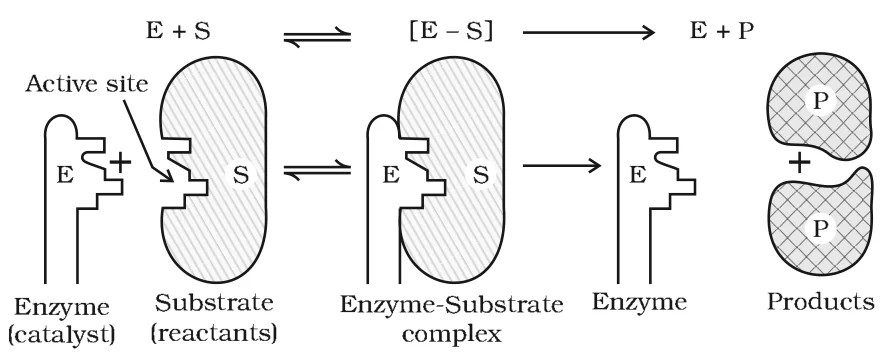

# [{ align=left, width=3.8% }](../../index.md)  Surface Chemistry | Enzyme Catalysis

## Enzymes

Enzymes are complex nitrogenous organic compounds produced by living plants and animals which act as very effective catalysts. They are termed biochemical catalysts and the phenomenon is known as biochemical catalysis.

* Enzymes are actually protein molecules of high molecular mass. They form colloidal solutions in water.
* Numerous reactions in the bodies of animals and plants that maintain the life process are catalysed by enzymes.
* Many enzymes have been obtained in pure crystalline state from living cells. The first enzyme was synthesised in the laboratory in 1969.

## Examples of Enzyme Catalysed Reactions

### 1. Inversion of cane sugar

The enzyme invertase converts cane sugar into glucose and fructose.

!!! tip ""

    $$C_{12}H_{22}O_{11(aq)}\ (cane\ sugar) + H_2O_{(l)} \xrightarrow{Invertase} C_6H_{12}O_{6(aq)}\ (glucose) + C_6H_{12}O_{6(aq)}\ (fructose)$$

### 2. Conversion of glucose into ethyl alcohol

The enzyme zymase converts glucose into ethyl alcohol and carbon dioxide.

!!! tip ""

    $$C_6H_{12}O_{6(aq)} \xrightarrow{Zymase} 2C_2H_5OH_{(aq)} + 2CO_{2(g)}$$

### 3. Conversion of starch into maltose

The enzyme diastase converts starch into maltose.

!!! tip ""

    $$2(C_6H_{10}O_5)_{n(aq)}\ (starch) + nH_2O_{(l)} \xrightarrow{Diastase} nC_{12}H_{22}O_{11(aq)}\ (maltose)$$

### 4. Conversion of maltose into glucose

The enzyme maltase converts maltose into glucose.

!!! tip ""

    $$C_{12}H_{22}O_{11(aq)} + H_2O_{(l)} \xrightarrow{Maltase} 2C_6H_{12}O_{6(aq)}$$

### 5. Decomposition of urea

The enzyme urease decomposes urea into ammonia and carbon dioxide.

!!! tip ""

    $$NH_2CONH_{2(aq)} + H_2O_{(l)} \xrightarrow{Urease} 2NH_{3(g)} + CO_{2(g)}$$

### 6. Digestion of proteins

In the stomach, pepsin converts proteins into peptides, while in the intestine, pancreatic trypsin converts proteins into amino acids by hydrolysis.

### 7. Conversion of milk into curd

It is an enzymatic reaction brought about by lacto bacilli enzyme present in curd.

### Summary of some enzymatic reactions

Enzyme    | Source   | Enzymatic reaction                       |
----------|----------|------------------------------------------|
Invertase | Yeast    | Sucrose &rarr; Glucose and fructose      |
Zymase    | Yeast    | Glucose &rarr; Ethyl alcohol and CO2 |
Diastase  | Malt     | Starch &rarr; Maltose                    |
Maltase   | Yeast    | Maltose &rarr; Glucose                   |
Urease    | Soyabean | Urea &rarr; Ammonia and CO2   |
Pepsin    | Stomach  | Proteins &rarr; Amino acids              |

## Characteristics of Enzyme Catalysis

### 1. Most highly efficient

One molecule of an enzyme may transform one million molecules of the reactant per minute.

### 2. Highly specific nature

Each enzyme is specific for a given reaction, i.e., one enzyme cannot catalyse more than one reaction. For example, urease catalyses the hydrolysis of urea only and not of any other amide.

### 3. Highly active under optimum temperature

* The rate of an enzyme reaction is maximum at a definite temperature, called the optimum temperature. On either side of it, enzyme activity decreases.
* The optimum temperature range for enzymatic activity is 298–310 K. Human body temperature (310 K) is suited for enzyme-catalysed reactions.

### 4. Highly active under optimum pH

The rate of an enzyme-catalysed reaction is maximum at a particular pH called the optimum pH, which is between pH 5–7.

### 5. Increasing activity in presence of activators and co-enzymes

* **Co-enzymes:** When a small non-protein (vitamin) is present along with an enzyme, its catalytic activity increases considerably.
* **Activators:** These are generally metal ions such as Na+, Mn2+, Co2+, Cu2+, etc. When weakly bonded to enzyme molecules, they increase catalytic activity. For example, amylase in presence of NaCl (Na+ ions) is catalytically very active.

### 6. Influence of inhibitors and poisons

Like ordinary catalysts, enzymes are inhibited or poisoned by certain substances. These interact with the active functional groups on the enzyme surface and reduce or completely destroy the catalytic activity. Many drugs work by acting as enzyme inhibitors in the body.

## Mechanism of Enzyme Catalysis

* The surface of colloidal enzyme particles has many cavities of characteristic shape. These contain active groups such as -NH2, -COOH, -SH, -OH, etc., which are the **active centres**.
* The reactant (substrate) molecules having a complementary shape fit into these cavities just like a key fits into a lock (lock and key model).
* Due to the active groups, an activated complex is formed, which then decomposes to give the products.

{loading=lazy}

* The reaction proceeds in two steps:

!!! tip ""

    $$Step\ 1\ (binding\ of\ enzyme\ to\ substrate):\ E + S &rarr; ES^{\ne}$$

    $$Step\ 2\ (decomposition\ of\ activated\ complex):\ ES^{\ne} &rarr; E + P$$

## Catalysts in Industry

Process | Catalyst and conditions |
--------|-------------------------|
Haber's process for manufacture of ammonia | Finely divided iron, molybdenum as promoter; 200 bar pressure and 723–773 K |
Ostwald's process for manufacture of nitric acid | Platinised asbestos; 573 K |
Contact process for manufacture of sulphuric acid | Platinised asbestos or vanadium pentoxide (V2O5); 673–723 K |

!!! tip "Haber's process"

    $$N_{2(g)} + 3H_{2(g)} &rarr; 2NH_{3(g)}$$

!!! tip "Ostwald's process"

    $$4NH_{3(g)} + 5O_{2(g)} &rarr; 4NO_{(g)} + 6H_2O_{(g)}$$

    $$2NO_{(g)} + O_{2(g)} &rarr; 2NO_{2(g)}$$

    $$4NO_{2(g)} + 2H_2O_{(l)} + O_{2(g)} &rarr; 4HNO_{3(aq)}$$

!!! tip "Contact process"

    $$2SO_{2(g)} + O_{2(g)} &rarr; 2SO_{3(g)}$$

    $$SO_{3(g)} + H_2SO_{4(aq)} &rarr; H_2S_2O_{7(l)}\ (oleum)$$

    $$H_2S_2O_{7(l)} + H_2O_{(l)} &rarr; 2H_2SO_{4(aq)}$$

## Questions

!!! question "What are enzymes? Write in brief the mechanism of enzyme catalysis."

    Enzymes are complex nitrogenous organic compounds (proteins of high molecular mass) produced by living plants and animals, which catalyse biochemical reactions.

    **Mechanism (lock and key):** The surface of an enzyme has cavities of characteristic shape containing active groups like -NH2, -COOH, -SH and -OH. The substrate molecule with a complementary shape fits into the cavity like a key in a lock and forms an activated complex, which then decomposes into products, releasing the enzyme.

    $$E + S &rarr; ES^{\ne}$$

    $$ES^{\ne} &rarr; E + P$$

!!! question "Name the enzymes that convert (i) cane sugar into glucose and fructose (ii) glucose into ethyl alcohol (iii) urea into ammonia and carbon dioxide."

    * (i) Invertase
    * (ii) Zymase
    * (iii) Urease

!!! question "Why are enzymes most effective at about 310 K and pH 5–7?"

    Enzyme activity is maximum at an optimum temperature (298–310 K) and an optimum pH (5–7). Away from these values, the enzyme activity decreases. Human body temperature is about 310 K and body fluids have pH in this range, which is why enzyme-catalysed reactions proceed efficiently in the body.
