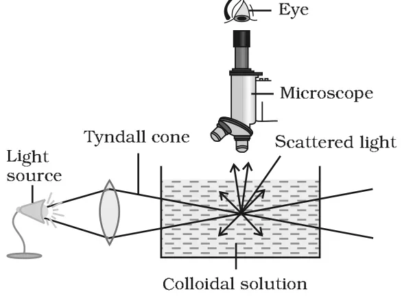
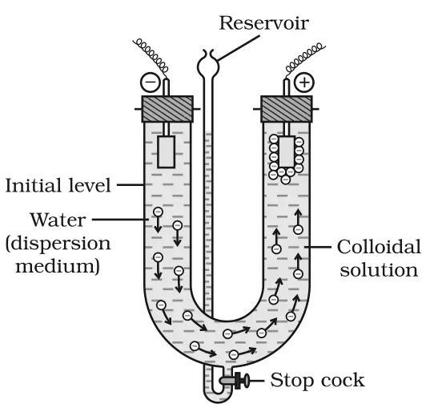

# [{ align=left, width=3.8% }](../../index.md)  Surface Chemistry | Properties of Colloids

Colloidal solutions show characteristic colligative, optical, mechanical and electrical properties such as Tyndall effect, Brownian movement, charge on particles, electrophoresis and coagulation.

## 1. Colligative Properties

* Colloidal particles are big aggregates, so the number of particles in a colloidal solution is much smaller than in a true solution of the same concentration.
* Hence, the values of colligative properties (osmotic pressure, lowering of vapour pressure, depression in freezing point and elevation in boiling point) are of small order compared to true solutions at the same concentration.

## 2. Tyndall Effect

* A true solution kept in the dark appears clear when seen along the direction of light, and perfectly dark when viewed at right angles to the beam.
* A colloidal solution looks clear by transmitted light, but when viewed at right angles to the beam, the path of the beam is illuminated by a bluish light.
* This effect was first observed by Faraday and later studied in detail by Tyndall. It is called the **Tyndall effect**. The bright cone of light is called the **Tyndall cone**.
* It is due to the scattering of light in all directions by colloidal particles.

{loading=lazy}

!!! example "Example"

    In a cinema hall, the path of the projected beam is visible due to scattering of light by dust and smoke particles.

!!! note "Conditions for Tyndall effect"

    * The diameter of the dispersed particles is not much smaller than the wavelength of the light used.

    * The refractive indices of the dispersed phase and the dispersion medium differ greatly in magnitude.

* Tyndall effect is used to distinguish between a colloidal solution and a true solution.

### Ultramicroscope

* In 1903, Zsigmondy used the Tyndall effect to build the **ultramicroscope**.
* An intense beam of light is focussed on the colloidal solution, and the focus is observed through a microscope at right angles to the beam. The particles appear as bright stars against a dark background.
* The ultramicroscope does not show the actual particles, only the light scattered by them. So it gives no information about the size and shape of colloidal particles.

## 3. Colour

* The colour of a colloidal solution depends on the wavelength of light scattered by the dispersed particles, which in turn depends on the size and nature of the particles.
* Colour also depends on how the observer receives the light. For example, a mixture of milk and water appears blue by reflected light and red by transmitted light.
* The finest gold sol is red. As the particle size increases, it appears purple, then blue and finally golden.

## 4. Brownian Movement

* Under a powerful ultramicroscope, colloidal particles are seen in continuous zig-zag motion all over the field of view. This was first observed by the botanist Robert Brown and is called **Brownian movement**.
* It is independent of the nature of the colloid but depends on the size of particles and the viscosity of the solution. Smaller the size and lower the viscosity, faster the motion.
* It is due to the unbalanced bombardment of the particles by the molecules of the dispersion medium.
* Brownian movement has a stirring effect which does not let the particles settle. So it is responsible for the stability of sols.

## 5. Charge on Colloidal Particles

Colloidal particles always carry an electric charge. All particles in a given sol carry the same type of charge, either positive or negative.

Positively charged sols                                                     | Negatively charged sols                                  |
----------------------------------------------------------------------------|----------------------------------------------------------|
Hydrated metallic oxides: Al2O3.xH2O, CrO3.xH2O, Fe2O3.xH2O | Metals: copper, silver, gold sols  |
Basic dye stuffs: methylene blue sol                                        | Metallic sulphides: As2S3, Sb2S3, CdS sols |
Haemoglobin (blood)                                                         | Acid dye stuffs: eosin, congo red sols                   |
Oxides: TiO2 sol                                                 | Sols of starch, gum, gelatin, clay, charcoal             |

### Origin of charge

* The charge may arise due to electron capture during electrodispersion of metals, preferential adsorption of ions from solution, and/or formation of an electrical double layer.
* **Preferential adsorption of ions** is the most accepted reason. When two or more ions are present, the ion common to the colloidal particle is usually adsorbed.

!!! example "Examples"

    * AgNO3 added to KI solution: AgI adsorbs I- (KI in excess), giving a negative sol, AgI/I-.

    * KI added to AgNO3 solution: AgI adsorbs Ag+ (AgNO3 in excess), giving a positive sol, AgI/Ag+.

    * FeCl3 added to excess hot water: adsorption of Fe3+ gives a positive sol, Fe2O3.xH2O/Fe3+.

    * FeCl3 added to NaOH: adsorption of OH- gives a negative sol, Fe2O3.xH2O/OH-.

### Electrical double layer and zeta potential

* The charged layer on the particle attracts counter ions from the medium, forming a second layer, e.g., AgI/I- K+ and AgI/Ag+ I-.
* The combination of these two layers of opposite charges is called the **Helmholtz electrical double layer**.
* The first layer is firmly held and is called the **fixed layer**. The second layer is mobile and is called the **diffused layer**.
* The potential difference between the fixed layer and the diffused layer is called the **electrokinetic potential** or **zeta potential**.
* The similar charge on all particles makes them repel each other, which prevents them from coalescing. This is largely responsible for the stability of the sol.

## 6. Electrophoresis

* When an electric potential is applied across two platinum electrodes dipped in a colloidal solution, the colloidal particles move towards one or the other electrode.
* The movement of colloidal particles under an applied electric potential is called **electrophoresis**. It confirms the presence of charge on colloidal particles.
* Positively charged particles move towards the cathode and negatively charged particles move towards the anode.

{loading=lazy}

* In the set-up shown, a negatively charged sol is placed in a U-tube with water above it. On applying the potential, the negative particles move up towards the positive electrode (anode) and collect there, and the level of the sol falls on the other side.

* When the movement of particles is prevented by some suitable means, the dispersion medium itself begins to move in the electric field. This is called **electroosmosis**.

## 7. Coagulation or Precipitation

The process of settling of colloidal particles is called coagulation or precipitation of the sol.

* The stability of lyophobic sols is due to the charge on the particles. If the charge is removed, the particles come together, form aggregates and settle under gravity.

### Methods of coagulation of lyophobic sols

* **By electrophoresis:** The particles move to the oppositely charged electrode, get discharged and precipitate.
* **By mixing two oppositely charged sols:** Mixed in nearly equal proportions, they neutralise each other's charges and precipitate. Example: hydrated ferric oxide (+ve sol) with arsenious sulphide (-ve sol). This is called **mutual coagulation**.
* **By boiling:** Increased collisions with molecules of the medium disturb the adsorbed layer, reduce the charge and cause settling.
* **By persistent dialysis:** Prolonged dialysis removes even the traces of electrolyte needed for stability, so the colloid coagulates.
* **By addition of electrolytes:** Excess electrolyte neutralises the charge on the particles. The ion that neutralises the charge is called the **coagulating ion**. A negative ion coagulates a positive sol, and a positive ion coagulates a negative sol.

### Hardy-Schulze Rule

Generally, the greater the valence of the flocculating ion added, the greater is its power to cause precipitation. This is known as the Hardy-Schulze rule.

!!! tip ""

    $$For\ a\ negative\ sol:\ Al^{3+} > Ba^{2+} > Na^+$$

    $$For\ a\ positive\ sol:\ [Fe(CN)_6]^{4-} > PO_4^{3-} > SO_4^{2-} > Cl^-$$

### Coagulating value

* The minimum concentration of an electrolyte in millimoles per litre required to cause precipitation of a sol in two hours is called the **coagulating value**.
* The smaller the coagulating value, the higher the coagulating power of the ion.

!!! tip ""

    $$Coagulating\ power &Proportional; {1 \over Coagulating\ value}$$

### Coagulation of lyophilic sols

* Two factors stabilise lyophilic sols: the **charge** and the **solvation** of the colloidal particles.
* To coagulate them, both must be removed: (i) by adding an electrolyte and (ii) by adding a suitable solvent.
* Solvents like alcohol and acetone dehydrate the dispersed phase of hydrophilic sols. Then a small amount of electrolyte can bring about coagulation.

## Protection of Colloids

* Lyophilic sols are more stable than lyophobic sols because their particles are extensively solvated, i.e., covered by a sheath of the dispersion medium.
* When a lyophilic sol is added to a lyophobic sol, the lyophilic particles form a layer around the lyophobic particles and protect them from electrolytes.
* Lyophilic colloids used for this purpose are called **protective colloids**. Example: gelatin protecting a gold sol.

## Questions

!!! question "Explain what is observed (i) when a beam of light is passed through a colloidal sol (ii) an electrolyte, NaCl is added to hydrated ferric oxide sol (iii) electric current is passed through a colloidal sol?"

    * **(i)** The path of the beam becomes visible as a bright cone when viewed at right angles, due to scattering of light by colloidal particles (Tyndall effect).
    * **(ii)** Hydrated ferric oxide sol is positively charged. The Cl- ions of NaCl neutralise the positive charge on the particles, and the sol gets coagulated (precipitated).
    * **(iii)** The colloidal particles move towards the oppositely charged electrode (electrophoresis). Positive particles move to the cathode and negative particles move to the anode, where they get discharged and coagulate.

!!! question "Explain the terms: (i) Electrophoresis (ii) Coagulation (iii) Tyndall effect."

    * **(i) Electrophoresis:** The movement of colloidal particles towards an oppositely charged electrode under an applied electric potential. It confirms that colloidal particles are charged.
    * **(ii) Coagulation:** The process of settling of colloidal particles as a precipitate, generally by neutralising their charge, e.g., by adding an electrolyte.
    * **(iii) Tyndall effect:** The scattering of light by colloidal particles, due to which the path of a light beam through a colloidal solution becomes visible as a bright cone when viewed at right angles.

!!! question "What modification can you suggest in the Hardy-Schulze law?"

    Hardy-Schulze law considers only the charge (valence) of the coagulating ion. It should also take into account the size of the ion. A smaller ion has a higher charge density and is adsorbed more easily, so it is a better coagulant than a larger ion of the same charge. So the law can be modified as: coagulating power depends on both the valence and the size of the flocculating ion.

!!! question "Arrange the following in increasing order of coagulating power for a negatively charged As2S3 sol: NaCl, BaCl2, AlCl3."

    The sol is negative, so the cations are the coagulating ions. By the Hardy-Schulze rule, coagulating power increases with the valence of the cation.

    $$NaCl\ (Na^+) < BaCl_2\ (Ba^{2+}) < AlCl_3\ (Al^{3+})$$

!!! question "Why are lyophilic colloids called protective colloids?"

    When a lyophilic sol is added to a lyophobic sol, its particles form a protective layer around the lyophobic particles. This layer shields them from the electrolyte, so the lyophobic sol does not coagulate easily. Hence, lyophilic colloids are called protective colloids.
